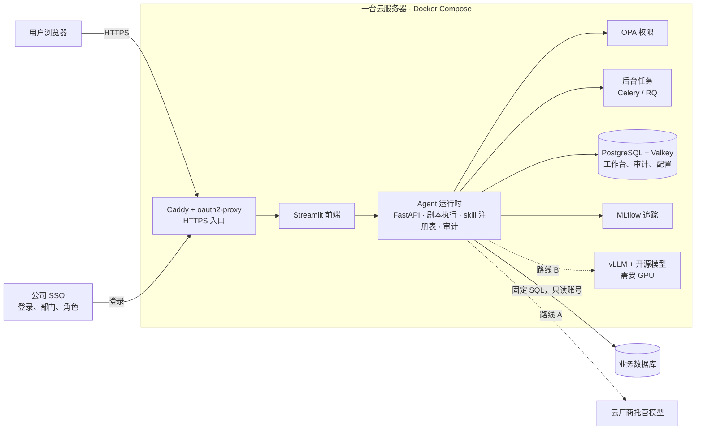

# 部署方案：一台云服务器

2026-10 整理。把 skill 链 agent 平台部署到一台自己的云服务器上：每部分用什么、模型怎么选、能做到什么程度、需要多少资源。架构见 [`architecture.md`](architecture.md)。

## 结论

- 一台云服务器够 20 人左右使用。除了模型，其他部分都用开源组件，全部装在这台服务器上。
- 模型有两条路线：
  - **路线 A：** 调用云厂商托管的模型（比如 Bedrock 上的 Claude）。服务器不需要显卡，数据留在同一个云账号和区域里。
  - **路线 B：** 在服务器上用开源模型（vLLM 部署），需要显卡。
- 合规允许时先走路线 A：每月约 $400–1,100，模型能力更强，上线快。要求模型必须跑在自己的机器上时走路线 B：每月约 $900–1,200 起，模型规模小一些，还要有人维护显卡服务器。
- **两条路线的应用代码相同，只换模型的接口地址**，以后可以切换。

| | 路线 A · 托管模型 | 路线 B · 开源模型 |
|---|---|---|
| 每月 | 约 $400–1,100 | 约 $900–1,200 起 |
| 机器 | 一台 8 核 32 GB 的普通服务器 | 一块 24 GB 显卡，跑 200–300 亿参数的模型 |
| 数据 | 留在同一个云账号和区域 | 完全不出服务器 |
| 运维 | 不用管显卡和模型升级 | 要有人维护驱动、推理服务和模型版本 |

价格是 AWS 一个亚太区域的按需价（美元，2026-10 查的公开价目表）。签一年的 Savings Plan 大约便宜 20–30%。换区域要重查。

## 一、每部分用什么



| 部分 | 用什么 | 许可证 | 说明 |
|---|---|---|---|
| 入口和登录 | Caddy（反向代理）+ oauth2-proxy | Apache-2.0 / MIT | oauth2-proxy 直接对接公司 SSO（Entra 等 OIDC）。需要把公司的组映射成本系统的角色时，再加 Keycloak（Apache-2.0，约 1–1.5 GB 内存） |
| 前端 | Streamlit | Apache-2.0 | 第一版够用。以后做成正式产品再换 React 前端。Open WebUI 2025 年 4 月改了许可证，不建议用 |
| Agent 运行时 | 自己写，约 300–500 行；Pydantic v2 + PydanticAI | MIT | PydanticAI 负责调模型，可以接托管模型，也可以接自己部署的开源模型 |
| 后台任务 | FastAPI + Celery 或 RQ | MIT / BSD | 出 PDF、PPT 这类慢任务放到后台跑 |
| 数据库 | PostgreSQL 16 + Valkey | PostgreSQL / BSD | 存工作台、审计日志、配置。Valkey 是 Redis 的开源分支，避开 Redis 近年的许可证变化 |
| 业务数据 | 现有数据库，只读账号 | — | SQL 用固定模板加参数。MySQL 没有行级权限，要按组建视图 |
| 权限 | OPA，或 Cedar（cedarpy 在进程内跑） | Apache-2.0 | 规则单独写成文件，便于审计。OPA 要加 `--skip-version-check`，不让它连外网 |
| 模型 | 路线 A：托管模型；路线 B：vLLM + 开源模型 | —；Apache-2.0 | 见下一节 |
| 追踪 | MLflow tracing | Apache-2.0 | 和应用共用 PostgreSQL，最省资源。Langfuse 功能更全，但官方最低要 4 核 16 GB |
| 报表 | Jinja2、Altair + vl-convert、WeasyPrint、python-pptx | BSD / MIT | 出 HTML、图、PDF、PPT，全部能离线。WeasyPrint 要关掉联网取资源 |
| 密钥 | 云厂商的 Secrets Manager，或 OpenBao | — / MPL-2.0 | Vault 2023 年起改成 BSL 许可 |
| 沙箱 | gVisor | Apache-2.0 | 以后要跑用户写的 Python 时才需要。能直接装在云服务器上 |
| 部署 | Docker Compose | Apache-2.0 | 一台机器够用。以后要多台机器，再换 k3s 或 Kubernetes |

除去模型，这些组件加起来大约需要 **8 核 CPU、16 GB 内存、150–200 GB 硬盘**。这是按 20 人使用的估算，没有压测过。追踪改用 Langfuse 的话再加 4 核 16 GB。

所有组件都要关掉对外发送的使用统计，部署时逐个确认，例如 MLflow 设 `MLFLOW_DISABLE_TELEMETRY=true`，Streamlit 设 `browser.gatherUsageStats=false`。

### 离线部署

- 前端页面和报表做成**完全离线的单文件 HTML**：不引用任何 CDN、外部字体和脚本，弹窗用 `<details>` 这类不需要脚本的写法，平板上也能打开。
- 内网装依赖走内部的 PyPI / 容器镜像，不直接从公网下载。外部写的代码进内网要走批准的途径。

## 二、模型怎么选

### 路线 A：云厂商托管的模型

例如通过 Bedrock 调用 Claude。有的区域可以选「区域内」端点（数据只在该区域处理），价格比全球端点高约 10%；有的区域只有全球端点，有的区域没有。选区域前先查清楚。

| 模型 | 价格（每百万 token，输入 / 输出） | 适合 |
|---|---|---|
| Haiku 5.5 | $0.10 / $0.50 | 解析指令这类简单任务 |
| Sonnet 5.5 | $2 / $10 | 写解读、以后的多步分析 |
| Opus 5.5 | $4 / $20 | 最难的任务 |

按任务选模型：解析指令用小模型，写解读用中等模型。

### 路线 B：开源模型

用 vLLM 部署，它提供和 OpenAI 一样的接口，也支持按 JSON Schema 输出，应用代码基本不用改。截至 2026-10，适合一台服务器的模型：

| 模型 | 参数规模 | 许可证 | 显存需求 | 说明 |
|---|---|---|---|---|
| Qwen3.6-27B | 270 亿 | Apache-2.0 | INT4 量化约 24 GB；FP8 约 40 GB | 中文好，支持工具调用 |
| Qwen3.6-35B-A3B | 350 亿，每次激活约 30 亿 | Apache-2.0 | FP8 一块 H100（80 GB） | 速度快 |
| gpt-oss-20b | 210 亿，激活 36 亿 | Apache-2.0 | 约 16 GB | 官方没有公布中文水平 |
| gpt-oss-120b | 1170 亿，激活 51 亿 | Apache-2.0 | 一块 80 GB 显卡 | 用 vLLM 时 `tool_choice` 只支持 `auto` |
| Gemma 4 26B-A4B | 252 亿，激活 38 亿 | Apache-2.0 | 8 位量化约 29 GB；4 位约 14 GB | 官方语言列表里没写中文 |

| 推理引擎 | 许可证 | 按 JSON Schema 输出 | 适合 |
|---|---|---|---|
| vLLM | Apache-2.0 | 支持 | 正式部署，首选 |
| SGLang | Apache-2.0 | 支持 | 和 vLLM 差不多 |
| llama.cpp | MIT | 支持 | 单卡跑量化模型 |
| Ollama | MIT | 部分支持 | 开发和试用 |
| TGI | Apache-2.0 | — | 2026 年 3 月已归档，不要用 |

### 换成指定的开源模型（例如 GLM）

如果合规只批准某个开源模型系列（例如 GLM），对现在的设计影响不大：

- 应用代码只换模型的接口地址。GLM 可以用 vLLM 部署，提供 OpenAI 兼容接口，也支持按 JSON Schema 输出。
- GLM 默认开思考模式，解析指令这一步要关掉，否则可能影响按格式输出。
- 要看用哪个型号。最新的大型号总参数很大，一台单卡服务器放不下，要多卡；按选定的型号重新算显卡和费用。
- 换模型前后跑同一组测试题，比较解析和解读的结果。

### 要注意的两点

- **模型来源。** 有些机构不允许使用特定国家公司发布的模型。这种情况下可以选 gpt-oss 或 Gemma，但中文能力要实测。
- **思考模式。** Qwen、GLM 等模型默认先输出一段思考过程。解析指令时要关掉，否则可能影响按格式输出。

两条路线都能完成「把指令解析成结构化请求」「按占位符写解读」这两项任务。以后做写 SQL、多步分析这类更难的任务，对模型要求更高，到时用同一组测试题比较再定。

## 三、能做到什么程度

| 阶段 | 做什么 | 做完能干什么 |
|---|---|---|
| demo | 一句话指令 → 结构化请求 → 跑固定的查询和计算 → 带出处的报告。有权限检查和审计。用模拟数据 | 演示整条链怎么走，讨论需求 |
| 第一阶段 | 部署到云服务器，接 SSO 和真实历史数据（只读）。一个组，2–3 个剧本，5 个左右 skill，出 HTML 报告。建一组固定的测试题 | 跑通第一批固定的分析和报表 |
| 第二阶段 | 增加 skill 和剧本；出 PDF 和 PPT；关键步骤加人工审批；按测试题比较不同模型 | 给更多人用，报告可以直接发给内部同事 |
| 第三阶段（按需要） | 让模型写查询 SQL（只读账号、语法检查、表白名单）；在沙箱里跑用户写的 Python；接 Teams | 临时性的数据问题不用再等人写代码 |

**不做的事：**

- 不写入生产系统。系统只出计划和分析，执行仍在现有系统里做。
- 不做实时调整。计算在事前做好，回放和报告在事后做。
- 不替代现有模型的审批流程。业务模型仍按现有方式验证，平台只负责调用和展示。

## 四、需要多少资源

### 路线 A

| 项目 | 配置 | 每月 |
|---|---|---|
| 服务器 | AWS m7i.2xlarge，8 核 32 GB | $368 |
| 硬盘 | 300 GB SSD | 约 $30 |
| 数据库 | PostgreSQL 装在同一台服务器上；要托管的话用 RDS db.m7g.large 单可用区，$171 | $0 或 $171 |
| 模型调用：Haiku 5.5 | 两项任务都比较简单，最便宜的模型可能就够 | 约 $21 |
| 模型调用：Sonnet 5.5 | | 约 $319 |
| 模型调用：Opus 5.5 | | 约 $639 |

**模型费用的估算条件：** 20 人，每人每天 30 次，每次约 6,000 个输入 token、1,000 个输出 token，每月 22 个工作日，使用区域内端点（+10%）。Haiku 5.5 的分词器同样的文字会多数约 30% 的 token，已经算进去。

```
每月请求数 = 20 × 30 × 22 = 13,200
输入 token = 13,200 × 6,000 = 79.2M；输出 token = 13,200 × 1,000 = 13.2M
费用 = (输入M × 输入单价 + 输出M × 输出单价) × 分词系数 × 1.1
```

思考过程按输出计费，一次请求也可能调用模型不止一次，实际费用可能是估算的 2–3 倍。重复的系统提示可以缓存，能省一部分输入费用。

**合计：** 用 Haiku 约 $419/月，用 Sonnet 约 $717/月，用 Opus 约 $1,037/月。数据库用 RDS 的话再加 $171。

### 路线 B

| 显卡 | 实例 | 每月 | 能跑的模型 |
|---|---|---|---|
| 1 块 L4（24 GB） | AWS g6.2xlarge，8 核 32 GB | $928 | Qwen3.6-27B INT4，或 gpt-oss-20b。应用和模型放一台机器，CPU 和内存偏紧 |
| 应用和模型分开 | m7i.2xlarge（$368）+ g6.xlarge（1 块 L4，4 核 16 GB，$764） | $1,132 | 同上，更稳 |
| 1 块 A100（80 GB） | Azure NC24ads_A100_v4 | $3,888 | gpt-oss-120b、Qwen3.6-35B-A3B |
| 1 块 H100（80 GB） | AWS p5.4xlarge | $6,529 | 同上 |
| 48 GB 显卡（L40S） | 不少亚太区域没有，要跨区域 | 约 $1,970 | 数据要出区域，一般不考虑 |

- AWS 新账号的显卡实例配额是 0，要先提申请。H100 通常要预约。
- Azure、GCP 在部分亚太区域的显卡型号更少，需要再查。

### 人和审批

- **开发：** 第一阶段按 1 人估计，约 6–8 周。粗略估计，主要取决于接数据和权限要花多久。
- **IT 和云团队：** 开云账号和服务器、配网络、在 SSO 里登记这个应用。
- **数据库管理员：** 开只读账号，按组建视图。
- **合规：** 批准用哪个模型和哪个区域；开源组件按流程审批。路线 B 还要多管一台显卡服务器。

## 五、要先确认的事

1. 模型能不能用云厂商的托管服务，还是必须跑在自己的服务器上。这决定走路线 A 还是 B。
2. 允许用哪些开源模型（是否只允许某个指定系列）。
3. 用哪个云、哪个区域。显卡配额要提前申请。
4. 数据在哪种数据库里，有没有只读账号；权限按什么划分（组、个人还是客户）。
5. 开源组件的审批流程要多久。
6. 第一阶段先给谁用，解决哪两三个具体问题。

## 价格和资料来源（2026-10 查询）

- AWS EC2 按需价：b0.p.awsstatic.com/pricing/2.0/meteredUnitMaps/ec2/USD/current/ec2-ondemand-without-sec-sel/<区域>/Linux/index.json
- AWS RDS PostgreSQL 价格：b0.p.awsstatic.com/pricing/2.0/meteredUnitMaps/rds/USD/current/rds-postgresql-ondemand.json
- AWS 显卡实例配额：docs.aws.amazon.com/ec2/latest/instancetypes/ec2-instance-quotas.html
- Azure 价格：prices.azure.com/api/retail/prices
- Claude 价格：platform.claude.com/docs/en/about-claude/pricing
- Bedrock 上 Sonnet 5.5 的区域：docs.aws.amazon.com/bedrock/latest/userguide/model-card-anthropic-claude-sonnet-5-5.html
- Qwen3.6：huggingface.co/Qwen/Qwen3.6-35B-A3B；recipes.vllm.ai/Qwen/Qwen3.6-27B
- gpt-oss：huggingface.co/openai/gpt-oss-120b
- Gemma 4：ai.google.dev/gemma/docs/core
- vLLM 结构化输出：docs.vllm.ai/en/latest/features/structured_outputs.html
- TGI 归档：github.com/huggingface/text-generation-inference
- PydanticAI 接 vLLM：pydantic.dev/docs/ai/models/compatible-apis/
- Langfuse 自建最低配置：langfuse.com/self-hosting/deployment/docker-compose
- Open WebUI 许可证：docs.openwebui.com/license
- Vault 改 BSL：discuss.hashicorp.com/t/hashicorp-projects-changing-license-to-business-source-license-v1-1/57106
- gVisor：gvisor.dev/docs/user_guide/install/

未核实：各组件的 CPU 和内存估算（除 Langfuse 外，官方都没有给最低配置）；第一阶段的工期；GLM 各型号的显存需求（选定型号后再算）。
