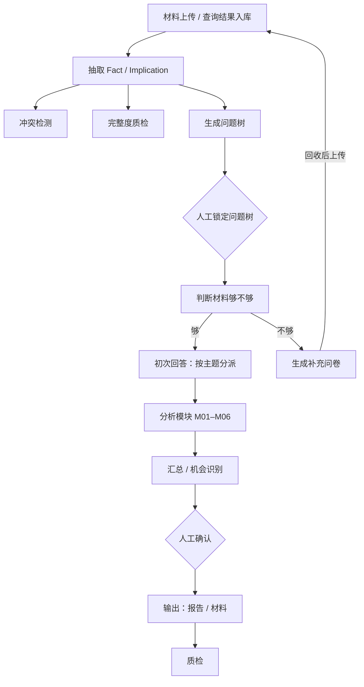

# Skill 链的后台：数据怎么喂、链怎么连

2026-10 整理。很多 skill 草稿只写了「提示词」那一半：每个 skill 有名称、目的、输入来源、分析步骤、输出要求、正反示例，但后台没法直接执行。这一份补上后台那一半。和 [`architecture.md`](architecture.md) 一起看。

## 典型的 skill 草稿缺什么

1. **数据怎么交给 skill：** 输入来源是自然语言（「读取事实库中标签 A1–A5 对应的条目」），后台没法直接执行。
2. **什么时候跑谁：** 触发条件散落在各个 skill 里，没有一张总的流程。
3. **输出格式：** 多数输出写的是「前端展示要求」，没有给后台用的结构化格式。
4. **更新之后怎么办：** 新材料进库后，哪些已有结果要重算、哪些不用，没写。
5. **agent 和 skill 的对应：** 只零星出现，没有完整列表。

## 思路：一个共享工作台 + 每个 skill 一份输入清单 + 事件驱动

### 1. 共享工作台

skill 之间**不直接互相调用**，都只和一个共享工作台打交道：从里面读输入，把结果写回去。

| 对象 | 谁写入 | 谁读取 |
|---|---|---|
| 原始材料 | 用户上传 | 抽取 skill、完整度质检 |
| 参考资料（硬事实） | 人工维护 | 所有涉及硬事实的 skill |
| 事实（Fact）、推论（Implication） | 抽取 skill；查询 skill | 几乎所有分析 skill |
| 冲突记录 | 冲突检测 skill | 展示层、下游分析 |
| 问题树（带版本） | 生成 skill 生成，人工修改和锁定 | 下游所有分析 |
| 人工选择（如选定的细分） | 人工 | 相关分析模块 |
| 模块分析结果 | 各分析模块，按子问题存 | 汇总 skill、下游 |
| 产出物（邮件、文字材料、PPT） | 输出 skill | 人 |
| 质检报告 | 质检 skill | 人 |

每个对象都带：ID、版本、状态（草稿 / 待确认 / 已确认 / 已锁定 / 过期）、由哪个 skill 或谁生成、生成时用了哪些对象的哪个版本。

### 2. 每个 skill 加一份输入清单

在每个 SKILL.md 旁边放一个 `manifest.yaml`，把「输入来源」翻译成代码能执行的选择条件。SKILL.md 本身不动，继续当提示词。例子：

```yaml
id: M02
name: 分析模块 B
agent: analyst
kind: llm_analysis
inputs:
  question:       {type: SubQuestion, from: current, required: true}
  facts:
    type: FactList
    select: {level2: ["2.1", "2.2", "2.4", "5.1"], question_id: $question.id}
    required: true
  upstream_a:     {type: ModuleResult, from: M03, question_id: $question.id, required: false}
  upstream_b:     {type: ModuleResult, from: M01, question_id: $question.id, required: false}
  segments:       {type: SegmentSelection, from: human, required: true}
preconditions:
  - question_tree.status == locked
outputs:
  result: {type: ModuleResult}
human_review: after
```

后台在运行 skill 之前，由代码按清单把输入组装好：

- **必选输入缺失或未确认：** 不能跑。界面告诉用户缺什么，比如「请先选定细分」。
- **条件性输入缺失：** 照常运行，明确传入「未提供」，让 skill 走写好的退化路径。
- **模型拿到的只有这一切片：** 不让模型自己去全库里找标签。

### 3. 链怎么连：按事件触发，不让模型决定下一步



| 事件 | 依次触发 |
|---|---|
| 材料上传（任何阶段） | 增量抽取 → 冲突检测 → 完整度质检 |
| 问题树锁定 | 判断材料是否充足 |
| 材料充足 | 初次回答：按子问题的主题标签分派到对应模块 |
| 材料不足 | 生成问卷；回收后上传，再走抽取，然后二次回答 |
| 人工确认 | 输出 skill |
| 全流程完成 | 最终产出 + 质检 |

**分派规则是代码里的一张固定表，不由模型决定：**

| 主题标签 | 模块 |
|---|---|
| 主题 1 | M01 |
| 主题 2 | M02 |
| 主题 3 | M03 |
| … | … |

模块之间按依赖排先后（例如 M03 先于 M02，M01 可选地喂给 M02），没有依赖的模块并行跑。

### 4. 怎么保证数据供给

- **只给需要的切片：** 按标签和子问题过滤。切片超过模型的上下文预算时，分批处理再合并，**不悄悄截断**。
- **引用必须可验证：** 每个分析 skill 输出结构化 JSON，每条结论带上它用到的 Fact ID。后台检查这些 ID 存在、且在喂给它的切片里；不合格就退回重做。展示时可以隐藏 ID，但后台保留。
- **结构化输出：** 每类结果定义一个 Pydantic 模型，例如模块结果 = 子问题 ID + 若干条发现（文字、Fact ID、Implication ID、标签）+ 小结。「前端展示要求」改成渲染模板。
- **版本与过期：** 每个结果记录它用了哪个版本的事实库和问题树。新材料进库、问题树改动后，依赖它们的结果自动标成「过期」，界面提示重跑，像编译系统按依赖重编译。
- **冲突：** 冲突写进冲突记录。未裁决的冲突在下游照常分析，但必须带 ⚠️ 显示。
- **硬事实只认参考资料：** 参考资料作为单独的输入传入，涉及硬事实的陈述必须引用参考条目。
- **人工节点留痕：** 确认、锁定、选定都记下是谁、什么时候、确认的是哪个版本。下游的前置条件检查读的就是这些状态。
- **质检当闸门：** 质检的红黄绿结果展示给用户。红灯时提示补材料，是否继续由人决定。

### 5. agent 和 skill 的对应

一个 agent 就是一份配置：系统提示（人设）、允许的 skill 列表、能响应的事件。

| agent | 负责的 skill |
|---|---|
| ingest（材料解析） | 抽取、冲突检测、完整度质检 |
| planner（问题定义） | 问题树、材料充足判断 |
| analyst（分析） | 初次 / 二次回答、各分析模块、汇总 |
| writer（输出） | 报告、材料、最终质检 |

## 数据来自数据库时

骨架不变：共享工作台、输入清单、事件驱动、版本和过期、人工节点、引用校验。

变的是数据从哪来：多一类「查询 skill」，跑固定 SQL 或 Python，把结果作为 Fact 写进工作台，来源标为数据库并带上查询 ID；用户口头说的信息也作为 Fact 写进去，来源标为用户。「分门别类再合成」就是同一个事实库里按来源区分，再由推论和渲染 skill 合起来。查询 skill 以当前用户的身份取数。

## 技术落地

| 部分 | 做法 |
|---|---|
| 工作台 | Postgres：ID、状态、版本、依赖关系用普通表；对象内容放 JSONB |
| skill | SKILL.md 当提示词，旁边放 manifest.yaml；每类输入输出一个 Pydantic 模型 |
| 调模型 | PydanticAI：结构化输出、校验不过自动重试，不绑模型厂商 |
| 编排 | 事件表 + 任务队列（arq 或 Celery）+ 每个项目一个阶段状态。人工节点之间等几天，只是数据库里的一个状态，不需要一直挂着的进程，所以第一版不需要 LangGraph 或 Temporal |
| 前端 | 每个人工节点一个确认按钮；结果按模板渲染 |
| 评测 | 把每个 skill 的正反示例整理成回归测试集 |

## 建议的第一步

挑一条链端到端做通：上传 → 抽取 → 问题树 → 人工锁定 → 初次回答 → 两个分析模块。用假数据，先验证工作台、输入清单、分派和引用校验这几件事。
