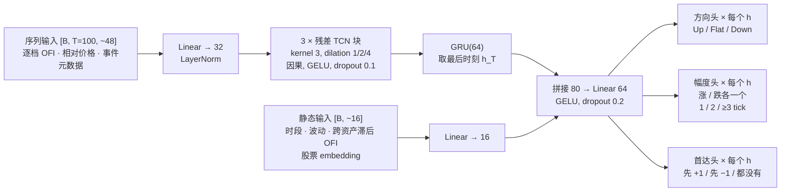

# 深度学习路线：网络怎么设计

2026-10 调研整理。从 GBDT 往深度学习走时，选什么结构、输入怎么表示、网络怎么搭、训练盯什么。总览见 [`modeling-guide.md`](modeling-guide.md)，GBDT 路线见 [`ml-pipeline.md`](ml-pipeline.md)。

## 结论

1. **公开基准上的高分基本不可信，也不可迁移。** TransLOB 在 FI-2010 上自报 F1 约 87%，统一复现只有 59%。换到新的 NASDAQ 数据后，15 个模型的 F1 全部落在 48–61%（LOBCAST，Prata 等 2024）。
2. **能不能预测，主要看股票的微观结构，网络结构影响小得多。** 大 tick 股票（平均价差 ≲ 1.5 档、队列厚）明显更好预测：10 个事件的 MCC 约 0.29，小 tick 股票约 0.11；小 tick 股票在 100 个事件上接近随机（Briola 等 2025）。
3. **输入表示比结构更重要。** 逐档 OFI、以中间价为锚的量网格，稳定好于原始 10 档价量（Kolm 等 2023；Lucchese 等 2024；Wu 等 2021）。OFI 输入加一个普通 LSTM，就能打败多数「原始盘口 + 复杂网络」。
4. **F1 高不等于能用。** 逐点指标好，不代表信号在时间上连贯；「开平仓都对」的比例只有 0.04–0.15（Briola 等 2025）。执行里还要和成交概率、逆向选择一起评估。
5. **第一版网络：OFI 序列 → 小型因果卷积（TCN）+ GRU → 多 horizon 多任务头，3–5 万参数。** CPU 上逐事件增量推理；或者把网络输出当特征喂给 GBDT。
6. **Mamba、时间序列基础模型、GNN：暂不考虑。** 没有找到它们在 LOB 方向预测上有用的证据，基础模型的延迟也不可接受。跨资产信息用「相关资产的滞后 OFI」做 GBDT 特征，性价比更高。

在真实的大规模数据上，模型之间的差距通常只有 1–5 个 F1 点；输入表示、标签定义、按股票微观结构分层、评估口径造成的差距是 10–30 个点。**工程投入优先放在后者。**

## 1. 模型谱系

| 模型 | 输入 | 结构 | 效果和复现 |
|---|---|---|---|
| **DeepLOB**（Zhang、Zohren、Roberts 2019） | 最近 100 个盘口状态 × 40 维（10 档买卖价量） | Conv(1×2) 配对价量 → Conv(1×2) 合成买卖 → Conv(1×10) 整合各档 → Inception → LSTM(64) → softmax(3)；约 6 万参数 | 统一复现在 LOB-2022 上排第一（F1 59.5）。原文学习率设置在别的数据上不一定稳 |
| **DeepLOB-Seq2Seq / Attention**（Zhang、Zohren 2021） | 50 个更新 × 40 维 | DeepLOB 编码器 + LSTM 解码器，逐 horizon 输出 | 短 horizon 和 DeepLOB 相当，长 horizon 更好。官方代码 MIT |
| **Deep OFI**（Kolm、Turiel、Westray 2023） | 逐档 OFI（对照：原始盘口） | ARX、MLP、LSTM、CNN-LSTM 等对比 | **多输出回归**中间价收益的期限结构，不需要平滑标签。OFI 输入显著好于原始盘口；准确度在约 2 次价格变动处见顶。无官方代码 |
| **TransLOB**（Wallbridge 2020） | 100 × 40 原始盘口 | 扩张因果 Conv1D → Transformer | **复现差**：自报 87%，复现 59% |
| **TABL / BiN-CTABL**（Tran 等 2019 / 2020） | 原始盘口序列 | 双线性投影 + 时间注意力；BiN 是可学习的双向归一化 | **公开基准里最稳**：约 1.1 万参数、0.71 ms，复现结果和原文一致。建议作为深度学习的基线 |
| **DLA**（Guo、Chen 2023） | 盘口序列 | 两阶段时间注意力 + RNN | 种子间方差大于 5 个点 |
| **HLOB**（Briola 等 2025） | 10 档 | 用 TMFG 学各档成交量之间的依赖结构，再设计卷积 | 短 horizon、大 tick 股票上优势明显；代码禁止商用 |
| **Axial-LOB**（Kisiel、Gorse 2022） | 原始盘口 | 沿时间轴和特征轴分别做注意力 | 参数少 |
| **TLOB / MLPLOB**（Berti、Kasneci 2025） | 128 / 384 个快照 × 40 维 | BiN → 时间注意力 → 特征注意力 → 前馈 | 比 BiN-CTABL 好 0–8 个 F1 点，推理慢 3–7 倍；把阈值设成平均价差（考虑交易成本）后性能明显下降。代码 MIT，最活跃 |
| **LiT**（Xiao 等 2025） | 加密货币 20 档 L2 | 结构化 patch → Transformer → LSTM | 比 DeepLOB 领先大多不到 1 个点，长 horizon 上 DeepLOB 更好。无代码 |
| **Mamba / SSM** | — | — | 没有找到用于 LOB 方向预测的同行评审工作 |
| **时间序列基础模型**（Chronos、TimesFM） | 单变量价格序列 | 大型预训练 Transformer | 没有 LOB 方向任务的公开基准；2 亿参数和 CPU 亚毫秒推理不相容 |
| **跨资产**（Cont、Cucuringu、Zhang 2023） | 多资产多档 OFI | OLS / LASSO，不是 GNN | 同期的跨资产项没有增量；**滞后的跨资产 OFI 能改善短期预测**，但衰减很快 |

相关的几条结论：

- **跨股票的通用模型好于单股模型**，能泛化到没见过的股票（Sirignano 和 Cont 2019；Lucchese 等 2024）。
- **L2 明显好于 L1**；OFI 和量网格表示进入最优模型集的比例约 85–90%，原始 DeepLOB 输入只有 5–11%（Lucchese 等 2024）。
- 只用逐笔委托（MBO）和只用盘口快照的效果相近，两者结合能提升（Zhang、Lim、Zohren 2021）。
- 限价单成交通常伴随不利的中间价漂移；按中间价成交、零成本的回测会系统性高估收益（DeLise 2024）。

## 2. 基准的问题

**FI-2010**（Ntakaris 等）：5 只芬兰股票 10 个交易日，已经预处理和打好标签，**无法还原原始盘口，也就没法回测**。标签是「未来 k 个中间价的均值」相对当前的变化，平滑窗口和 horizon 耦合在一起；类别比例随 horizon 漂移；不考虑价差。不同论文的切分方式混用，数字没法直接比。

**LOBCAST**（Prata 等 2024）：统一复现 15 个模型。主要发现：

1. 多个模型的复现结果远低于自报。
2. 换到新数据后所有模型都明显变差（F1 48–61%）。
3. 对超参非常敏感，搜索中约一半的 run 发散；多个模型跨种子标准差大于 5 个点。
4. 前三名都不用长窗口。
5. 集成没有超过最好的单模型。
6. 回测显示盈利远没有保证。

**Briola、Bartolucci、Aste（2025）**：15 只 NASDAQ 大盘股、3 年数据、135 组实验，按平均价差和 tick 之比分组：

| Horizon（事件数） | 小 tick MCC | 中 tick MCC | 大 tick MCC |
|---|---|---|---|
| 10 | ~0.11 | ~0.13 | ~0.29 |
| 50 | ~0.04 | ~0.085 | ~0.36 |
| 100 | ~0.01 | ~0.036 | ~0.26 |

为什么大 tick 好预测：最优档队列厚，**成交前队列会先变薄**，这本身就是方向信息；10 档基本覆盖有效深度；事件频率高。小 tick 股票价差宽、订单簿稀疏，按档位排列的输入在空间上不均匀。

**交易正确率** `pT = CT / (PT + TT − CT)`（CT 正确的完整交易数，PT 目标序列里的潜在交易数，TT 预测执行出来的交易数）。实测只有 0.04–0.15。**提高置信度阈值能抬高 MCC，却会把 pT 压到接近 0**，因为阈值把信号序列打断了。

## 3. 网络设计

### 3.1 采样时钟和标签

- **事件时间采样**：前 L 档有任何变化算一个事件。并行准备一套「价格变动时钟」（每次中间价变化记一步）。每个样本另存 `Δt` 和时段，最后要换算回物理时间。
- **多 horizon**：执行决策实际用到的物理时间（如 1 / 5 / 30 秒）为主；事件数 {10, 50, 100}、价格变动次数 {1, 2, 5} 作对照，和文献结果比较时用。
- **标签**：不要用 FI-2010 那种平滑标签。**主决策用首达标签**，和其他文档一致；方向头用点到点变化作辅助：

```
首达（主）：τ 内中间价先触达 +1 tick / 先触达 −1 tick / 都没有，外加首达时间

方向（辅助）：
  y_h   = (mid_{t+h} − mid_t) / tick_size
  cls_h = Up    if y_h >= +1
          Down  if y_h <= −1
          Flat  otherwise          # 价差开合造成的 ±0.5 tick 记 Flat（或单独一类）

小 tick 股票另用一套标签：阈值 θ = c × 当前价差（c 取 0.5–1），贴近可交易性
```

- **horizon**：主定义用物理时间（执行层的决策间隔）；事件数、价格变动次数的版本只作对照。

### 3.2 输入表示（按优先级）

| 方案 | 维度 / 事件 | 评价 | 建议 |
|---|---|---|---|
| A. 原始 10 档价量 | 40 | 非平稳；小 tick 股票上档位不均匀；对扰动脆弱 | 只作对照 |
| B. 价格相对中间价（以 tick 计）+ `log(1 + 量)` | 40 | 平移不变，跨股票可共享 | 基础通道 |
| C. **逐档 OFI 序列** | 10–20 | 平稳，直接编码供需变化，证据最强 | **主输入** |
| D. 量网格（以中间价为锚、按 tick 距离排列，宽 10 tick） | 20 | 空间均匀，对卷积友好 | 小 tick 股票优先 |
| E. 事件元数据 | 5–10 | 事件类型 one-hot、`log Δt`、成交方向和规模、价差、撤单比例 | 必加 |
| F. 静态上下文 | 10–30 | 时段、日内波动、近期成交强度、相关资产滞后 OFI、GBDT 的重要特征 | 在输出头之前拼接 |

逐档 OFI（第 i 档、第 n 个事件；多档推广有多种写法，要和实现对齐）：

```
bOF_i(n) = 1[Pb_i(n) >= Pb_i(n−1)] × Qb_i(n) − 1[Pb_i(n) <= Pb_i(n−1)] × Qb_i(n−1)
aOF_i(n) = 1[Pa_i(n) <= Pa_i(n−1)] × Qa_i(n) − 1[Pa_i(n) >= Pa_i(n−1)] × Qa_i(n−1)
OFI_i(n) = bOF_i(n) − aOF_i(n)
可选：除以滚动平均深度；或把 bOF、aOF 两路分开输入（20 维）
```

### 3.3 归一化

- **按股票、按日滚动**：用前 N 天（如 5 天）的统计量做 z-score，**禁止用当日或未来的统计量**。
- 量类特征先 `log1p`，再做稳健 z-score（中位数 / IQR），然后截断到 ±5。
- OFI 除以滚动平均最优档深度，跨股票可比。
- 价格类用「相对中间价的 tick 数」，本身平稳。
- 可以在网络里加一层 BiN 做可学习归一化，但离线归一化仍然要做。
- 多股票共用一个模型时，加股票 embedding（4–8 维）或 tick 类别 embedding。

### 3.4 窗口长度

默认 T = 100 个事件，消融 {50, 100, 200}。用 OFI 输入时，信息集中在最近几十个事件，T = 50 大概率就够。更长的上下文用静态特征补（如过去 5 分钟的波动和成交强度），比把窗口拉到 1000 划算。

### 3.5 结构选择

| 结构 | CPU 延迟 | 说明 |
|---|---|---|
| 因果 1D CNN + GRU | 低 | **首选**。GRU 支持增量推理，每个新事件 O(1) |
| TCN（扩张因果卷积） | 低 | **首选**。用环形缓冲做流式推理 |
| BiN-CTABL | 很低 | 1.1 万参数，跨数据最稳，**深度学习基线** |
| DeepLOB | 中 | 对照 |
| 小型 Transformer（2 层，d = 32，4 头） | 中到高 | 第二阶段；不能增量推理 |
| MLP-Mixer 类 | 低到中 | 第二阶段 |
| Mamba / 基础模型 / GNN | — | 暂不考虑 |

### 3.6 推荐的第一版网络：OFI-TCN-GRU，多任务



```
输入
  seq    [B, T=100, F≈48] = 逐档 OFI(10) + 最优 3 档 bOF/aOF(6) + 前 5 档相对价格和量(20)
                            + 事件类型 one-hot(4) + log Δt + 价差 + 成交 signed size + 撤单比例 + …
  static [B, F≈16]        = 时段(sin/cos)、日内波动、近 5 分钟成交强度、相关资产滞后 OFI、tick 类别、股票 embedding(8)

序列编码
  Linear(F → 32) + LayerNorm
  3 × ResidualTCNBlock(32 通道, 每块 2 层因果卷积, kernel 3, dilation 1/2/4, GELU, dropout 0.1)
                                                                  # 感受野 1 + 2×2×(1+2+4) = 29 个事件
  GRU(32 → 64, 1 层)                                              # 长依赖，取 h_T

共享主干
  concat(h_T[64], static_proj[16]) → Linear(80 → 64) → GELU → Dropout(0.2)

每个 horizon h 的头
  首达      Linear(64 → 3)    # 先 +1 / 先 −1 / 都没有（主决策用）
  方向      Linear(64 → 3)    # 辅助
  幅度（涨）Linear(64 → 3)    # 以「先涨」为条件，序数 {1, 2, ≥3 tick}
  幅度（跌）Linear(64 → 3)    # 以「先跌」为条件
  小 tick 股票或较长 h：幅度头改成 0.1 / 0.5 / 0.9 分位数（大 tick 上分位数会退化成 0 或 ±1）

总参数 ≈ 3.5–5 万
```

**损失函数**

```
每个样本乘唯一性权重 w_i（见 ml-pipeline.md 2.4 节），不加类权重

L = Σ_i w_i × Σ_h λ_h × [ CE(首达_h)
                        + λ_dir × CE(方向_h)
                        + λ_mag × CE(幅度_h | 动了, 方向)          # 只对首达为涨 / 跌的样本计算
                        (+ 分位数版本：Σ_q pinball_q(y_h, ŷ_q,h)，pinball_q(e) = max(q·e, (q−1)·e)) ]
初始：λ_h = 1，λ_dir = 0.3，λ_mag = 0.3；跑 1 个 epoch 后按各项损失的量级重新标定
分位数交叉：训练后对 ŷ_q 排序，或用「基准 + softplus 增量」参数化
```

**不加逆频率类权重，也不用 focal loss**：两者都会让输出概率偏离真实分布，而执行层直接用概率算成本。只有出现「预测塌缩到 Flat」时才加类权重，之后必须重新校准。

**训练超参（第一版）**

| 项 | 值 |
|---|---|
| 优化器 | AdamW，lr 1e-3（batch 512），weight decay 1e-4 |
| 学习率调度 | warmup 0.5 epoch + cosine；或 OneCycle(max_lr 2e-3) |
| 正则化 | dropout 0.1（TCN）/ 0.2（头）；梯度裁剪 1.0；可选输入高斯噪声 σ = 0.05 |
| 早停 | 盯**验证集平均 log loss**（不是 F1），patience 5，最多 30 epoch |
| 切分 | 按日：训练 60 天 → 空 1 天 → 早停验证 8 天 → 校准 2 天 → 测试 10 天，之后 walk-forward 重训；切点两侧留 ≥ 最大 horizon 的 purge（有多日滚动特征时 ≥ 窗口天数） |
| 采样 | 按「日 × 股票」分层；保持原始类分布（不做类平衡采样）；每隔 5–10 个事件取一个窗口降低冗余 |
| 种子 | 至少 3 个，报告均值 ± 标准差 |
| 精度 | GPU 上 bf16；CPU 训练 fp32（这个规模多核 CPU 可行，只是慢） |
| 超参搜索 | 只搜 lr、T、hidden、dropout，20–40 次 trial（Optuna / ASHA），配早停和剪枝 |

### 3.7 CPU 推理

| 手段 | 说明 |
|---|---|
| **流式增量推理** | GRU 保持隐状态，TCN 用环形缓冲缓存各层最近的激活。每来一个事件只算一步，代价约为整窗的 1/T。**对延迟帮助最大** |
| ONNX Runtime | RNN / Transformer 用动态量化，CNN 用静态量化 + 校准集。量化有损，要和 fp32 的 log loss 对比；老硬件上可能反而更慢 |
| 线程 | 单样本推理设 `intra_op_num_threads = 1` 并绑核 |
| 手写前向 | 5 万参数的 GRU + TCN 可以用 numpy / C++ 手写，延迟最可预期 |
| 蒸馏 | 把网络的 logits / 分位数当特征喂 GBDT（stacking），常常是最稳的增量；或用网络的软标签训练更小的模型 |
| 参考量级 | MLP 0.08 ms，BiN-CTABL 0.71 ms，DeepLOB 1.31 ms，TLOB 2.24 ms（TLOB 论文实测，硬件按原文）。**务必在目标 CPU 上自测 p50 / p99** |
| GPU 训练、CPU 推理 | 可行；用 LayerNorm 而不是 BatchNorm，导出时关 dropout |

## 4. 训练时盯什么

### 训练过程

| 指标 | 异常迹象 |
|---|---|
| 训练 / 验证 loss（总的、分 horizon、分任务） | 训练 loss 一直降、验证 loss 1–3 个 epoch 后回升：在记忆日内模式，LOB 上很常见 |
| 分任务 loss 占比 | 某个头的 loss 不降：权重失衡或标签有问题 |
| 梯度范数 | 爆炸或 NaN |
| 预测类别分布 | 塌缩到 Flat：检查类权重 |
| 种子间方差 | 大于 2 个 log loss 技能点：结论不可靠 |

### 预测质量（每个 horizon 单独报）

```
LogLossSkill_h = 1 − LL_model,h / LL_prior,h       # prior = 训练期的类频率
MCC_h、macro-F1_h、各类 precision / recall
Brier_h、ECE_h（10–15 个分箱）+ 可靠性图          # 执行要用概率做决策，校准很重要
IC_h = Spearman(P(Up) − P(Down), 实现的 y_h)       # 先按日算，再看均值、t 值、正值天数占比
分位数头：覆盖率（y ≤ ŷ_0.1 的比例应约为 0.1）+ pinball loss
首达头：AUC、校准
```

- 看置信度前 k% 子集上的 precision / IC，同时盯 pT 或信号翻转频率，防止信号碎片化。
- 在**独立的校准窗口**（不同于早停用的验证集）上做 temperature scaling，再交给执行逻辑。

### 稳定性

- 按日的指标序列和滚动 20 日均值，看有没有漂移、有没有在特定日期崩坏。
- 按 tick 类别、流动性分位、时段、波动分位分层报告。**可以只在可预测的子集上启用深度学习信号。**
- 定期重训（默认节奏见 [`modeling-guide.md`](modeling-guide.md) 第 7 节），比较「新模型」和「旧模型继续用」，估计衰减速度，再决定深度模型要不要比 GBDT 更频繁或更少重训。

### 和 GBDT 公平比较

1. 样本、标签、切分、采样时钟完全一致；GBDT 拿到相同的信息（把序列手工汇总成多尺度 OFI 累计等特征）。
2. 主指标：各 horizon 的 LogLossSkill 和按日 IC。**按日**做 block bootstrap 或 Diebold-Mariano 检验，不能把逐样本当独立。
3. 增量检验：`GBDT + 网络输出当特征` 对比 `GBDT`。增量显著的话，网络不单独上线也有价值。
4. 在固定 p99 延迟预算内比。
5. **上线门槛是执行模拟里的成本改善**（含逆向选择和成交概率），不是 F1。

## 5. 推进路线

1. **数据层**：事件级盘口重建 → 逐档 OFI、相对价格、量网格 → 多时钟标签 → 按日 parquet 分区。GBDT 和深度学习共用。
2. **GBDT 基线**：见 [`ml-pipeline.md`](ml-pipeline.md)。
3. **深度学习 v1**：OFI-TCN-GRU，同时跑 BiN-CTABL 和 DeepLOB 作对照（可以直接用 TLOB 仓库里的实现接自有数据）。
4. **融合**：网络输出当 GBDT 特征，检验增量；按 tick 类别 / 时段决定是否启用。
5. **上线**：ONNX Runtime 或手写流式推理；影子运行；按日监控，月度重训。
6. **第二阶段（可选）**：小型 Transformer 或 Mixer；多股票通用模型 + 股票 embedding；跨资产滞后 OFI。

开源实现见 [`repos.md`](repos.md)。

## 参考文献

- Zhang, Zohren, Roberts (2019). DeepLOB. *IEEE Transactions on Signal Processing* 67(11). https://arxiv.org/abs/1808.03668
- Zhang, Zohren (2021). Multi-horizon forecasting for limit order books. https://arxiv.org/abs/2105.10430
- Kolm, Turiel, Westray (2023). Deep order flow imbalance. *Mathematical Finance* 33(4):1044–1081.
- Wallbridge (2020). Transformers for limit order books. https://arxiv.org/abs/2003.00130
- Tran, Iosifidis, Kanniainen, Gabbouj (2019). Temporal attention-augmented bilinear network (TABL). *IEEE TNNLS*. https://arxiv.org/abs/1712.00975
- Tran, Kanniainen, Gabbouj, Iosifidis (2020). Data normalization for bilinear structures in high-frequency financial time-series (BiN). *ICPR 2020*. https://arxiv.org/abs/2003.00598
- Guo, Chen (2023). Dual-stage temporal attention (DLA). *Arabian Journal for Science and Engineering* 48:9597–9618.
- Briola, Bartolucci, Aste (2025). HLOB. *Expert Systems with Applications* 266:126078. https://arxiv.org/abs/2405.18938
- Kisiel, Gorse (2022). Axial-LOB. https://arxiv.org/abs/2212.01807
- Berti, Kasneci (2025). TLOB: a novel transformer model with dual attention for price trend prediction with limit order book data. https://arxiv.org/abs/2502.15757
- Xiao 等 (2025). LiT. *Frontiers in AI* 8. https://doi.org/10.3389/frai.2025.1616485
- Prata 等 (2024). LOBCAST. *Artificial Intelligence Review* 57(5). https://arxiv.org/abs/2308.01915
- Briola, Bartolucci, Aste (2025). Deep limit order book forecasting: a microstructural guide. *Quantitative Finance* 25(7):1101–1131. https://arxiv.org/abs/2403.09267
- Ntakaris 等 (2018). Benchmark dataset for mid-price forecasting of limit order book data (FI-2010). *Journal of Forecasting*. https://arxiv.org/abs/1705.03233
- Lucchese, Pakkanen, Veraart (2024). The short-term predictability of returns in order book markets: a deep learning perspective. *International Journal of Forecasting* 40(4):1587–1621. https://arxiv.org/abs/2211.13777
- Sirignano (2019). Deep learning for limit order books. *Quantitative Finance* 19(4):549–570. https://arxiv.org/abs/1601.01987
- Sirignano, Cont (2019). Universal features of price formation in financial markets. *Quantitative Finance* 19(9):1449–1459. https://arxiv.org/abs/1803.06917
- Zhang, Lim, Zohren (2021). Deep learning for market by order data. *Applied Mathematical Finance* 28(1):79–95. https://arxiv.org/abs/2102.08811
- Wu, Mahfouz, Magazzeni, Veloso (2021). Towards robust representation of limit orders books for deep learning models. https://arxiv.org/abs/2110.05479
- Cont, Cucuringu, Zhang (2023). Cross-impact of order flow imbalance in equity markets. *Quantitative Finance*. https://arxiv.org/abs/2112.13213
- DeLise (2024). The negative drift of a limit order fill. https://arxiv.org/abs/2407.16527
- Hedges (2026). The inference-compute frontier and a latency-efficient architecture for LOB prediction. https://arxiv.org/abs/2606.25986 （只读了摘要）
- Lin, Goyal, Girshick, He, Dollár (2017). Focal loss. https://arxiv.org/abs/1708.02002
- ONNX Runtime 量化文档：https://onnxruntime.ai/docs/performance/model-optimizations/quantization.html

未核实：Deep OFI 的具体 R²、窗口长度和代码；TABL 的卷期；Axial-LOB 的会议出处；BiN-CTABL 的作者官方仓库。
