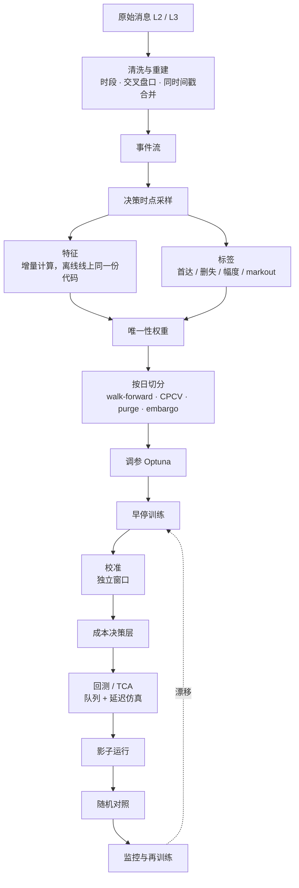

# 机器学习路线：从逻辑回归到 GBDT 和生存模型

2026-10 调研整理。不用深度学习，怎么一步步改进信号：每个模型的数学形式、整条 pipeline、训练时看哪些指标、参数怎么选。总览见 [`modeling-guide.md`](modeling-guide.md)，变量见 [`features-and-targets.md`](features-and-targets.md)。运行环境：Intel i9 CPU，没有 GPU；这条路线完全不需要 GPU。

## 结论

| 主题 | 默认做法 |
|---|---|
| 标签 | 三分类首达：τ 内先涨 ≥ 1 tick / 先跌 ≥ 1 tick / 没动。本质是竞争风险问题。幅度单独建模 |
| 模型路线 | ① 新标签 + 新特征放进「样条 + 交互项 + 弹性网」的多项 logit，作为强基线 → ② LightGBM 多分类作为主力 → ③ 离散时间竞争风险 hazard，一个模型覆盖一组 τ → ④ 单独建被动单成交概率的生存模型 |
| 增益拆分 | 四组对比，分开度量「特征带来的增益」和「模型带来的增益」（1.3 节）。log loss 只在同一个标签内比较 |
| 样本 | 按决策时点采样；按平均唯一性加权（2.4 节） |
| 切分 | 以整个交易日为块做 walk-forward；选模用 CPCV（$N = 10$，$k = 2$）+ purge + embargo |
| 早停和选模 | 早停用加权 log loss；选模用 log loss 技能分，ECE 作门槛，仿真成本打破平局。**不用准确率** |
| 校准 | 独立的校准窗口，温度缩放或 Dirichlet；每天重新校准，每周重训 |
| 阈值 | 不用固定阈值。按期望成本最小选动作（2.8 节） |
| 延迟 | 控制树的总量；LightGBM 单行快速接口、lleaves，或自己把树导出成扁平数组的 C++ |

## 1. 模型路线

### 1.1 标签

记决策时点 $t$ 的中间价 $m_t$，tick 为 $\delta$，障碍宽度 $b$（默认 1）。三分类首达标签：

$$
y_t = \begin{cases}
\text{UP} & \tau^{\uparrow}_t < \min(\tau^{\downarrow}_t,\ t + \tau) \\
\text{DOWN} & \tau^{\downarrow}_t < \min(\tau^{\uparrow}_t,\ t + \tau) \\
\text{NONE} & \text{其他}
\end{cases}
\qquad
\tau^{\uparrow}_t = \inf\{s > t : m_s \ge m_t + b\delta\},\quad
\tau^{\downarrow}_t = \inf\{s > t : m_s \le m_t - b\delta\}
$$

- $b = 1$ 正好过滤掉「价差从 1 档变 2 档时中间价移动 $\delta/2$」这种噪声。
- **竞争风险视角**：UP 和 DOWN 是两种互斥的首次事件，NONE 是在 τ 处的右删失。
- **τ**：主定义用**物理时间，等于执行层实际的决策间隔**（如 1 / 5 / 30 秒）；事件时间的版本只作对照。NONE 占比只是诊断量：太高（> 80%）说明这个 τ 下信号多半没用，太低（< 10%）说明 τ 已经长到接近纯方向预测。**不要为了平衡类别去调 τ**。
- **幅度**：以「动了」和方向为条件的序数分类 $\{1, 2, \ge 3\}$ tick，涨跌分开；小 tick 股票可以对 $m_{t+\tau} - m_t$ 做分位数回归；markout 只作评估。
- **边界**：$t + \tau$ 超过收盘或停牌时点的样本，**分类模型的训练和评估都剔除**，不能当作 NONE；只有 hazard 模型保留它们作删失。

### 1.2 逻辑回归族

**多项 logit**（三分类，NONE 为基准类）：

$$
P(y = k \mid x) = \frac{\exp\big(\beta_k^\top \phi(x)\big)}{\sum_{j \in \{\text{UP}, \text{DOWN}, \text{NONE}\}} \exp\big(\beta_j^\top \phi(x)\big)},
\qquad \beta_{\text{NONE}} \equiv 0
$$

**弹性网目标**（$w_i$ 是唯一性权重）：

$$
\min_{\beta}\ -\frac{1}{\sum_i w_i}\sum_{i} w_i \log P(y_i \mid x_i; \beta) + \lambda\Big(\rho\,\lVert\beta\rVert_1 + \frac{1-\rho}{2}\lVert\beta\rVert_2^2\Big)
$$

$\rho$（`l1_ratio`）取 0.1–0.5，$\lambda$（即 $1/C$）用 purged CV 选。

**特征映射 $\phi(x)$**：

- 有饱和或 S 形效应的特征（OBI、$\mathrm{OFI}/\mathrm{AD}$、$G^*$）用三次 B 样条展开 $\phi_j(x) = \sum_{r} c_{jr} B_r^{(3)}(x_j)$，5–8 个节点放在分位数上；
- 其余特征先缩尾到 1% / 99%，再滚动 z-score；
- 只加少量有先验依据的交互项：$\mathrm{OBI}_1 \times \mathbb{1}[S_{\text{tk}} = 1]$、$\mathrm{OFI}^{\text{short}} \times \sigma$、$\mathrm{OBI}_1 \times \widetilde{\mathrm{Depth}}$、$\mathrm{TI} \times C_{\text{MO}}$。

**有序 logit**（把 DOWN < NONE < UP 看作同一个潜变量 $y^* = \beta^\top x + \varepsilon$）：

$$
P(y \le j \mid x) = \sigma(\theta_j - \beta^\top x),\qquad \theta_{\text{DOWN}} < \theta_{\text{NONE}}
$$

参数少，但**比例优势假设经常不成立**：波动升高会同时推高 UP 和 DOWN 的概率，单个 $\beta^\top x$ 表达不了这种对称效应。用之前先和多项 logit 比 log loss。

**两阶段**：把「会不会动」和「往哪动」分开：

$$
P(\text{UP} \mid x) = \underbrace{P(\text{动} \mid x)}_{\text{波动、事件强度驱动}} \cdot \underbrace{P(\text{UP} \mid \text{动}, x)}_{\text{OBI、OFI 驱动}}
$$

两部分的特征和约束不同，方向子模型可以加单调约束（OBI 越大 $P(\text{UP} \mid \text{动})$ 越大）。乘积的校准要单独检查。

Gould 和 Bonart（2016）只用逻辑回归加一个队列不平衡，在大 tick 股票上就拿到可观的增益。**「LR + 好特征」是很强的对照组，GBDT 必须明确跑赢它。**

### 1.3 增益拆分：四组对比

| 组 | 特征 | 标签 | 模型 | 能比什么 |
|---|---|---|---|---|
| A | 旧 | 旧（下一笔成交涨跌） | 旧 LR | 标签不同，log loss 不可比，只比经济指标和信号十分位图 |
| B | 旧 | 新（首达三分类） | 多项 LR | 换标签本身的效果（经济指标） |
| C | 新 | 新 | 样条 + 交互 LR | B → C 是**特征**带来的增益 |
| D | 新 | 新 | GBDT | C → D 是**模型**带来的增益 |

### 1.4 GBDT：数学和参数

**目标函数**。第 $t$ 棵树 $f_t$ 加到当前模型 $F^{(t-1)}$ 上，对损失做二阶展开（XGBoost / LightGBM 的共同框架）：

$$
\mathcal{L}^{(t)} \approx \sum_i w_i\Big[g_i f_t(x_i) + \tfrac{1}{2} h_i f_t(x_i)^2\Big] + \gamma T + \tfrac{1}{2}\lambda \sum_{j=1}^{T} v_j^2
$$

$T$ 是叶子数，$v_j$ 是叶子值。多分类 softmax 下，类 $k$ 的一阶、二阶导数是

$$
g_{ik} = p_{ik} - \mathbb{1}[y_i = k],\qquad h_{ik} = p_{ik}(1 - p_{ik}),\qquad p_{ik} = \frac{e^{F_k(x_i)}}{\sum_j e^{F_j(x_i)}}
$$

（每一轮对每个类各长一棵树。）记叶子 $j$ 里的 $G_j = \sum_{i \in j} w_i g_i$，$H_j = \sum_{i \in j} w_i h_i$，最优叶子值和分裂增益是

$$
v_j^* = -\frac{G_j}{H_j + \lambda},
\qquad
\text{Gain} = \frac{1}{2}\Big[\frac{G_L^2}{H_L + \lambda} + \frac{G_R^2}{H_R + \lambda} - \frac{(G_L + G_R)^2}{H_L + H_R + \lambda}\Big] - \gamma
$$

**这对参数选择的含义**：

- $\lambda$（`lambda_l2`）把叶子值往 0 收缩，tick 数据噪声大，取 10 左右。
- `min_sum_hessian_in_leaf` 限制的是 $H_j$，也就是**加权后**的有效样本；`min_data_in_leaf` 数的是行数，不看权重。
- 学习率 $\eta$ 让 $F^{(t)} = F^{(t-1)} + \eta f_t$，越小越稳、树越多（延迟越高）。

**LightGBM 起点超参**（百万到千万行、30–80 个特征、三分类、延迟敏感）：

| 参数 | 起点 | 搜索范围 | 说明 |
|---|---|---|---|
| `objective` / `num_class` | `multiclass` / 3 | — | 两阶段方案用 `binary` |
| `learning_rate` | 0.05 | [0.02, 0.1] log | |
| `num_boost_round` | 上限 2000 | — | 早停决定；**上线前按延迟预算封顶**，如 ≤ 400 轮（3 类即 ≤ 1200 棵树） |
| `early_stopping_round` | 100 | 50–200 | `first_metric_only=True`，`metric=multi_logloss` |
| `num_leaves` | 31 | [15, 127] | |
| `max_depth` | 6 | {4–8} | 限制最坏推理路径 |
| `min_data_in_leaf` | 1000–5000 | [200, 20000] log | 默认 20 对 tick 数据太小；想按有效样本控制，设成「目标有效样本数 / $\bar u$」 |
| `min_sum_hessian_in_leaf` | 1e-2 | [1e-3, 1] log | 加权的叶子大小下限 |
| `feature_fraction` | 0.7 | [0.4, 0.9] | |
| `bagging_fraction` / `bagging_freq` | 0.5 / 1 | [0.2, 0.8] | 重叠严重时接近平均唯一性 $\bar u$，不低于 0.1 |
| `lambda_l2` | 10 | [0.01, 100] log | |
| `max_bin` | 63 | {31, 63, 127, 255} | 分箱越少越抗噪、推理越快 |
| `path_smooth` | 10 | [0, 50] | 叶子值向父节点平滑，抗噪 |
| `deterministic` / `force_row_wise` | True / True | — | 可复现 |
| 样本权重 | 唯一性权重 $w_i$ | — | 必须用 |

- **样本权重只允许不依赖标签的量**：唯一性权重，以及决策时刻就知道的量（当时的价差、子单规模）。**不要用 $\lvert\Delta m\rvert$ 这类事后结果做权重**：NONE 样本的 $\Delta m \approx 0$，权重接近 0，模型等于不学 NONE，概率也不再校准。**不用 focal loss，不用逆频率类权重**，理由相同。
- XGBoost 对应：`tree_method=hist`、`multi:softprob`、`max_depth=6`、`eta=0.05`、`subsample=0.5`、`colsample_bytree=0.7`、`lambda=10`、`max_bin=64`。
- CatBoost 用对称树（同一层所有节点用同一个分裂），单棵树推理只要 depth 次比较再做一次位运算寻址，单行延迟很友好。
- **i9 上的训练时间**（量级估计）：$10^7$ 行 × 60 特征 × 3 类、1000 轮，`max_bin=63`，用全部核约 5–15 分钟；Optuna 100 个 trial 加 purged 5 折约一晚。

### 1.5 生存模型：最值得加的第二个模型

执行真正关心两件事：「我等的时候价格先往哪边走、多快走」（首达时间 + 竞争风险），和「我挂的单多久能成交，成交前价格会不会先跑」（成交时间 + 删失）。固定 τ 的分类只是生存曲线上的一个截面。

**离散时间竞争风险 hazard（推荐）**。把 $(0, \tau_{\max}]$ 切成 $J$ 段（物理时间，如 0.5、1、2、5、10、30 秒）。第 $l$ 段的条件概率

$$
h_{\uparrow}(l \mid x) = P(T \in l,\ J = \uparrow \mid T > l - 1,\ x),
\qquad
h_{\downarrow}(l \mid x) = P(T \in l,\ J = \downarrow \mid T > l - 1,\ x)
$$

由一个多分类模型给出：把每个样本展开成「每段一行、直到事件发生或删失」（person-period 格式），目标是 {继续, UP, DOWN}，段号 $l$ 当特征。这个模型的似然恰好等于原问题的离散时间竞争风险似然，所以**直接用 LightGBM 多分类训练就行**。由 hazard 得到生存函数和累积发生函数（CIF）：

$$
S(j \mid x) = \prod_{l \le j}\big(1 - h_{\uparrow}(l) - h_{\downarrow}(l)\big),
\qquad
\mathrm{CIF}_{\uparrow}(j \mid x) = \sum_{l \le j} h_{\uparrow}(l)\,S(l - 1 \mid x),\quad S(0) = 1
$$

$\mathrm{CIF}_{\uparrow}(j) + \mathrm{CIF}_{\downarrow}(j) + S(j) = 1$。一个模型覆盖所有格点上的 τ，格点之间插值。

**AFT（加速失效时间）**，用于「距下次中间价变化的时间」或「被动单的成交时间」：

$$
\log T = \beta^\top x + \sigma\,\varepsilon,\qquad \varepsilon \sim \text{正态 / logistic / 极值分布}
$$

右删失样本的似然用 $P(T > c) = 1 - F_\varepsilon\big((\log c - \beta^\top x)/\sigma\big)$。XGBoost 的 `survival:aft` 把 $\beta^\top x$ 换成树模型（Barnwal 等 2022）。

**被动单成交模型**：用「钉在最优价上的虚拟 1 股订单」构造标签：它在队尾进入，按 L3 数据跟踪前方的量，前方量被消耗完之后有成交才算成交；没成交就删失。Lo、MacKinlay、Zhang（2002）发现**用首达时间构造的「假想成交」很难代替真实成交**，所以最终必须用自己的真实子单校准。

```python
import numpy as np


def expand_person_period(X, event, period, n_periods):
    """Discrete-time competing-risks data: one row per (sample, period still at risk).
    event: 0 = none by the end (censored), 1 = up, 2 = down; period: index of the period it happened in
    (or the last period observed if censored). Target per row: 0 continue, 1 up, 2 down."""
    rows, ys, ks = [], [], []
    for x, e, p in zip(X, event, period):
        for k in range(min(p, n_periods - 1) + 1):
            rows.append(x); ks.append(k)
            ys.append(e if (k == p and e > 0) else 0)
    Z = np.column_stack([np.asarray(rows), np.asarray(ks)])    # period index is a feature
    return Z, np.asarray(ys)


def cif_from_hazards(h):
    """h: (n, J, 3) per-period probabilities [continue, up, down] from a multiclass model.
    Returns CIF_up, CIF_down, S, each (n, J): values at the end of each period."""
    surv_prev = np.cumprod(np.concatenate([np.ones((len(h), 1)), h[:, :-1, 0]], axis=1), axis=1)
    cif_up = np.cumsum(h[:, :, 1] * surv_prev, axis=1)
    cif_dn = np.cumsum(h[:, :, 2] * surv_prev, axis=1)
    surv = np.cumprod(h[:, :, 0], axis=1)
    return cif_up, cif_dn, surv
```

### 1.6 其他模型族

| 模型 | 数学 | 适合 | 风险 |
|---|---|---|---|
| GBDT 分位数 | pinball loss $\ell_\alpha(e) = \max(\alpha e, (\alpha - 1)e)$ | 小 tick 股票的幅度 | 分位数可能交叉，训练后排序 |
| CatBoost MultiQuantile | 一个模型同时输出多个 $\alpha$ | 同上 | 不保证不交叉 |
| NGBoost | 用自然梯度拟合分布参数 $\theta(x)$，$\tilde\nabla = \mathcal{I}(\theta)^{-1}\nabla_\theta S$ | 研究幅度和持续时间的不确定性 | 慢，不放关键路径 |

## 2. Pipeline



### 2.1 清洗与对齐

| 问题 | 处理 |
|---|---|
| 交易时段 | 只留连续竞价；剔除开盘、收盘集合竞价，开盘后和收盘前各 N 分钟（默认 5，单独评估），日内休市边界（如有），暂停交易前后 |
| 交叉 / 锁定盘口 | $P^b_1 \ge P^a_1$ 标记异常，剔除或沿用前一个有效状态，统计占比 |
| 异常报价 | 偏离中间价过多、数量 ≤ 0、不在 tick 网格上的剔除；tick 规则变更、除权除息做日历化处理 |
| 同一时间戳多条消息 | **合并成一次盘口更新**，中间态不做采样点，否则会制造虚假的可预测性 |
| 时间戳 | 区分交易所时间和本地接收时间。**特征只用决策时刻看得到的信息**（本地接收时间）；回测注入实测延迟 |
| 成交方向 | 有主动方标志直接用；没有就用盘口变化反推；最后才用 tick rule |
| L1 / L2 / L3 | L1 能做 $\mathrm{OBI}_1$、microprice；L2 能做多档 OBI 和多档 OFI；L3 能还原**队列位置**，成交模型强烈建议用 L3 |
| 重建校验 | 快照和增量回放逐日核对；缺包、序列号跳号的日子标记出来 |

### 2.2 采样

| 方案 | 评价 |
|---|---|
| 每次盘口更新或成交（事件时间） | 信息密度高；样本高度重叠，配唯一性加权 |
| 固定时钟（如 100 ms） | 跨标的可比；对照和监控用 |
| 成交量钟 / 笔数钟 | 收益分布更接近平稳（Easley 等 2012） |
| **决策时点** | 只在算法真正会查询信号的时刻采样，训练分布和线上一致。**最终方案** |

### 2.3 标签实现

每个样本记录 $t_{i0}$（决策时刻）和 $t_{i1}$（首次触达时刻，没触达则 $t_{i0} + \tau$）。purge 用 $t_{i1}$（保守做法用 $t_{i0} + \tau$）；唯一性权重用固定区间 $[t_{i0}, t_{i0} + \tau]$。同时生成：类别、触达用时、τ 末的 $\Delta m$、τ 内最大有利和不利偏移、多个 $h$ 的 markout。

### 2.4 唯一性权重

事件时间密集采样时，相邻样本的标签区间几乎完全重叠，样本并不独立。不处理的话，有效样本量被严重高估，叶子过小、早停偏晚、交叉验证偏乐观。López de Prado（2018，第 4 章）：

$$
\mathcal{T}_i = [t_{i0},\ t_{i0} + \tau],
\qquad
c_t = \sum_i \mathbb{1}[t \in \mathcal{T}_i],
\qquad
\bar u_i = \frac{1}{\lvert \mathcal{T}_i \rvert}\sum_{t \in \mathcal{T}_i}\frac{1}{c_t},
\qquad
w_i = \frac{N\,\bar u_i}{\sum_j \bar u_j}
$$

有效样本量 $N_{\text{eff}} \approx N\,\bar u$，密集采样时 $\bar u$ 常常只有 0.02–0.1。

用固定长度区间是为了让权重**不依赖标签**：如果用首达时刻，早触达的 UP / DOWN 样本区间短、NONE 样本区间满 τ，权重会和类别系统性相关，概率就有偏。

```python
import numpy as np


def uniqueness_weights(t0, t1, grid):
    """Average uniqueness (AFML ch. 4) on a time grid.
    t0, t1: start/end of each label's fixed window [t0, t0 + tau]; grid: sorted event times.
    Returns w normalised so that sum(w) = len(w)."""
    i0 = np.searchsorted(grid, t0, side="left")
    i1 = np.searchsorted(grid, t1, side="right")
    conc = np.zeros(len(grid) + 1)
    np.add.at(conc, i0, 1.0)
    np.add.at(conc, i1, -1.0)
    c = np.cumsum(conc)[:-1]                                   # c_t: labels alive at each grid point
    inv = np.concatenate([[0.0], np.cumsum(1.0 / np.maximum(c, 1.0))])
    u = (inv[i1] - inv[i0]) / np.maximum(i1 - i0, 1)           # mean of 1/c_t over each window
    return u * len(u) / u.sum()
```

### 2.5 切分

| 方法 | 用途 | 默认 |
|---|---|---|
| Walk-forward | **最终评估，模拟上线节奏** | 训练 40–60 个交易日 → 早停 2 天 → 校准 1–2 天 → 测试 5 天；每次滚 5 天 |
| Purged K-fold | 调参、特征选择 | $K = 5$–10，以交易日为块；删掉标签区间和测试块重叠的训练样本 |
| Embargo | 序列相关 | 测试块之后 $\max(\tau_{\max}, \text{最长特征窗口})$ 不进训练。**有多日滚动特征**时 embargo ≥ 窗口天数 |
| CPCV | 得到性能的**分布** | 见下 |

**CPCV**：把数据按时间分成 $N$ 组，每次拿 $k$ 组做测试、其余训练（都做 purge 和 embargo），共有

$$
\binom{N}{k}\ \text{个切分},\qquad
\varphi = \frac{k}{N}\binom{N}{k}\ \text{条完整的样本外路径}
$$

$N = 10$、$k = 2$ 时是 45 个切分、9 条路径。每条路径上算一次技能分，得到它的分布而不是一个点。

过拟合检验：记录所有试过的配置，用 PBO（Bailey 等 2017）和 Deflated Sharpe（Bailey 和 López de Prado 2014）折扣「最好的那组」。

### 2.6 调参

- Optuna TPE + MedianPruner，50–200 个 trial；目标是 purged CV 上加权 log loss 的 $\text{均值} + 0.5 \times \text{标准差}$。
- 硬约束：$\text{best\_iteration} \times \text{num\_class} \times \text{平均叶深}$ 超过延迟预算的 trial 直接剪掉。
- **不要用回测 PnL 或执行成本做调参目标**，噪声太大。经济指标只在最后几个候选之间做选择。
- 调好后固定超参，滚动重训时只让早停决定轮数。

### 2.7 校准

**温度缩放**（多分类默认，Guo 等 2017）：在独立的校准窗口上拟合一个标量 $T$：

$$
\hat p_k(x) = \frac{\exp\big(z_k(x)/T\big)}{\sum_j \exp\big(z_j(x)/T\big)},
\qquad
T^* = \arg\min_{T > 0} -\sum_{i \in \text{cal}} \log \hat p_{y_i}(x_i)
$$

$z_k$ 是模型的 logit（LightGBM 用 `raw_score=True` 取）。它不改变各类的排序，只调整置信度。

**Dirichlet 校准**（各类偏差不对称时，比如 NONE 被系统性低估，Kull 等 2019）：

$$
\hat p(x) = \operatorname{softmax}\big(W \log p(x) + b\big),\qquad W \in \mathbb{R}^{3 \times 3}
$$

| 方法 | 适用 |
|---|---|
| 温度缩放 | 多分类默认，1 个参数 |
| Dirichlet / 矩阵缩放 | 各类偏差不对称 |
| Platt（OvR） | 两阶段二分类 |
| Isotonic（OvR 后归一化） | 每类 ≥ 1 万个有效样本时 |

检查按类的可靠性图和 classwise-ECE，并**分状态检查**（价差 1 档 vs ≥ 2 档、开盘半小时、波动三分位）。某个分组 ECE 超标，就把分组变量作为校准器的输入，或分组校准。

```python
import numpy as np
from scipy.optimize import minimize_scalar


def fit_temperature(logits, y):
    """Temperature scaling: minimise NLL of softmax(logits / T) over T > 0 on a held-out window."""
    def nll(logT):
        z = logits / np.exp(logT)
        z = z - z.max(axis=1, keepdims=True)
        logp = z - np.log(np.exp(z).sum(axis=1, keepdims=True))
        return -logp[np.arange(len(y)), y].mean()
    return float(np.exp(minimize_scalar(nll, bounds=(-3, 3), method="bounded").x))
```

### 2.8 阈值：从成本推，不用固定值

以买单为例，成本相对决策时刻的中间价、以价格计。$s$ 是价差，$f_t$ 吃单费用，$f_m$ 挂单费用（返佣为负）；$p_\uparrow, p_\downarrow, p_0$ 是三类概率；$\Delta_\uparrow, \Delta_\downarrow$ 是「先涨 / 先跌」之后的期望移动幅度（幅度模型）；$q_k = P(\tau \text{ 内挂单成交} \mid \text{结局 } k, x)$ 由成交模型按结局分别给出；$c_{\text{wait}}$ 是落后于进度的单位惩罚。

$$
C_{\text{take}} = \frac{s}{2} + f_t + \text{impact}
$$

$$
\begin{aligned}
C_{\text{post}} \approx\ & p_\uparrow\Big[q_\uparrow\big(-\tfrac{s}{2} + f_m\big) + (1 - q_\uparrow)\big(\Delta_\uparrow + \tfrac{s}{2} + f_t\big)\Big] && \text{先涨：多半没成交，追价吃单}\\
+\ & p_\downarrow\Big[q_\downarrow\big(-\tfrac{s}{2} + f_m\big) + (1 - q_\downarrow)\big(-\Delta_\downarrow + \tfrac{s}{2} + f_t\big)\Big] && \text{先跌：多半成交；没成交就在更低价吃}\\
+\ & p_0\Big[q_0\big(-\tfrac{s}{2} + f_m\big) + (1 - q_0)\big(\tfrac{s}{2} + f_t + c_{\text{wait}}\big)\Big] && \text{没动：看成交概率}
\end{aligned}
$$

决策：$C_{\text{take}} < C_{\text{post}} - \text{margin}$ 就吃单，否则挂单；$p_\downarrow$ 很高、已经超前进度、且有更低价位可挂时，撤单后挂深或等待。

- 逆向选择已经包含在「先跌 ⇒ 成交」这条分支里（成交后价格还在往下走），不要再额外加一项。
- 不要假设「先跌 ⇒ 必成交」：价差 ≥ 2 档时，中间价可能因为卖方挂进价差而下移，买单并没有成交。所以 $q$ 要按结局分开估。
- 子单不超过对手一档量时 impact 可以忽略。
- $C_{\text{post}}$ 对 $(p_\uparrow, p_\downarrow, p_0)$ 是线性的，所以在概率单纯形上，决策边界是一个超平面，位置随 $s$、费率、$\Delta$、$q$ 和 $c_{\text{wait}}$ 变化。这正是固定阈值做不到的。二分类的特例就是代价敏感阈值 $p^* = \frac{C_{\text{FP}}}{C_{\text{FP}} + C_{\text{FN}}}$（Elkan 2001）。
- **不要用重采样或类权重「修正」类不平衡**，否则概率偏离真实分布，这个公式就算错了。

```python
def post_vs_take(p_up, p_dn, p_0, q_up, q_dn, q_0, spread, f_take, f_make, move_up, move_dn, c_wait, impact=0.0):
    """Expected cost (price units, relative to the decision mid) of taking now vs. posting at the touch,
    for a BUY child order. Positive = cost. Returns (C_take, C_post)."""
    half = spread / 2
    c_take = half + f_take + impact
    c_post = (p_up * (q_up * (-half + f_make) + (1 - q_up) * (move_up + half + f_take))
              + p_dn * (q_dn * (-half + f_make) + (1 - q_dn) * (-move_dn + half + f_take))
              + p_0 * (q_0 * (-half + f_make) + (1 - q_0) * (half + f_take + c_wait)))
    return c_take, c_post
```

### 2.9 回测与 TCA

- 仿真器必须有：**队列位置**（L3 回放，或 L2 上的概率队列模型，见 [`reinforcement-learning.md`](reinforcement-learning.md) 10.3 节）、**双向延迟**、自身订单对盘口的影响。
- 用历史真实子单的成交去校准仿真的成交模型。
- 按价差档位、大 / 小 tick、时段、波动、参与率分组报告。

### 2.10 上线

1. **特征一致性**：线上实时算的特征和离线用同一份行情重算的结果逐条比对，不一致率必须为 0。
2. **影子运行 2–4 周**：记录信号和「假如采用的决策」，不执行；在线上数据上核对校准和 log loss。
3. **小流量**：1%–5% 的母单，设熔断（成本恶化超过阈值或 ECE 超阈值就自动回退）。
4. **随机对照**：按母单随机化，按标的、规模、紧急度分层。**主检验用子单级指标**（markout、价差捕获、清扫成本），**母单 IS 当护栏**做非劣效检验，CUPED 降方差（样本量见 [`reinforcement-learning.md`](reinforcement-learning.md) 第 11 节）。

### 2.11 监控与再训练

**PSI**（群体稳定性指数），按训练期的十分位分箱：

$$
\mathrm{PSI} = \sum_{b=1}^{B}\big(a_b - e_b\big)\ln\frac{a_b}{e_b}
$$

$e_b, a_b$ 是训练期和当前在第 $b$ 箱的比例。经验阈值：< 0.1 稳定，0.1–0.25 预警，> 0.25 告警。

| 监控项 | 方法 | 动作 |
|---|---|---|
| 特征漂移 | 每个特征的 PSI | 超阈值排查 |
| 预测分布 | 三类平均概率、熵 | 类先验变化时先**重新校准** |
| 校准和性能 | 按天 log loss、Brier、classwise-ECE（τ 很短，标签几分钟内就有） | 连续 3 天比基线差 2σ 以上告警 |
| 经济指标 | 每天的 markout、被动成交率、IS | 和对照组比 |
| 数据质量 | 交叉盘口比例、缺包、时间戳延迟 | 超标的日子不参与训练 |

节奏：**每天重新校准**，**每周滚动重训**（固定超参），**每季度重新调参和做特征审计**。新模型必须在最近一周样本外上，统计指标和仿真成本都不劣于当前模型，才允许替换。

```python
import numpy as np


def classwise_ece(p, y, n_bins=15):
    """Mean over classes of the equal-mass-binned |mean predicted - observed frequency|."""
    out = []
    for k in range(p.shape[1]):
        order = np.argsort(p[:, k])
        bins = np.array_split(order, n_bins)
        out.append(sum(len(b) * abs(p[b, k].mean() - (y[b] == k).mean()) for b in bins) / len(y))
    return float(np.mean(out))


def psi(expected, actual, n_bins=10):
    """Population stability index of a feature, bins = deciles of the training sample."""
    edges = np.unique(np.quantile(expected, np.linspace(0, 1, n_bins + 1)))
    e = np.histogram(np.clip(expected, edges[0], edges[-1]), edges)[0] / len(expected)
    a = np.histogram(np.clip(actual, edges[0], edges[-1]), edges)[0] / len(actual)
    e, a = np.clip(e, 1e-6, None), np.clip(a, 1e-6, None)
    return float(np.sum((a - e) * np.log(a / e)))
```

### 2.12 推理延迟

| 方案 | 评价 |
|---|---|
| LightGBM C API `LGBM_BoosterPredictForMatSingleRowFast` | 最省事，延迟要自测 |
| lleaves（LLVM 编译 LightGBM） | 单行约 5 倍加速 |
| ONNX Runtime | 可移植，单次调用有 µs 级固定开销 |
| 自己导出扁平数组 + C++ 遍历；或 CatBoost 对称树位运算寻址 | **延迟最低、最可控** |

单行推理的代价约为 $\text{轮数} \times \text{类数} \times \text{平均深度}$ 次比较。400 轮 × 3 类 × 深度 6 ≈ 7200 次比较，i9 上单线程约几微秒。**特征计算往往比树遍历更贵**：特征一律做成 $O(1)$ 增量更新（环形缓冲、指数衰减计数）。

## 3. 训练时看什么指标

### 3.1 统计指标

**加权 log loss**（早停和选模用）和 **log loss 技能分**：

$$
\mathrm{LL} = -\frac{1}{\sum_i w_i}\sum_i w_i \log \hat p_{y_i}(x_i),
\qquad
\mathrm{Skill} = 1 - \frac{\mathrm{LL}_{\text{model}}}{\mathrm{LL}_{\text{ref}}}
$$

$\mathrm{LL}_{\text{ref}}$ 默认用训练期的类频率（无条件先验）$\hat p_k = \bar\pi_k$，另报一个相对强基线 LR 的技能分。

**Brier score** 和它的分解（$K$ 类）：

$$
\mathrm{BS} = \frac{1}{n}\sum_i\sum_{k=1}^{K}\big(\hat p_{ik} - \mathbb{1}[y_i = k]\big)^2
= \underbrace{\text{可靠性}}_{\text{越小越好}} - \underbrace{\text{分辨率}}_{\text{越大越好}} + \underbrace{\text{不确定性}}_{\text{和模型无关}}
$$

**classwise-ECE**（等频分箱 $B_1, \dots, B_M$）：

$$
\mathrm{ECE}_{\text{cw}} = \frac{1}{K}\sum_{k=1}^{K}\sum_{m=1}^{M}\frac{\lvert B_m \rvert}{n}\Big\lvert \overline{\hat p_k}(B_m) - \overline{\mathbb{1}[y = k]}(B_m)\Big\rvert
$$

**多分类 MCC**（混淆矩阵 $C$，$t_k$ 是类 $k$ 的真实数，$p_k$ 是预测数，$c$ 是对的个数，$n$ 是总数）：

$$
\mathrm{MCC} = \frac{c\,n - \sum_k p_k t_k}{\sqrt{\big(n^2 - \sum_k p_k^2\big)\big(n^2 - \sum_k t_k^2\big)}}
$$

| 指标 | 角色 |
|---|---|
| **加权 log loss**（严格 proper 的评分规则） | **早停 + 主要选模** |
| Log loss 技能分 | 跨标的、跨时期比较的主报告指标 |
| Brier score | 辅助，看可靠性和分辨率分解 |
| classwise-ECE + 可靠性图 | **门槛**（例如 < 0.01–0.02） |
| 每类 AUC（OvR） | 诊断；对「动 / 不动」和「涨 / 跌 \| 动」分别报 |
| Macro-F1、MCC | 只在成本决策层之后报告 |
| 分组指标 | 按价差档位、tick 规模、时段、波动分组 |

proper 评分规则的含义：只有报出真实概率 $p$ 才能让期望得分最优，$\mathbb{E}_{y \sim p}[S(\hat p, y)]$ 在 $\hat p = p$ 处取到最优（Gneiting 和 Raftery 2007）。log loss 和 Brier 是，准确率不是。

### 3.2 经济指标

| 指标 | 定义（买单 $d = +1$，卖单 $d = -1$） | 用途 |
|---|---|---|
| Markout | $\mathrm{MO}_h = d\,\dfrac{m_{t+h} - p_{\text{fill}}}{m_t}\times 10^4$，$h \in \{1, 5, 30\}$ 秒 | 子单质量 |
| 逆向选择 | $\mathrm{AS}_h = -d\,\dfrac{m_{t+h} - m_t}{m_t}\times 10^4$（$m_t$ 是成交时刻的中间价）；被动成交时 $\mathrm{MO}_h = \text{价差捕获} - \mathrm{AS}_h$ | markout 为负说明逆向选择超过了赚到的半个价差 |
| Implementation shortfall | $d\,\dfrac{\overline{p}_{\text{exec}} - m_{\text{arrival}}}{m_{\text{arrival}}}$ + 未完成部分的机会成本 | 母单级；方差大，对照试验里当护栏 |
| 加权命中率 | $\dfrac{\sum_i \operatorname{sign}(\hat y_i)\,\Delta m_i}{\sum_i \lvert\Delta m_i\rvert}$ | 比命中率更接近 PnL |
| **信号十分位图** | 按 $p_\uparrow - p_\downarrow$ 分十组，看每组未来 $\Delta m / \delta$ 的均值 | **最直观的诊断**：应当单调，两端幅度要大于半个价差 |

### 3.3 为什么准确率会误导

1. **类别不平衡**：τ 短时 NONE 占多数，全猜 NONE 准确率就很高。
2. **可预测不等于可交易**：很多高准确率来自扣掉价差后不赚钱的状态，比如价差 2 档后的回补、队列快被吃穿时的跳动（Briola 等 2025）。
3. **忽略置信度和幅度**：执行用的是概率 × 成本，准确率只反映 0.5 阈值下的结果。
4. **准确率不是 proper 评分**，用它早停或选模会偏向过度自信、校准差的模型。

**选模流程**：早停用加权 log loss → CPCV 9 条路径上的技能分（中位数和 10% 分位数都要 > 0）→ ECE 和延迟门槛 → 平局时比仿真成本 → 最终看线上对照。

## 4. 特征重要性与稳健性

| 方法 | 数学 / 注意 | 建议 |
|---|---|---|
| MDI / `gain` | 训练集上各特征分裂增益之和；偏向取值多的变量 | 只粗筛 |
| Permutation | $\Delta\mathrm{LL}_j = \mathrm{LL}(\text{置换特征 } j) - \mathrm{LL}$，必须在样本外 purged 折上做；特征高度相关时单个置换会外推 | **按特征组整体置换** |
| **分组消融** | 去掉一组特征重新训练，看 $\Delta\mathrm{LL}$ | **最终特征决策用这个**：去掉后在 ≥ 70% 的 CPCV 路径上变差才保留 |
| SHAP | $\phi_j = \sum_{S \subseteq F \setminus \{j\}} \frac{\lvert S \rvert!\,(\lvert F \rvert - \lvert S \rvert - 1)!}{\lvert F \rvert!}\big[f(S \cup \{j\}) - f(S)\big]$ | 看方向和形状是否符合微观结构直觉（OBI↑ ⇒ UP↑） |
| 按日稳定性 | 相邻日重要性排名的 Spearman 相关 | 低于 0.5 或符号常翻转的特征要警惕 |
| 对抗验证 | 训练「训练期 vs 测试期」分类器 | AUC 高说明有漂移，找出漂移最严重的特征 |

## 5. 落地排期

| 阶段 | 内容 | 退出标准 |
|---|---|---|
| P0（2–3 周） | 清洗和重建校验；决策时点采样；三分类和删失标签；唯一性权重；按日 walk-forward + purged CV 框架 | 数据质量报告；旧基线在新框架下的经济指标 |
| P1（2–3 周） | 新特征 + 样条 / 交互 LR；校准层；成本决策层 | 同一新标签下，C 组相对 B 组的技能分 > 0；信号十分位图单调；仿真成本改善 |
| P2（3–4 周） | LightGBM 多分类，Optuna + CPCV；分组 ECE；SHAP 和分组消融；低延迟实现 | CPCV 下分位数仍好于 P1；p99 延迟达标 |
| P3（3–4 周） | 竞争风险 hazard；被动单成交生存模型（L3 队列）；幅度模型 | 成交模型在真实成交上校准合格 |
| P4（4–8 周） | 一致性校验 → 影子运行 → 小流量 → 随机对照；监控看板 | 子单级指标显著改善，母单 IS 不显著变差 |

工具（都是 MIT / BSD / Apache 许可）：LightGBM、XGBoost（含 `survival:aft`）、CatBoost、Optuna、lifelines、SHAP；hftbacktest 做带队列位置和延迟的回测。注意 scikit-survival 是 GPL-3.0，mlfinlab 现在是专有许可，不建议引入。

## 参考文献

- Gould, Bonart (2016). Queue imbalance as a one-tick-ahead price predictor in a limit order book. https://arxiv.org/abs/1512.03492
- Cartea, Donnelly, Jaimungal (2018). Enhancing trading strategies with order book signals. *Applied Mathematical Finance* 25(1):1–35.
- Chen, Guestrin (2016). XGBoost: a scalable tree boosting system. *KDD 2016*.
- Ke 等 (2017). LightGBM: a highly efficient gradient boosting decision tree. *NeurIPS 2017*.
- Prokhorenkova 等 (2018). CatBoost: unbiased boosting with categorical features. *NeurIPS 2018*.
- Duan 等 (2020). NGBoost: natural gradient boosting for probabilistic prediction. *ICML 2020*.
- Barnwal, Cho, Hocking (2022). Survival regression with accelerated failure time model in XGBoost. *JCGS* 31(4):1292–1302.
- Tutz, Schmid (2016). *Modeling Discrete Time-to-Event Data*. Springer.（离散时间 hazard）
- Fine, Gray (1999). A proportional hazards model for the subdistribution of a competing risk. *JASA* 94(446):496–509.
- Arroyo, Cartea, Moreno-Pino, Zohren (2024). Deep attentive survival analysis in limit order books. *Quantitative Finance* 24(1):35–57.
- Maglaras, Moallemi, Wang (2022). A deep learning approach to estimating fill probabilities in a limit order book. *Quantitative Finance* 22(11):1989–2003.
- Lo, MacKinlay, Zhang (2002). Econometric models of limit-order executions. *J. Financial Economics* 65:31–71.
- Easley, López de Prado, O'Hara (2012). The volume clock. *J. Portfolio Management*.
- López de Prado (2018). *Advances in Financial Machine Learning*. Wiley.（第 4 章样本权重，第 7 章 purged K-fold，第 12 章 CPCV）
- Bailey, Borwein, López de Prado, Zhu (2017). The probability of backtest overfitting. *J. Computational Finance* 20(4).
- Bailey, López de Prado (2014). The deflated Sharpe ratio. *J. Portfolio Management* 40(5):94–107.
- Niculescu-Mizil, Caruana (2005). Predicting good probabilities with supervised learning. *ICML 2005*.
- Guo, Pleiss, Sun, Weinberger (2017). On calibration of modern neural networks. *ICML 2017*.
- Kull 等 (2019). Beyond temperature scaling: obtaining well-calibrated multiclass probabilities with Dirichlet calibration. *NeurIPS 2019*.
- Gneiting, Raftery (2007). Strictly proper scoring rules, prediction, and estimation. *JASA* 102(477):359–378.
- Elkan (2001). The foundations of cost-sensitive learning. *IJCAI 2001*.
- Gorodkin (2004). Comparing two K-category assignments by a K-category correlation coefficient. *Computational Biology and Chemistry* 28:367–374.（多分类 MCC）
- Strobl 等 (2007). Bias in random forest variable importance measures. *BMC Bioinformatics* 8:25.
- Hooker, Mentch, Zhou (2021). Unrestricted permutation forces extrapolation. *Statistics and Computing* 31:82.
- Lundberg 等 (2020). From local explanations to global understanding with explainable AI for trees. *Nature Machine Intelligence* 2:56–67.
- Briola, Bartolucci, Aste (2025). Deep limit order book forecasting: a microstructural guide. *Quantitative Finance* 25(7):1101–1131.

未核实：LightGBM `monotone_constraints` 能否用于 multiclass；i9 上的训练时间是量级估计，没有实测。
