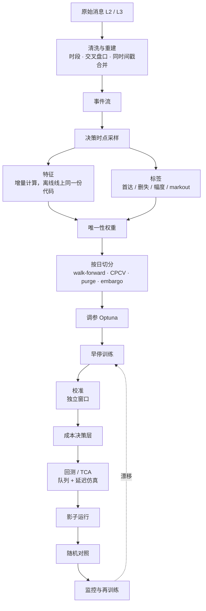

# 机器学习路线：从逻辑回归到 GBDT 和生存模型

2026-10 调研整理。不用深度学习，怎么一步步改进信号：每个模型的数学形式、整条 pipeline、训练时看哪些指标、参数怎么选。总览见 [`modeling-guide.md`](modeling-guide.md)，变量见 [`features-and-targets.md`](features-and-targets.md)。运行环境：Intel i9 CPU，没有 GPU；这条路线完全不需要 GPU。

## 结论

| 主题 | 默认做法 |
|---|---|
| 标签 | 三分类首达：τ 内先涨 ≥ 1 tick / 先跌 ≥ 1 tick / 没动。本质是竞争风险问题。幅度单独建模 |
| 模型路线 | ① 新标签 + 新特征放进「样条 + 交互项 + 弹性网」的多项 logit，作为强基线 → ② LightGBM 多分类作为主力 → ③ 离散时间竞争风险 hazard，一个模型覆盖一组 τ → ④ 单独建被动单成交概率的生存模型 |
| 增益拆分 | 四组对比，分开度量「特征带来的增益」和「模型带来的增益」（1.3 节）。log loss 只在同一个标签内比较 |
| 样本 | 按决策时点采样；按平均唯一性加权（2.4 节） |
| 切分 | 以整个交易日为块做 walk-forward；选模用 CPCV（$N = 10$，$k = 2$）+ purge + embargo |
| 早停和选模 | 早停用加权 log loss；选模用 log loss 技能分，ECE 作门槛，仿真成本打破平局。**不用准确率** |
| 校准 | 独立的校准窗口，温度缩放或 Dirichlet；每天重新校准，每周重训 |
| 阈值 | 不用固定阈值。按期望成本最小选动作（2.8 节） |
| 延迟 | 控制树的总量；LightGBM 单行快速接口、lleaves，或自己把树导出成扁平数组的 C++ |
| 其他模型 | 有序 logit、随机森林只作对照；EBM 作模型审阅版；stacking 只在 ≥ 70% 的 CPCV 路径上有增益时采用（1.7 节） |
| 单调约束 | LightGBM 多分类的约束对每一类分数同向生效，表达不了「$\hat\pi^{\uparrow}$ 随 OBI 增」；约束放在两阶段的方向模型上（1.7.4 节） |
| 特征选择 | 按簇、日内置换的 MDA + SFI + 跨折跨日稳定性；分组消融做最终决定（4.1 节） |
| 调参 | Optuna TPE + 中位数剪枝，purged 5 折；前 5 名再上完整 CPCV（2.6 节） |
| 线程 | 12 代 i9：LightGBM `num_threads` = P 核数（12900K 为 8，12900H 为 6）；并行数 × 线程数 ≤ P 核数（2.13 节） |

## 1. 模型路线

### 1.1 标签

记决策时点 $t$ 的中间价 $m_t$，tick 为 $\delta$，障碍宽度 $b$（默认 1）。三分类首达标签：

$$
y_t = \begin{cases}
\text{UP} & \tau^{\uparrow}_t < \min(\tau^{\downarrow}_t,\ t + \tau) \\
\text{DOWN} & \tau^{\downarrow}_t < \min(\tau^{\uparrow}_t,\ t + \tau) \\
\text{NONE} & \text{其他}
\end{cases}
\qquad
\tau^{\uparrow}_t = \inf\{s > t : m_s \ge m_t + b\delta\},\quad
\tau^{\downarrow}_t = \inf\{s > t : m_s \le m_t - b\delta\}
$$

- $b = 1$ 正好过滤掉「价差从 1 档变 2 档时中间价移动 $\delta/2$」这种噪声。
- **竞争风险视角**：UP 和 DOWN 是两种互斥的首次事件，NONE 是在 τ 处的右删失。
- **τ**：主定义用**物理时间，等于执行层实际的决策间隔**（如 1 / 5 / 30 秒）；事件时间的版本只作对照。NONE 占比只是诊断量：太高（> 80%）说明这个 τ 下信号多半没用，太低（< 10%）说明 τ 已经长到接近纯方向预测。**不要为了平衡类别去调 τ**。
- **幅度**：以「动了」和方向为条件的序数分类 $\{1, 2, \ge 3\}$ tick，涨跌分开；小 tick 股票可以对 $m_{t+\tau} - m_t$ 做分位数回归；markout 只作评估。
- **边界**：$t + \tau$ 超过收盘或停牌时点的样本，**分类模型的训练和评估都剔除**，不能当作 NONE；只有 hazard 模型保留它们作删失。

### 1.2 逻辑回归族

**多项 logit**（三分类，NONE 为基准类）：

$$
P(y = k \mid x) = \frac{\exp\big(\beta_k^\top \phi(x)\big)}{\sum_{j \in \{\text{UP}, \text{DOWN}, \text{NONE}\}} \exp\big(\beta_j^\top \phi(x)\big)},
\qquad \beta_{\text{NONE}} \equiv 0
$$

**弹性网目标**（$w_i$ 是唯一性权重）：

$$
\min_{\beta}\ -\frac{1}{\sum_i w_i}\sum_{i} w_i \log P(y_i \mid x_i; \beta) + \lambda\Big(\rho\,\lVert\beta\rVert_1 + \frac{1-\rho}{2}\lVert\beta\rVert_2^2\Big)
$$

$\rho$（`l1_ratio`）取 0.1–0.5，$\lambda$ 用 purged CV 选（sklearn 的目标是损失之和而不是平均，对应关系是 $\lambda = 1 / (C \sum_i w_i)$）。

**特征映射 $\phi(x)$**：

- 有饱和或 S 形效应的特征（OBI、$\mathrm{OFI}/\mathrm{AD}$、$G^*$）用三次 B 样条基展开 $x_j \mapsto \big(B^{(3)}_1(x_j), \dots, B^{(3)}_R(x_j)\big)$，系数并入 $\beta$，5–8 个节点放在分位数上；
- 其余特征先缩尾到 1% / 99%，再滚动 z-score；
- 只加少量有先验依据的交互项：$\mathrm{OBI}_1 \times \mathbf{1}[S_{\text{tk}} = 1]$、$\mathrm{OFI}^{\text{short}} \times \sigma$、$\mathrm{OBI}_1 \times \widetilde{\mathrm{Depth}}$、$\mathrm{TI} \times C_{\text{MO}}$。

**有序 logit**（把 DOWN < NONE < UP 看作同一个潜变量 $y^* = \beta^\top x + \varepsilon$）：

$$
P(y \le j \mid x) = \sigma(\theta_j - \beta^\top x),\qquad \theta_{\text{DOWN}} < \theta_{\text{NONE}}
$$

参数少，但**比例优势假设经常不成立**：波动升高会同时推高 UP 和 DOWN 的概率，单个 $\beta^\top x$ 表达不了这种对称效应。用之前先和多项 logit 比 log loss。

**两阶段**：把「会不会动」和「往哪动」分开：

$$
P(\text{UP} \mid x) = \underbrace{P(\text{动} \mid x)}_{\text{波动、事件强度驱动}} \cdot \underbrace{P(\text{UP} \mid \text{动}, x)}_{\text{OBI、OFI 驱动}}
$$

两部分的特征和约束不同，方向子模型可以加单调约束（OBI 越大 $P(\text{UP} \mid \text{动})$ 越大）。乘积的校准要单独检查。

Gould 和 Bonart（2016）只用逻辑回归加一个队列不平衡，在大 tick 股票上就拿到可观的增益。**「LR + 好特征」是很强的对照组，GBDT 必须明确跑赢它。**

### 1.3 增益拆分：四组对比

| 组 | 特征 | 标签 | 模型 | 能比什么 |
|---|---|---|---|---|
| A | 旧 | 旧（下一笔成交涨跌） | 旧 LR | 标签不同，log loss 不可比，只比经济指标和信号十分位图 |
| B | 旧 | 新（首达三分类） | 多项 LR | 换标签本身的效果（经济指标） |
| C | 新 | 新 | 样条 + 交互 LR | B → C 是**特征**带来的增益 |
| D | 新 | 新 | GBDT | C → D 是**模型**带来的增益 |

### 1.4 GBDT：数学和参数

**目标函数**。第 $t$ 棵树 $f_t$ 加到当前模型 $F^{(t-1)}$ 上，对损失做二阶展开（XGBoost / LightGBM 的共同框架）：

$$
\mathcal{L}^{(t)} \approx \sum_i w_i\Big[g_i f_t(x_i) + \tfrac{1}{2} h_i f_t(x_i)^2\Big] + \gamma \lvert\mathcal{T}\rvert + \tfrac{1}{2}\lambda \sum_{j=1}^{\lvert\mathcal{T}\rvert} v_j^2
$$

$\lvert\mathcal{T}\rvert$ 是叶子数，$v_j$ 是叶子值。多分类 softmax 下，类 $k$ 的一阶、二阶导数是

$$
g_{ik} = p_{ik} - \mathbf{1}[y_i = k],\qquad h_{ik} = p_{ik}(1 - p_{ik}),\qquad p_{ik} = \frac{e^{F_k(x_i)}}{\sum_j e^{F_j(x_i)}}
$$

（每一轮对每个类各长一棵树。实现里海森带一个常数：XGBoost 用 $2p(1-p)$，LightGBM 用 $\frac{K}{K-1}p(1-p)$，不影响下面的推导。）记叶子 $j$ 里的 $G_j = \sum_{i \in j} w_i g_i$，$H_j = \sum_{i \in j} w_i h_i$，最优叶子值和分裂增益是

$$
v_j^* = -\frac{G_j}{H_j + \lambda},
\qquad
\text{Gain} = \frac{1}{2}\Big[\frac{G_L^2}{H_L + \lambda} + \frac{G_R^2}{H_R + \lambda} - \frac{(G_L + G_R)^2}{H_L + H_R + \lambda}\Big] - \gamma
$$

**这对参数选择的含义**：

- $\lambda$（`lambda_l2`）把叶子值往 0 收缩，tick 数据噪声大，取 10 左右。
- `min_sum_hessian_in_leaf` 限制的是 $H_j$，也就是叶子里加权的曲率（每个样本最多贡献 $w_i/4$，概率接近 0 或 1 的样本贡献很小），不是样本数；`min_data_in_leaf` 数的是行数，不看权重。
- 学习率 $\eta$ 让 $F^{(t)} = F^{(t-1)} + \eta f_t$，越小越稳、树越多（延迟越高）。

**LightGBM 起点超参**（百万到千万行、30–80 个特征、三分类、延迟敏感）：

| 参数 | 起点 | 搜索范围 | 说明 |
|---|---|---|---|
| `objective` / `num_class` | `multiclass` / 3 | — | 两阶段方案用 `binary` |
| `learning_rate` | 0.05 | [0.02, 0.1] log | |
| `num_boost_round` | 上限 2000 | — | 早停决定；**上线前按延迟预算封顶**，如 ≤ 400 轮（3 类即 ≤ 1200 棵树） |
| `early_stopping_round` | 100 | 50–200 | `first_metric_only=True`，`metric=multi_logloss` |
| `num_leaves` | 31 | [15, 127] | |
| `max_depth` | 6 | {4–8} | 限制最坏推理路径 |
| `min_data_in_leaf` | 1000–5000 | [200, 20000] log | 默认 20 对 tick 数据太小；想按有效样本控制，设成「目标有效样本数 / $\bar u$」 |
| `min_sum_hessian_in_leaf` | 1e-2 | [1e-3, 1] log | 加权的叶子大小下限 |
| `feature_fraction` | 0.7 | [0.4, 0.9] | |
| `bagging_fraction` / `bagging_freq` | 0.5 / 1 | [0.2, 0.8] | 重叠严重时接近平均唯一性 $\bar u$，不低于 0.1 |
| `lambda_l2` | 10 | [0.01, 100] log | |
| `max_bin` | 63 | {31, 63, 127, 255} | 分箱越少越抗噪、推理越快 |
| `path_smooth` | 10 | [0, 50] | 叶子值向父节点平滑，抗噪 |
| `deterministic` / `force_row_wise` | True / True | — | 可复现 |
| 样本权重 | 唯一性权重 $w_i$ | — | 必须用 |

- **样本权重只允许不依赖标签的量**：唯一性权重，以及决策时刻就知道的量（当时的价差、子单规模）。**不要用 $\lvert\Delta m\rvert$ 这类事后结果做权重**：NONE 样本的 $\Delta m \approx 0$，权重接近 0，模型等于不学 NONE，概率也不再校准。**不用 focal loss，不用逆频率类权重**，理由相同。
- XGBoost 对应：`tree_method=hist`、`multi:softprob`、`max_depth=6`、`eta=0.05`、`subsample=0.5`、`colsample_bytree=0.7`、`lambda=10`、`max_bin=64`。
- CatBoost 用对称树（同一层所有节点用同一个分裂），单棵树推理只要 depth 次比较再做一次位运算寻址，单行延迟很友好。
- **i9 上的训练时间**（量级估计）：$10^7$ 行 × 60 特征 × 3 类、1000 轮，`max_bin=63`，用 8 个 P 核约 5–15 分钟；Optuna 100 个 trial 加 purged 5 折约一晚。

### 1.5 生存模型：最值得加的第二个模型

执行真正关心两件事：「我等的时候价格先往哪边走、多快走」（首达时间 + 竞争风险），和「我挂的单多久能成交，成交前价格会不会先跑」（成交时间 + 删失）。固定 τ 的分类只是生存曲线上的一个截面。

**离散时间竞争风险 hazard（推荐）**。把 $(0, \tau_{\max}]$ 切成 $L$ 段，格点 $0 = t_0 < t_1 < \dots < t_L = \tau_{\max}$（物理时间，如 0.5、1、2、5、10、30 秒）。记首达时间为 $T^{\text{hit}}$、事件类型为 $E \in \{\uparrow, \downarrow\}$，第 $l$ 段的条件概率

$$
h_{\uparrow}(l \mid x) = P\big(T^{\text{hit}} \in (t_{l-1}, t_l],\ E = \uparrow \mid T^{\text{hit}} > t_{l-1},\ x\big),
\qquad
h_{\downarrow}(l \mid x) = P\big(T^{\text{hit}} \in (t_{l-1}, t_l],\ E = \downarrow \mid T^{\text{hit}} > t_{l-1},\ x\big)
$$

由一个多分类模型给出：把每个样本展开成「每段一行、直到事件发生或删失」（person-period 格式），目标是 {继续, UP, DOWN}，段号 $l$ 当特征。这个模型的似然恰好等于原问题的离散时间竞争风险似然，所以**直接用 LightGBM 多分类训练就行**。由 hazard 得到生存函数和累积发生函数（CIF），在格点 $t_j$ 上：

$$
\mathcal{S}(j \mid x) = \prod_{l \le j}\big(1 - h_{\uparrow}(l) - h_{\downarrow}(l)\big),
\qquad
\mathrm{CIF}_{\uparrow}(j \mid x) = \sum_{l \le j} h_{\uparrow}(l)\,\mathcal{S}(l - 1 \mid x),\quad \mathcal{S}(0) = 1
$$

$\mathrm{CIF}_{\uparrow}(j) + \mathrm{CIF}_{\downarrow}(j) + \mathcal{S}(j) = 1$。一个模型覆盖所有格点上的 τ，格点之间插值。

离散 hazard 就是连续时间条件强度在格点上的离散化。它和泊松、ACD、Hawkes、队列耗尽模型的对应关系，以及这些模型的输出怎么当协变量，见 [`event-arrivals.md`](event-arrivals.md) 第 10 节。

**AFT（加速失效时间）**，用于「距下次中间价变化的时间」或「被动单的成交时间」：

$$
\log T^{\text{hit}} = \beta^\top x + \sigma\,\varepsilon,\qquad \varepsilon \sim \text{正态 / logistic / 极值分布}
$$

右删失样本的似然用 $P(T^{\text{hit}} > c) = 1 - F_\varepsilon\big((\log c - \beta^\top x)/\sigma\big)$。XGBoost 的 `survival:aft` 把 $\beta^\top x$ 换成树模型（Barnwal 等 2022）。

**被动单成交模型**：用「钉在最优价上的虚拟 1 股订单」构造标签：它在队尾进入，按 L3 数据跟踪前方的量，前方量被消耗完之后有成交才算成交；没成交就删失。Lo、MacKinlay、Zhang（2002）发现**用首达时间构造的「假想成交」很难代替真实成交**，所以最终必须用自己的真实子单校准。

```python
import numpy as np


def expand_person_period(X, event, period, n_periods):
    """Discrete-time competing-risks data: one row per (sample, period still at risk).
    event: 0 = none by the end (censored), 1 = up, 2 = down; period: index of the period it happened in
    (or the last period observed if censored). Target per row: 0 continue, 1 up, 2 down."""
    rows, ys, ks = [], [], []
    for x, e, p in zip(X, event, period):
        for k in range(min(p, n_periods - 1) + 1):
            rows.append(x); ks.append(k)
            ys.append(e if (k == p and e > 0) else 0)
    Z = np.column_stack([np.asarray(rows), np.asarray(ks)])    # period index is a feature
    return Z, np.asarray(ys)


def cif_from_hazards(h):
    """h: (n, J, 3) per-period probabilities [continue, up, down] from a multiclass model.
    Returns CIF_up, CIF_down, S, each (n, J): values at the end of each period."""
    surv_prev = np.cumprod(np.concatenate([np.ones((len(h), 1)), h[:, :-1, 0]], axis=1), axis=1)
    cif_up = np.cumsum(h[:, :, 1] * surv_prev, axis=1)
    cif_dn = np.cumsum(h[:, :, 2] * surv_prev, axis=1)
    surv = np.cumprod(h[:, :, 0], axis=1)
    return cif_up, cif_dn, surv
```

### 1.6 其他模型族

| 模型 | 数学 | 适合 | 风险 |
|---|---|---|---|
| GBDT 分位数 | pinball loss $\ell_\alpha(e) = \max(\alpha e, (\alpha - 1)e)$ | 小 tick 股票的幅度 | 分位数可能交叉，训练后排序 |
| CatBoost MultiQuantile | 一个模型同时输出多个 $\alpha$ | 同上 | 不保证不交叉 |
| NGBoost | 用自然梯度拟合分布参数 $\theta(x)$，$\tilde\nabla = \mathcal{I}(\theta)^{-1}\nabla_\theta S$ | 研究幅度和持续时间的不确定性 | 慢，不放关键路径 |

### 1.7 各模型展开：数学、参数、什么时候用

1.2–1.6 节给出了骨架。这一节逐个模型展开：公式、参数、什么时候用、常见的坑。记号沿用前文：$x \in \mathbb{R}^p$ 是决策时刻的特征；三类为 DOWN、NONE、UP；$w_i$ 是唯一性权重（2.4 节），$W = \sum_i w_i$；$\hat\pi^{\uparrow}(x), \hat\pi^{\downarrow}(x), \hat\pi^{0}(x)$ 是模型给出的三类概率，也就是 2.8 节里的 $p_\uparrow, p_\downarrow, p_0$。

| 模型 | 角色 | 训练成本 | 上线 |
|---|---|---|---|
| 多项 logit + 弹性网 | 强基线（1.3 节 C 组） | 低 | 可以 |
| 有序 logit | 参数最少的对照；检查比例优势 | 很低 | 不上线 |
| 随机森林 / ExtraTrees | 稳健性对照 | 中 | 不上线 |
| LightGBM | 主力 | 中 | 可以（2.12 节） |
| EBM | 模型审阅用的可解释版本 | 中到高 | 精度够时可以 |
| GBDT hazard | 一个模型覆盖一组 τ | 行数乘 2–5 倍 | 可以 |
| Stacking | 只在增益稳定时用 | 各成员之和 | 延迟是各成员之和 |

本页所有 python 代码块按顺序拼起来是一个可以直接运行的脚本：用模拟数据，几十秒跑完。下面第一块是共用的模拟数据、切分和指标函数，后面的块都依赖它。模拟数据由已知的多项 logit 生成：$\log\sigma$ 同时推高 UP 和 DOWN，microprice 偏离是 OBI 的带噪副本，另有 6 列纯噪声。

```python
import os
import warnings
from itertools import combinations

import numpy as np

# Shared helpers for the demos in 1.7, 2.6, 2.13 and 4.1. Class coding: 0 = DOWN, 1 = NONE, 2 = UP (ordered,
# so the same y also works for the ordered logit). The person-period code in 1.5 uses 0 = continue, 1 = up, 2 = down.

# LightGBM / OpenMP threads. On a 12th-gen i9 export N_PCORES = number of PERFORMANCE cores (i9-12900K: 8,
# i9-12900H: 6), not the logical CPU count (24 / 20), see 2.13. The fallback is deliberately small: more OpenMP
# threads than free cores makes LightGBM crawl, because spinning threads wait for descheduled ones.
N_THREADS = int(os.environ.get("N_PCORES", max(1, min(4, (os.cpu_count() or 2) // 2))))
warnings.filterwarnings("ignore", message=".*Unknown solver options.*")   # scipy>=1.15 vs sklearn 1.5 lbfgs noise


def simulate_panel(n_days=20, n_per_day=1500, n_noise=6, seed=0):
    """Toy decision-time panel from a known multinomial logit (NONE = base class):
        eta_UP / eta_DOWN = -0.8 +/- [1.5 tanh(2 obi) + 0.5 ofi + 0.6 obi * spread1] + 0.8 log_vol
    log_vol raises BOTH UP and DOWN (breaks proportional odds, 1.7.2); micro_dev is a noisy copy of obi
    (a correlated cluster with no signal of its own, 4.1). Returns dict with X (n, p) float32, y (n,) int,
    w (n,) label-free weights with mean 1, day (n,) trading-day index (the CV block unit), names (p,)."""
    rng = np.random.default_rng(seed)
    n = n_days * n_per_day
    day = np.repeat(np.arange(n_days), n_per_day)
    obi = np.clip(rng.normal(0.0, 0.45, n), -1, 1)                  # queue imbalance in [-1, 1]
    ofi = 0.5 * obi + rng.normal(0.0, 1.0, n)                       # OFI / average depth
    micro = obi + rng.normal(0.0, 0.15, n)                          # (microprice - mid) / half-spread
    log_vol = rng.normal(0.0, 0.5, n) + rng.normal(0.0, 0.3, n_days)[day]   # with a day-level regime
    spread1 = (rng.random(n) < 0.7).astype(float)                   # 1 if spread == 1 tick
    sig = 1.5 * np.tanh(2 * obi) + 0.5 * ofi + 0.6 * obi * spread1
    logits = np.column_stack([-0.8 - sig + 0.8 * log_vol, np.zeros(n), -0.8 + sig + 0.8 * log_vol])
    y = np.argmax(logits + rng.gumbel(size=(n, 3)), axis=1)        # Gumbel-max trick = exact softmax draw
    w = rng.beta(2.0, 5.0, n)                                       # stand-in for uniqueness weights
    X = np.column_stack([obi, ofi, micro, log_vol, spread1, rng.normal(size=(n, n_noise))]).astype(np.float32)
    names = ["obi1", "ofi_short", "micro_dev", "log_vol", "spread1"] + [f"noise_{j}" for j in range(n_noise)]
    return dict(X=X, y=y, w=w / w.mean(), day=day, names=names)


def wlogloss(p, y, w=None, eps=1e-12):
    """Weighted log loss  -sum_i w_i log p[i, y_i] / sum_i w_i  in nats; p is (n, K)."""
    w = np.ones(len(y)) if w is None else np.asarray(w, float)
    return float(-(w * np.log(np.clip(p[np.arange(len(y)), y], eps, 1.0))).sum() / w.sum())


def cpcv_splits(day, n_groups=10, k=2, embargo_days=1):
    """CPCV (2.5) on whole trading days: each choice of k of n_groups day-groups is one test set.
    Labels never cross the close (1.1), so day blocks need no intra-day purge; the embargo drops
    `embargo_days` days after each test group from training. k=1 is purged K-fold.
    Yields (train_idx, test_idx, test_group_ids)."""
    groups = np.array_split(np.unique(day), n_groups)
    for comb in combinations(range(n_groups), k):
        test = np.isin(day, np.concatenate([groups[g] for g in comb]))
        emb = np.isin(day, np.concatenate([groups[g].max() + 1 + np.arange(embargo_days) for g in comb]))
        yield np.flatnonzero(~test & ~emb), np.flatnonzero(test), comb


def split_last_days(idx, day, n_val_days=2):
    """Split rows idx into (earlier days, last n_val_days days): early-stopping / hold-out by whole days."""
    is_val = np.isin(day[idx], np.unique(day[idx])[-n_val_days:])
    return idx[~is_val], idx[is_val]


DATA = simulate_panel()
X, y, w = DATA["X"], DATA["y"], DATA["w"]
tr, te = split_last_days(np.arange(len(y)), DATA["day"], n_val_days=5)   # train days 0-14, test days 15-19
print("panel", X.shape, "shares DOWN/NONE/UP", np.round(np.bincount(y) / len(y), 3))
```

#### 1.7.1 多项 logit + 弹性网

目标函数见 1.2 节。对类 $k$ 的系数，加权负对数似然的梯度是

$$
\nabla_{\beta_k}\Big[-\frac{1}{W}\sum_i w_i \log p_{i y_i}\Big] = \frac{1}{W}\sum_i w_i\big(p_{ik} - \mathbf{1}[y_i = k]\big)\,\phi(x_i),
\qquad p_{ik} = P(y_i = k \mid x_i)
$$

负对数似然是凸的；$\rho < 1$ 时 L2 项让目标严格凸，解唯一，共线的样条基和交互项不会让系数发散。

**λ 路径**。$\phi$ 中心化后，在 $\beta = 0$、截距取加权类频率 $\bar\pi_k$ 的点上，KKT 条件给出让所有系数都为 0 的最小 λ：

$$
\lambda_{\max} = \frac{1}{\rho\,W}\max_{j,k}\Big\lvert\sum_i w_i\big(\bar\pi_k - \mathbf{1}[y_i = k]\big)\,\phi_j(x_i)\Big\rvert
$$

从 $\lambda_{\max}$ 到 $10^{-3}\lambda_{\max}$ 取对数等距的 20 个点，依次热启动拟合（Friedman、Hastie、Tibshirani 2010）。选 λ 有两种：purged CV log loss 最小的点；或 **1-SE 规则**，取 log loss 在最小值一个标准误以内的最大 λ。默认用 1-SE：更稀疏，跨日更稳。

sklearn 用对称参数化：每一类都有一组 β，不设基准类，靠罚项保证可识别。不加罚项时它和 1.2 节「NONE 为基准」等价，加了罚项时略有不同，概率的用法不变。

| 参数 | 取值 | 说明 |
|---|---|---|
| `solver` | `saga` | sklearn 里唯一同时支持多项损失和 L1 的求解器 |
| `l1_ratio`（$\rho$） | 0.1–0.5，默认 0.3 | 有的文献记作 α。ρ 太大时，同一个样条的相邻基函数会被随机去掉一部分，形状变成锯齿 |
| `C` | $1/(\lambda W)$ | λ 由路径 + purged CV 选 |
| `max_iter` / `tol` | 2000 / 1e-4 | saga 收敛慢；所有列必须先标准化 |
| `warm_start` | True | 沿 λ 路径热启动 |
| 样条 | 三次，5–8 个分位数节点，`extrapolation="constant"` | 超出训练范围时取边界值，不外推 |
| `sample_weight` | $w_i$ | 不要再加 `class_weight` |
| `multi_class` | 不传 | sklearn 1.5 已弃用；类别数大于 2 时默认就是多项 |

**什么时候用**：永远先跑。它是 1.3 节的 C 组，GBDT 的增益要相对它来算。

**坑**：

- 样条节点和标准化只在训练折上拟合；在全样本上拟合会把测试期的分布带进特征。
- L1 在相关特征之间随机挑一个，选中的集合不稳定。看系数路径和跨折的选中频率，不只看最终那一组。
- 样本重叠时，软件给出的系数标准误偏小。要显著性就按交易日做块 bootstrap。

```python
import numpy as np
from sklearn.compose import ColumnTransformer
from sklearn.linear_model import LogisticRegression
from sklearn.pipeline import make_pipeline
from sklearn.preprocessing import FunctionTransformer, SplineTransformer, StandardScaler


def make_design(names, spline_cols=("obi1", "ofi_short"), n_knots=6):
    """phi(x) of 1.2 as an sklearn transformer (fit it on the TRAINING fold only: the knots are quantiles).
    Cubic B-splines on saturating features, z-scores on the rest, plus OBI_1 x 1[spread = 1 tick].
    Every column is standardised so one lambda penalises all columns on the same scale.
    (Winsorising at 1% / 99% is omitted here because the toy data has no outliers.)"""
    col = {n: j for j, n in enumerate(names)}
    spl = [col[c] for c in spline_cols]
    lin = [j for j in range(len(names)) if j not in spl]
    obi_x_spread1 = FunctionTransformer(lambda X: X[:, [col["obi1"]]] * X[:, [col["spread1"]]])
    return ColumnTransformer([
        ("spline", make_pipeline(SplineTransformer(n_knots=n_knots, degree=3, knots="quantile",
                                                   extrapolation="constant"), StandardScaler()), spl),
        ("linear", StandardScaler(), lin),
        ("inter", make_pipeline(obi_x_spread1, StandardScaler()), list(range(len(names)))),
    ])


def lambda_max(Phi, y, w, rho, n_class=3):
    """Smallest lambda at which every slope is 0 (KKT at beta = 0, intercepts at the weighted class shares):
    lambda_max = max_{j,k} |sum_i w_i (pibar_k - 1[y_i = k]) phi_ij| / (rho * sum_i w_i). Phi must be centred."""
    Y = np.eye(n_class)[y]                                       # (n, K) one-hot
    pibar = (w[:, None] * Y).sum(0) / w.sum()                    # (K,) weighted class shares
    grad = Phi.T @ (w[:, None] * (pibar - Y)) / w.sum()          # (p, K) gradient of the mean NLL at beta = 0
    return float(np.abs(grad).max() / rho)


def enet_path_cv(X, y, w, day, names, rho=0.3, n_lambda=6, ratio=1e-3, n_folds=3):
    """Purged-day CV over a log grid lambda_max * [1 .. ratio]. Returns (lambdas, mean LL, se LL).
    sklearn minimises C * sum_i w_i loss_i + penalty, so lambda = 1 / (C * sum_i w_i) for each fold."""
    design = make_design(names).fit(X)
    lam = lambda_max(design.transform(X), y, w, rho) * np.logspace(0, np.log10(ratio), n_lambda)
    ll = np.zeros((n_folds, n_lambda))
    for f, (tr, te, _) in enumerate(cpcv_splits(day, n_groups=n_folds, k=1)):
        d = make_design(names).fit(X[tr])
        Ptr, Pte = d.transform(X[tr]), d.transform(X[te])
        clf = LogisticRegression(penalty="elasticnet", solver="saga", l1_ratio=rho, warm_start=True,
                                 max_iter=300, tol=1e-3)        # saga: the only solver with multinomial + L1
        for j, l in enumerate(lam):                             # large -> small lambda, warm starts along the path
            clf.set_params(C=1.0 / (l * w[tr].sum()))
            clf.fit(Ptr, y[tr], sample_weight=w[tr])
            ll[f, j] = wlogloss(clf.predict_proba(Pte), y[te], w[te])
    return lam, ll.mean(0), ll.std(0, ddof=1) / np.sqrt(n_folds)


import warnings
from sklearn.exceptions import ConvergenceWarning
warnings.filterwarnings("ignore", category=ConvergenceWarning)   # demo uses a loose max_iter
sub = DATA["day"] < 10                                          # demo: 10 days keeps saga fast
lam, m, se = enet_path_cv(DATA["X"][sub], DATA["y"][sub], DATA["w"][sub], DATA["day"][sub], DATA["names"], n_lambda=5)
best = int(np.argmin(m))
one_se = int(np.flatnonzero(m <= m[best] + se[best])[0])       # 1-SE rule: largest lambda within 1 SE of the best
print("lambda grid", np.round(lam, 5), "\nCV LL", np.round(m, 4), "| best", lam[best], "1-SE", lam[one_se])
```

#### 1.7.2 有序 logit 与比例优势检查

把 DOWN < NONE < UP 看作潜变量 $y^* = x^\top\beta + \varepsilon$（$\varepsilon$ 服从 logistic 分布）落在两个切点 $\theta_{\text{DOWN}} < \theta_{\text{NONE}}$ 隔开的三段里（McCullagh 1980）。记 $\eta = x^\top\beta$：

$$
P(y \le k \mid x) = \sigma(\theta_k - \eta),\qquad
\hat\pi^{\downarrow} = \sigma(\theta_{\text{DOWN}} - \eta),\quad
\hat\pi^{0} = \sigma(\theta_{\text{NONE}} - \eta) - \sigma(\theta_{\text{DOWN}} - \eta),\quad
\hat\pi^{\uparrow} = 1 - \sigma(\theta_{\text{NONE}} - \eta)
$$

**比例优势**：两个切点上的对数几率 $\log\frac{P(y > k \mid x)}{P(y \le k \mid x)} = \eta - \theta_k$ 共用同一个 β，所以 $x$ 和 $x'$ 之间的对数优势比 $(x - x')^\top\beta$ 与切点无关。参数 $p + 2$ 个，多项 logit 是 $2p + 2$ 个。

**检查（Brant 1990 的思路）**：分别拟合两个二元 logit

$$
\operatorname{logit} P(y \ne \text{DOWN} \mid x) = a_1 + x^\top\beta^{(1)},
\qquad
\operatorname{logit} P(y = \text{UP} \mid x) = a_2 + x^\top\beta^{(2)}
$$

比例优势成立时 $\beta^{(1)} = \beta^{(2)} = \beta$。检验统计量

$$
W_{\text{PO}} = \big(\hat\beta^{(1)} - \hat\beta^{(2)}\big)^\top \hat V^{-1}\big(\hat\beta^{(1)} - \hat\beta^{(2)}\big) \;\overset{H_0}{\sim}\; \chi^2_p,
\qquad
\hat V = \widehat{\operatorname{Cov}}\big(\hat\beta^{(1)} - \hat\beta^{(2)}\big)
$$

Brant 用两个估计量的渐近协方差。这里样本重叠，渐近协方差偏小，改用按交易日的块 bootstrap 估计 $\hat V$，并逐个特征看 $z_j = (\hat\beta^{(1)}_j - \hat\beta^{(2)}_j)/\sqrt{\hat V_{jj}}$。样本上百万时 $W_{\text{PO}}$ 几乎总是显著，所以主要看差的**大小和符号**。

- **典型失败**：波动类特征（σ、事件强度、价差）同时推高 UP 和 DOWN，于是 $\beta^{(1)}_\sigma < 0$、$\beta^{(2)}_\sigma > 0$，符号相反。方向类特征（OBI、OFI）两个系数接近，比例优势大致成立。模拟数据上 $\log\sigma$ 的 $z \approx -24$，OBI 的 $z \approx 1.5$。
- **修补**：partial proportional odds（Peterson 和 Harrell 1990），方向类特征共用 β，波动类特征每个切点一组系数 $\gamma_k$：$P(y \le k \mid x) = \sigma(\theta_k - x_{\text{dir}}^\top\beta - x_{\text{vol}}^\top\gamma_k)$。要检查数据范围内 $P(y \le \text{DOWN}) \le P(y \le \text{NONE})$ 始终成立，否则会出现负概率。
- **结论**：有序 logit 只作对照。它失败的方式本身说明 1.2 节的两阶段结构是对的：波动决定「动不动」，OBI 和 OFI 决定「往哪动」。

```python
import numpy as np
from scipy.optimize import minimize
from scipy.special import expit
from sklearn.linear_model import LogisticRegression


def ordered_logit_proba(theta, beta, X):
    """P(y = k), k = 0 DOWN, 1 NONE, 2 UP, from P(y <= k | x) = sigmoid(theta_k - x'beta). Returns (n, 3)."""
    eta = X @ beta
    c0, c1 = expit(theta[0] - eta), expit(theta[1] - eta)        # cumulative P(y <= 0), P(y <= 1)
    return np.column_stack([c0, c1 - c0, 1.0 - c1])


def fit_ordered_logit(X, y, w):
    """Weighted proportional-odds model (McCullagh 1980). theta_0 < theta_1 is enforced by
    theta_1 = theta_0 + exp(d). Only p + 2 parameters vs 2p + 2 for the multinomial logit."""
    def unpack(par):
        return np.array([par[0], par[0] + np.exp(par[1])]), par[2:]
    def nll(par):
        return wlogloss(ordered_logit_proba(*unpack(par), X), y, w)
    res = minimize(nll, np.r_[-1.0, 0.0, np.zeros(X.shape[1])], method="L-BFGS-B")
    return unpack(res.x)


def po_check(X, y, w, day, n_boot=30, seed=0):
    """Brant-style check of proportional odds with two binary logits:
        logit P(y > 0 | x) = a_1 + x'beta^(1)  (not DOWN),   logit P(y > 1 | x) = a_2 + x'beta^(2)  (UP).
    Under proportional odds beta^(1) = beta^(2). Cov(beta^(1) - beta^(2)) comes from a bootstrap over
    whole trading days (samples overlap within a day, so the textbook standard errors are too small).
    Returns (beta1, beta2, z per feature, Wald chi2 with p degrees of freedom)."""
    def slopes(idx):
        fit = lambda t: LogisticRegression(C=1e6, max_iter=500).fit(X[idx], t[idx], sample_weight=w[idx]).coef_[0]
        return fit((y > 0).astype(int)), fit((y > 1).astype(int))
    b1, b2 = slopes(np.arange(len(y)))
    rng, days = np.random.default_rng(seed), np.unique(day)
    by_day = {d: np.flatnonzero(day == d) for d in days}
    boots = []
    for _ in range(n_boot):
        idx = np.concatenate([by_day[d] for d in rng.choice(days, len(days))])
        s1, s2 = slopes(idx)
        boots.append(s1 - s2)
    V = np.cov(np.asarray(boots), rowvar=False)                 # (p, p) bootstrap covariance of the difference
    diff = b1 - b2
    return b1, b2, diff / np.sqrt(np.diag(V)), float(diff @ np.linalg.solve(V, diff))


cols = [DATA["names"].index(c) for c in ("obi1", "ofi_short", "log_vol", "spread1")]
Xo = DATA["X"][:, cols].astype(float)
theta, beta = fit_ordered_logit(Xo, y, w)
beta_1, beta_2, z, wald = po_check(Xo, y, w, DATA["day"], n_boot=20)
print("ordered logit beta", np.round(beta, 3), "| binary slopes", np.round(beta_1, 2), np.round(beta_2, 2))
print("z(beta1 - beta2)", np.round(z, 1), "Wald chi2(4) =", round(wald, 1))   # log_vol: opposite signs -> PO fails
```

#### 1.7.3 随机森林 / ExtraTrees：只做稳健性对照

$B$ 棵树取平均。每棵树的预测方差是 $\sigma_T^2$，任意两棵树之间的相关系数是 $\varrho$（Hastie、Tibshirani、Friedman 2009，式 15.1）：

$$
\operatorname{Var}\Big(\frac{1}{B}\sum_{b=1}^{B} T_b(x)\Big) = \varrho\,\sigma_T^2 + \frac{1 - \varrho}{B}\,\sigma_T^2
$$

$B \to \infty$ 只消掉第二项。第一项 $\varrho\,\sigma_T^2$ 是下限，只能靠降低树之间的相关来压：`max_features` 让每次分裂只看一部分特征；ExtraTrees（Geurts、Ernst、Wehenkel 2006）连分裂阈值也随机取，$\varrho$ 更低，偏差更大。

**标签重叠时**：默认的 bootstrap 有放回地抽 $n$ 行，袋内样本和它的邻居几乎是同一个样本，树之间的 $\varrho$ 偏高，OOB 分数偏乐观。López de Prado（2018，第 6 章）建议把 `max_samples` 设成平均唯一性 $\bar u$。

**为什么只做对照**：

1. 概率是各棵树叶子里类频率的平均，靠近 0 和 1 时系统性偏向中间（Niculescu-Mizil 和 Caruana 2005），必须再校准。
2. 没有按验证集 log loss 早停的机制，复杂度只能靠叶子大小控制。
3. 树多且深，单行推理和内存都比同等精度的 GBDT 贵得多。

**用法**：在同一套 CPCV 上跑一次，和 LightGBM 比 log loss。两者接近，说明 GBDT 的增益不是过拟合造成的；随机森林明显更好，说明 GBDT 的调参有问题；随机森林明显更差，是正常情况。

| 参数 | 取值 | 说明 |
|---|---|---|
| `n_estimators` | 300–500 | B = 300 之后方差的第二项已经很小 |
| `criterion` | `log_loss` | 和评估指标一致 |
| `max_features` | 0.3，或 $\sqrt p$ | 降低 $\varrho$ |
| `min_samples_leaf` | 和 `min_data_in_leaf` 同量级（≥ 200） | 叶子频率就是概率；小叶子会给出 0 或 1 |
| `bootstrap` / `max_samples` | True / $\bar u$（下限 0.05） | 见上 |
| `oob_score` | False | 重叠时偏乐观 |
| `sample_weight` | $w_i$ | |
| `n_jobs` | P 核数；也可以用全部物理核（2.13 节） | 每棵树独立训练，E 核慢不会拖住别的树 |

```python
import numpy as np
from sklearn.ensemble import ExtraTreesClassifier, RandomForestClassifier


def forest_params(avg_uniqueness, n_jobs, min_leaf=200, n_trees=300):
    """Forest settings for overlapping tick labels (AFML ch. 6). max_samples ~ average uniqueness u_bar,
    so each tree sees roughly one effectively independent draw per label window, which lowers the
    between-tree correlation rho_tree. min_samples_leaf is large because leaf frequencies ARE the
    probabilities: tiny leaves give 0 / 1 probabilities and infinite log loss."""
    return dict(n_estimators=n_trees, criterion="log_loss", max_features=0.3,
                min_samples_leaf=min_leaf, bootstrap=True, max_samples=float(np.clip(avg_uniqueness, 0.05, 1.0)),
                oob_score=False,               # OOB rows are neighbours of in-bag rows: optimistic under overlap
                n_jobs=n_jobs, random_state=0)


prior = np.bincount(y[tr], weights=w[tr]) / w[tr].sum()
print("prior LL", round(wlogloss(np.tile(prior, (len(te), 1)), y[te], w[te]), 4))
for Model in (RandomForestClassifier, ExtraTreesClassifier):
    m = Model(**forest_params(avg_uniqueness=0.3, n_jobs=N_THREADS, n_trees=100)).fit(X[tr], y[tr], sample_weight=w[tr])
    print(Model.__name__, "LL", round(wlogloss(m.predict_proba(X[te]), y[te], w[te]), 4))
```

#### 1.7.4 LightGBM、XGBoost、CatBoost

二阶展开的目标、最优叶子值 $v_j^* = -G_j/(H_j + \lambda)$ 和分裂增益见 1.4 节。把 $v_j^*$ 代回目标，得到给定树结构 $\mathcal{T}$ 的最小损失：

$$
\mathcal{L}^{(t)}(\mathcal{T}) = -\frac{1}{2}\sum_{j=1}^{\lvert\mathcal{T}\rvert}\frac{G_j^2}{H_j + \lambda} + \gamma\,\lvert\mathcal{T}\rvert
$$

分裂增益就是分裂前后这个量的差。三个库共用这个框架，差别在于怎么找分裂点、树怎么长、怎么采样。

**LightGBM**（Ke 等 2017）：

- **直方图**：每个特征先分成至多 `max_bin` 个箱，找分裂点只扫箱，代价是 $O(\text{箱数})$ 而不是 $O(n)$。子节点的直方图等于父节点减兄弟节点，只需直接算较小的那个子节点。
- **按叶生长**：每次分裂全树增益最大的叶子。叶子数相同时损失降得更快，也更容易过拟合，所以 `num_leaves` 和 `max_depth` 要一起限制。
- **GOSS**：保留 $\lvert g_i\rvert$ 最大的 $a$ 比例样本，再从其余样本中随机抽取占全部样本 $b$ 比例的样本，抽中的样本权重乘 $\frac{1-a}{b}$，使梯度和的估计无偏。**这里不用 GOSS**：它按梯度大小挑样本，会系统性地多抽噪声大的样本；而且 LightGBM 4 的 `data_sample_strategy` 只能在 bagging 和 GOSS 之间二选一，而我们需要 `bagging_fraction` 来对付样本重叠。

**XGBoost**（Chen 和 Guestrin 2016）：

- `tree_method="hist"` 同样是直方图。默认按层生长，`max_depth` 是主要的复杂度参数；`grow_policy="lossguide"` 相当于按叶生长。
- 1.4 节的 $\gamma$、$\lambda$ 就是 `gamma`、`lambda`。`min_child_weight` 是 $H_j$ 的下限；XGBoost 没有按行数限制叶子大小的参数，只能靠它。自带 `survival:aft`（1.5 节）。

**CatBoost**（Prokhorenkova 等 2018）：

- **对称树**：同一层的所有节点用同一个（特征，阈值）。深度为 $D$ 的树就是一张 $2^D$ 格的表，叶子编号是 $D$ 个比较结果拼成的二进制数。正则化强，单行推理快（2.12 节）。
- **Ordered boosting**：普通 boosting 用「见过样本 $i$ 的模型」算 $i$ 的梯度，梯度有偏（prediction shift）。CatBoost 取一个排列 $\sigma$，样本 $i$ 的梯度只用排在它前面的样本训练出的模型 $M_{\sigma(i)-1}$ 来算：$g_i = \ell'\big(y_i,\ M_{\sigma(i)-1}(x_i)\big)$，$\ell'$ 是损失对第二个参数的导数。
- 类别特征用同样思路的有序目标统计编码。我们的类别特征很少（tick 类别、时段、股票编号），这部分优势用得不多。
- **时间序列要设 `has_time=True`**：用数据本身的时间顺序代替随机排列，否则「未来」的样本会参与当前样本的梯度和类别编码。

| | LightGBM | XGBoost | CatBoost |
|---|---|---|---|
| 树的生长 | 按叶 | 按层（可选按叶） | 对称树 |
| 主要复杂度参数 | `num_leaves` + `max_depth` | `max_depth` | `depth` |
| 叶子大小下限 | `min_data_in_leaf`、`min_sum_hessian_in_leaf` | `min_child_weight` | 对称树只能靠 `l2_leaf_reg` |
| 行采样 | bagging 或 GOSS | `subsample` | `bootstrap_type` + `subsample` |
| 类别特征 | 内置 | 内置（`enable_categorical`） | 有序目标统计，最完善 |
| 单调约束 | 有；多分类时作用于每一类（见下） | 有 | 有 |
| CPU 上多分类训练 | 最快 | 接近 | 较慢 |
| 单行推理 | 中 | 中 | 最快（查表） |

**选择**：LightGBM 为主；XGBoost 作对照，两者差别通常很小；单行延迟最紧时考虑 CatBoost。

**$10^6$–$10^7$ 行 × 50–200 个特征的设置**（12 代 i9，搜索范围见 1.4 节的表）：

- `num_threads` 等于 P 核数：i9-12900K 是 8，i9-12900H 是 6（2.13 节）。
- `force_row_wise=True`：行多、总箱数不大、线程不超过 16、又用了 bagging，按行构建直方图更快。特征上千或线程很多时才换 `force_col_wise`。
- `min_data_in_leaf` = 目标有效样本数 / $\bar u$，例如 100 / 0.05 = 2000 行。
- `max_bin` 是 Dataset 的属性，Dataset 构建之后再改不起作用。调 `max_bin` 就要重建 Dataset。
- **内存**：$10^7 \times 200$ 的 float32 原始矩阵约 8 GB；分箱后每个值 1 字节（`max_bin` ≤ 255），约 2 GB。Dataset 建好就释放原始矩阵（`free_raw_data=True`），或者 `save_binary` 存成二进制文件，之后直接加载，省掉分箱时间。
- **早停**：验证集是训练日之后的 1–2 个整天，`first_metric_only=True`。

**单调约束**。对特征 $j$ 加 +1 约束，保证其他特征固定时

$$
x_j \le x_j' \;\Rightarrow\; F(x_1, \dots, x_j, \dots, x_p) \le F(x_1, \dots, x_j', \dots, x_p)
$$

- LightGBM：`monotone_constraints=[1, 0, -1, ...]`，按列给出，1 为递增，−1 为递减，0 为不约束；`monotone_constraints_method` 取 `basic`、`intermediate`、`advanced`，越往后对树的限制越少、训练越慢；`monotone_penalty` 越大，越不在浅层用受约束的特征分裂。XGBoost：`monotone_constraints="(1,0,-1)"` 或字典 `{"obi1": 1}`。
- **多分类不能直接用**（LightGBM 4.5 实测）：约束对每一类的分数 $F_k$ 都同方向生效。而

$$
\hat\pi^{\uparrow} = \Big(1 + \sum_{k \ne \text{UP}} e^{F_k - F_{\text{UP}}}\Big)^{-1}
$$

要它随 OBI 递增，需要 $F_{\text{UP}} - F_k$ 对每个 $k$ 都递增。加 +1 约束反而让 $F_{\text{DOWN}}$ 不能随 OBI 下降。**把约束放在两阶段的方向模型上**：$P(\text{UP} \mid \text{动}) = \sigma(F)$，$F$ 单调则概率单调。
- **相关特征一起约束**：只约束 OBI、不约束 microprice 偏离，模型可以把反方向的效应挪到 microprice 偏离上。
- 约束只保证其他特征固定时单调，也就是每条 ICE 曲线单调，不保证边际关系单调。

```python
import lightgbm as lgb
import numpy as np


def lgb_params(avg_uniqueness=0.05, n_threads=N_THREADS, target_eff_per_leaf=100, seed=0):
    """LightGBM start point for 1e6-1e7 rows x 50-200 dense features, 3 classes, on a 12th-gen i9 CPU.
    Search ranges are in the 1.4 table; these are the values the tuner starts from."""
    return {
        "objective": "multiclass", "num_class": 3, "metric": "multi_logloss",
        "learning_rate": 0.05,
        "num_leaves": 31, "max_depth": 6,               # max_depth bounds the worst-case inference path
        # leaf floor in EFFECTIVE samples: n_eff ~ n * u_bar, so rows = target / u_bar (u_bar=0.05 -> 2000 rows)
        "min_data_in_leaf": int(np.clip(target_eff_per_leaf / avg_uniqueness, 200, 20000)),
        "min_sum_hessian_in_leaf": 1e-2,                # floor on H_j = sum_i w_i h_i (weighted curvature)
        "feature_fraction": 0.7,
        "bagging_fraction": float(np.clip(2 * avg_uniqueness, 0.1, 0.5)), "bagging_freq": 1,
        "lambda_l2": 10.0,                              # the lambda in v* = -G / (H + lambda)
        "path_smooth": 10.0,
        "max_bin": 63,                                  # Dataset-level: fixed when the Dataset is first built
        "num_threads": n_threads,                       # = performance cores (8 on i9-12900K, 6 on i9-12900H)
        "force_row_wise": True,                         # many rows, few bins, <= 16 threads, bagging: row-wise wins
        "deterministic": True, "seed": seed,
        "verbosity": -1,
    }


def fit_lgb(X, y, w, tr, va, params, max_rounds=2000, patience=100):
    """Train on rows tr, early-stop on rows va (a purged, later block of days) by weighted multi_logloss.
    reference=dtrain makes the validation set reuse the training bin edges (required, and cheaper)."""
    dtr = lgb.Dataset(X[tr], y[tr], weight=w[tr], free_raw_data=True)
    dva = lgb.Dataset(X[va], y[va], weight=w[va], reference=dtr)
    return lgb.train(params, dtr, num_boost_round=max_rounds, valid_sets=[dva], valid_names=["purged_val"],
                     callbacks=[lgb.early_stopping(patience, first_metric_only=True, verbose=False)])


fit_idx, val_idx = split_last_days(tr, DATA["day"], n_val_days=2)          # days 0-12 fit, 13-14 early stop
P = lgb_params(avg_uniqueness=0.3)
booster = fit_lgb(X, y, w, fit_idx, val_idx, P, max_rounds=500, patience=30)
p_lgb = booster.predict(X[te], num_iteration=booster.best_iteration)       # (n_test, 3) probabilities
print("LightGBM LL", round(wlogloss(p_lgb, y[te], w[te]), 4), "best_iteration", booster.best_iteration)

# Monotone constraints. In LightGBM 4.5 a constraint on a multiclass model is applied to EVERY class
# score F_k in the same direction, so "P(UP) increasing in OBI" (= F_UP - F_k increasing for all k) cannot
# be expressed. Put it on the binary direction model P(UP | moved) of the two-stage split in 1.2 instead.
moved = np.flatnonzero(y != 1)
inc = {"obi1", "micro_dev", "ofi_short"}                # constrain the whole correlated cluster, not one member
P_dir = {**P, "objective": "binary", "metric": "binary_logloss",
         "monotone_constraints": [1 if n in inc else 0 for n in DATA["names"]],
         "monotone_constraints_method": "intermediate"}  # basic < intermediate < advanced: less over-constraining
del P_dir["num_class"]
m_tr, m_va = split_last_days(np.intersect1d(moved, tr), DATA["day"], n_val_days=2)
dir_model = fit_lgb(X, (y == 2).astype(int), w, m_tr, m_va, P_dir, max_rounds=300, patience=30)
grid = np.linspace(-1, 1, 41, dtype=np.float32)
rows = X[te[:200]].copy()
curves = []
for g in grid:                                         # ICE curves: vary obi1 only, everything else fixed
    rows[:, 0] = g
    curves.append(dir_model.predict(rows))
curves = np.stack(curves, axis=1)                      # (200 rows, 41 grid points) of P(UP | moved)
print("P(UP|moved) monotone in obi1 on every ICE curve:", bool((np.diff(curves, axis=1) >= -1e-12).all()))
```

XGBoost 和 CatBoost 的对应参数（代码块只定义字典，不导入这两个库）：

```python
# Equivalents of lgb_params for the two other libraries. Plain dicts: usable as
#   xgboost.train(XGB_PARAMS, xgboost.DMatrix(X, y, weight=w), num_boost_round=2000, evals=[(dval, "purged_val")],
#                 early_stopping_rounds=100)
#   catboost.CatBoostClassifier(**CATBOOST_PARAMS).fit(X, y, sample_weight=w, eval_set=(X_val, y_val))
XGB_PARAMS = {
    "objective": "multi:softprob", "num_class": 3, "eval_metric": "mlogloss",
    "tree_method": "hist", "max_bin": 64,
    "grow_policy": "depthwise", "max_depth": 6,      # level-wise trees: max_depth is the complexity knob
    "eta": 0.05, "subsample": 0.5, "colsample_bytree": 0.7,
    "lambda": 10.0, "gamma": 0.0,                    # the lambda and gamma of 1.4
    # No row-count floor in XGBoost. H_j = sum_i w_i * 2p(1-p) <= 0.5 * sum_i w_i, so 200 means a leaf
    # holds at least ~400-500 weighted rows when the class probabilities are around 0.3-0.4.
    "min_child_weight": 200.0,
    "nthread": N_THREADS, "seed": 0,
    # "monotone_constraints": "(1,1,1,0,0,0,0,0,0,0,0)",   # only on a binary direction model, see above
}
CATBOOST_PARAMS = {
    "loss_function": "MultiClass", "eval_metric": "MultiClass",
    "depth": 6, "learning_rate": 0.05, "iterations": 2000, "early_stopping_rounds": 100,
    "l2_leaf_reg": 10.0,                             # symmetric trees: the main leaf-size / shrinkage control
    "border_count": 64,                              # = max_bin
    "bootstrap_type": "Bernoulli", "subsample": 0.5, "rsm": 0.7,   # rsm = feature fraction per split
    "has_time": True,                                # rows must be sorted by decision time
    "thread_count": N_THREADS, "random_seed": 0, "verbose": False,
}
```

#### 1.7.5 EBM / GAM：给模型审阅用的可解释版本

广义可加模型加少量两两交互（GA²M，Lou 等 2013）：

$$
g\big(\mathbb{E}[y \mid x]\big) = \beta_0 + \sum_{j=1}^{p} f_j(x_j) + \sum_{(i,j) \in \mathcal{I}} f_{ij}(x_i, x_j)
$$

$g$ 是连接函数（二分类为 logit；多分类时每一类各有一组 $f$），$f_j$ 是一元函数，$f_{ij}$ 是二元函数，$\mathcal{I}$ 是一小组特征对。EBM（Explainable Boosting Machine，InterpretML，Nori 等 2019）用 boosting 来拟合它：

- **循环 boosting**：每一轮依次对每个特征只用这一个特征拟合一棵很浅的树，学习率 0.01 量级，几千轮。轮流进行，使相关特征之间的功劳分得比较均匀。
- **交互项**：主效应收敛后，用 FAST 给所有特征对按残差打分，挑前几对拟合二维项。
- **外层 bagging**：在多个子样本上重复训练、取平均，同时给出每个 $f_j$ 的置信带。

**为什么适合审阅**：每个 $f_j$ 是一条能画出来的曲线，每个 $f_{ij}$ 是一张热图；任何一次预测都等于各项查表相加，可以逐项解释。不合理的形状（例如 OBI 中间段反向）一眼能看到，可以事后单调化（`monotonize`）或手工修正。1.2 节的样条 LR 其实也是 GAM；EBM 是它的树版本：形状不受样条节点的限制，交互项自动挑选。

| 参数（interpret 0.7.x） | 取值 | 说明 |
|---|---|---|
| `max_bins` | 256 | 主效应的分辨率；默认 1024 对标准化特征偏细 |
| `interactions` | 5–10，或指定的特征对列表 | 默认 `"3x"`（特征数的 3 倍）太多，审阅看不过来 |
| `max_interaction_bins` | 32 | 二维项是 32 × 32 的表 |
| `learning_rate` | 0.015（默认） | |
| `min_samples_leaf` | ≥ 200 | 和 `min_data_in_leaf` 同样的理由 |
| `outer_bags` | 8–14 | 越多置信带越准，训练越慢 |
| `bags`（`fit` 的参数） | 按整天划分验证集 | 默认 `validation_size=0.15` 是按行随机划分，样本重叠时早停偏晚 |
| `sample_weight` | $w_i$ | |
| `n_jobs` | P 核数或全部物理核 | 按 bag 并行 |

**坑**：

- interpret 0.7.x 多分类时会拟合交互项，但全局解释里不显示（会给出警告），审阅价值打折。审阅版用两阶段：「动不动」和「方向」各一个二分类 EBM。
- 精度通常略低于 LightGBM。审阅版的作用是检查主力模型学到的形状是否合理。如果它的 log loss 在 CPCV 路径上和 LightGBM 差别不显著，可以直接上线：推理只是查表。
- 代码里 interpret 是可选依赖，没安装时跳过（`pip install interpret`）。

```python
import importlib.util

import numpy as np


def day_bags(day, outer_bags=8, val_frac=0.15, seed=0):
    """EBM `bags` argument, shape (n_samples, outer_bags): +1 train, -1 validation, 0 unused.
    Validation = whole random days, so EBM's internal early stopping is not fooled by overlapping labels
    (its default validation_size split is row-random)."""
    rng, days = np.random.default_rng(seed), np.unique(day)
    bags = np.ones((len(day), outer_bags), dtype=np.int8)
    for b in range(outer_bags):
        val_days = rng.choice(days, max(1, int(round(val_frac * len(days)))), replace=False)
        bags[np.isin(day, val_days), b] = -1
    return bags


def fit_ebm_direction(X, y_bin, w, day, names, n_jobs=N_THREADS, outer_bags=8, **kw):
    """Interpretable direction model P(UP | moved) as a GA2M (interpret >= 0.6 API; checked on 0.7.8).
    Binary on purpose: for multiclass EBMs the pairwise terms are fitted but not shown in the global
    explanation, which defeats the point of a model-risk review."""
    from interpret.glassbox import ExplainableBoostingClassifier     # optional dependency, imported lazily
    params = dict(
        feature_names=names,
        max_bins=256,               # main-effect resolution; 256 is plenty for standardised features
        max_interaction_bins=32,    # pair surfaces are 32 x 32 lookup tables
        interactions=5,             # at most 5 pairs picked by FAST (Lou et al. 2013); or a list of (i, j)
        learning_rate=0.015, max_rounds=5000, early_stopping_rounds=100,
        min_samples_leaf=200,       # same reason as min_data_in_leaf: noisy labels need big leaves
        outer_bags=outer_bags, n_jobs=n_jobs, random_state=0)
    ebm = ExplainableBoostingClassifier(**{**params, **kw})          # kw overrides the defaults above
    return ebm.fit(X, y_bin, sample_weight=w, bags=day_bags(day, outer_bags))


if importlib.util.find_spec("interpret") is not None:
    idx = np.intersect1d(np.flatnonzero(y != 1), tr)[:4000]          # small demo: moved rows, training days
    ebm = fit_ebm_direction(X[idx], (y[idx] == 2).astype(int), w[idx], DATA["day"][idx], DATA["names"],
                            outer_bags=2, max_rounds=300)
    imp = {t: round(float(v), 3) for t, v in zip(ebm.term_names_, ebm.term_importances())}
    print("EBM term importances (mean |score|):", sorted(imp.items(), key=lambda kv: -kv[1])[:6])
else:
    print("interpret not installed: EBM demo skipped (pip install interpret)")
```

#### 1.7.6 用 GBDT 做离散时间 hazard

1.5 节给出了 hazard、生存函数、CIF 和 person-period 展开。这里说明为什么展开之后直接训练多分类是精确的，以及怎么用。

**似然**。样本 $i$ 在第 $l_i$ 段发生事件 $e_i \in \{\uparrow, \downarrow\}$，或者到第 $l_i$ 段末仍未触达而删失（$e_i = 0$）。它的似然是

$$
\mathcal{L}_i = \prod_{l < l_i}\big(1 - h_{\uparrow}(l \mid x_i) - h_{\downarrow}(l \mid x_i)\big)\times
\begin{cases}
h_{e_i}(l_i \mid x_i) & e_i \in \{\uparrow, \downarrow\} \\
1 - h_{\uparrow}(l_i \mid x_i) - h_{\downarrow}(l_i \mid x_i) & e_i = 0
\end{cases}
$$

每个因子恰好是一行 person-period 数据在 {继续, UP, DOWN} 上的多项概率，段号是这一行的特征。所以 $\log\mathcal{L}_i$ 等于它展开出的 $l_i$ 行（段号从 1 计；代码里从 0 计）的多项对数似然之和，在展开数据上训练多分类就是在最大化原问题的似然（Tutz 和 Schmid 2016）。

- **只重复决策时刻的 $x_t$**：每一段的行都用同一个 $x_t$，再加段号（或格点时间 $t_l$）作特征。用 $t_{l-1}$ 时刻更新过的特征会把未来带进来，除非线上真的会在 $t_{l-1}$ 重新查询。
- **权重**：每行继承 $w_i$，不按行数重新归一化。样本的对数似然是它各行之和，$w_i$ 乘的就是这个和。
- **删失**：只展开完整观测到的段。在某段中间被收盘截断的样本，这一段不展开（1.1 节：分类模型剔除这类样本，hazard 模型保留为删失）。
- **行数**：$\sum_i l_i \le N L$。格点 $L = 5$–8 时通常是原来的 2–5 倍（模拟数据上约 2.9 倍）。不要对「继续」行做下采样，那会改变 hazard 的基线水平。
- **参数**：沿用 1.4 节；`min_data_in_leaf` 按展开后的行数重新算。段号作为普通数值特征即可，让树自己切。
- **读出固定 τ 的三分类**：$\tau = t_j$ 时 $(\hat\pi^{\downarrow}, \hat\pi^{0}, \hat\pi^{\uparrow}) = \big(\mathrm{CIF}_{\downarrow}(j), \mathcal{S}(j), \mathrm{CIF}_{\uparrow}(j)\big)$，和 1.1 节的标签同义，可以和直接训练的分类器比同一个 log loss。$\mathrm{CIF}$ 随 τ 单调；几个各自训练的固定 τ 分类器不保证这一点。
- **评估**：每个格点上剔除 $t_j$ 之前就删失的样本，算 log loss；再在一组格点上取平均。

```python
import lightgbm as lgb
import numpy as np


def simulate_first_passage(X, n_periods=5, seed=1):
    """Toy discrete-time competing risks: per-period probabilities [continue, up, down] from a softmax with a
    period-specific baseline (later bins are wider, so more likely to end). Also censors 5% of samples at a
    random period (e.g. the close), keeping only fully observed periods, as in 1.5.
    Returns event (n,) in {0 none/censored, 1 up, 2 down} and period (n,) in the coding of expand_person_period."""
    rng = np.random.default_rng(seed)
    n = len(X)
    base = np.log([0.08, 0.10, 0.15, 0.25, 0.35])[:n_periods]              # log-odds baseline per period
    sig = 1.5 * np.tanh(2 * X[:, 0]) + 0.5 * X[:, 1]                       # obi, ofi as in simulate_panel
    vol = 0.8 * X[:, 3]
    event = np.zeros(n, int)
    period = np.full(n, n_periods - 1)                                     # default: survived all periods
    alive = np.ones(n, bool)
    censor_at = np.where(rng.random(n) < 0.05, rng.integers(0, n_periods, n), n_periods)
    for l in range(n_periods):
        z = np.column_stack([np.zeros(n), base[l] + sig + vol, base[l] - sig + vol])
        p = np.exp(z) / np.exp(z).sum(1, keepdims=True)                    # (n, 3) true hazards in period l
        draw = (rng.random(n)[:, None] > np.cumsum(p, 1)).sum(1)           # 0 continue, 1 up, 2 down
        cens = alive & (censor_at == l)                                    # censored inside period l
        period[cens], alive[cens] = l - 1, False                           # last FULLY observed period is l-1
        hit = alive & (draw > 0)
        event[hit], period[hit], alive[hit] = draw[hit], l, False
    return event, period


def hazard_lgb(X, event, period, w, n_periods, params, rounds=200):
    """Person-period expansion (1.5) + LightGBM multiclass on {continue, up, down}.
    Each expanded row inherits its sample's weight w_i, unrenormalised: the sample's log-likelihood is the
    sum of its rows' log-likelihoods, so w_i multiplies the right quantity. Only x_t (decision-time
    features) is repeated across rows: updating x with information after t would leak the future."""
    Z, target = expand_person_period(X, event, period, n_periods)         # Z = [X, period index]
    n_rows = np.clip(np.minimum(period, n_periods - 1) + 1, 0, None)      # rows per sample (0 if censored in bin 0)
    d = lgb.Dataset(Z, target, weight=np.repeat(w, n_rows))
    return lgb.train(params, d, num_boost_round=rounds)


def cif_predict(model, X, n_periods):
    """Query every period for every sample, then 1.5's cif_from_hazards. Returns CIF_up, CIF_down, S, each (n, J)."""
    n = len(X)
    Z = np.column_stack([np.repeat(X, n_periods, axis=0), np.tile(np.arange(n_periods), n)])
    h = model.predict(Z).reshape(n, n_periods, 3)                         # (n, J, [continue, up, down])
    return cif_from_hazards(h)


J = 5
event, period = simulate_first_passage(X)
hz = hazard_lgb(X[tr], event[tr], period[tr], w[tr], J, {**P, "learning_rate": 0.1}, rounds=150)
cif_up, cif_dn, surv = cif_predict(hz, X[te], J)
assert np.allclose(cif_up + cif_dn + surv, 1.0) and (np.diff(cif_up, axis=1) >= -1e-12).all()
# The 3-class first-passage label at tau = t_j is read off the same model: (DOWN, NONE, UP) = (CIF_dn, S, CIF_up).
j = 2
ev, pe = event[te], period[te]
lab = np.where((ev == 1) & (pe <= j), 2, np.where((ev == 2) & (pe <= j), 0, 1))
known = (ev > 0) & (pe <= j) | (pe >= j)                                 # drop samples censored before t_j (1.1)
p_hz = np.column_stack([cif_dn[:, j], surv[:, j], cif_up[:, j]])
# Same label straight from a fixed-tau classifier, for comparison (it only knows this one tau).
ev_tr, pe_tr = event[tr], period[tr]
lab_tr = np.where((ev_tr == 1) & (pe_tr <= j), 2, np.where((ev_tr == 2) & (pe_tr <= j), 0, 1))
known_tr = (ev_tr > 0) & (pe_tr <= j) | (pe_tr >= j)
direct = lgb.train({**P, "learning_rate": 0.1}, lgb.Dataset(X[tr][known_tr], lab_tr[known_tr], weight=w[tr][known_tr]), 150)
print(f"tau = t_{j}: LL hazard", round(wlogloss(p_hz[known], lab[known], w[te][known]), 4),
      "| LL direct", round(wlogloss(direct.predict(X[te][known]), lab[known], w[te][known]), 4))
```

#### 1.7.7 Stacking 和简单集成

第一层是 $M$ 个基模型，第二层的元学习器只用基模型的**样本外**预测作输入（Wolpert 1992）。

**元学习器：带约束的对数线性池**

$$
\hat p(x) = \operatorname{softmax}\Big(\sum_{m=1}^{M} a_m \log \hat p^{(m)}(x) + b\Big),
\qquad a_m \ge 0,\quad b \in \mathbb{R}^3,\ b_{\text{NONE}} = 0
$$

$\log \hat p^{(m)}$ 和基模型的 logit 只差一个与类别无关的常数，softmax 不受影响，所以这就是 logit 上的线性组合。$\sum_m a_m$ 不限制，相当于同时做了温度缩放；$b$ 修正类先验。只有 $M + 2$ 个参数。$a_m \ge 0$ 防止元学习器押注高度相关的基模型之间的差（Breiman 1996 的非负约束）。另一个选择是线性池 $\sum_m a_m \hat p^{(m)}$（$a$ 在单纯形上），但即使每个成员都校准良好，线性池通常也不再校准（Ranjan 和 Gneiting 2010），之后必须重新校准。

**样本外预测怎么来**：

- 用按交易日的 purged 折（$k = 1$ 的 CPCV）生成 OOF：每个样本都由没见过它那一天、也没见过随后 embargo 日的模型预测。
- 严格的评估是嵌套的：外层 CPCV 的每个切分里，只在训练组上用内层 purged 折生成 OOF、拟合元学习器，再到外层测试组上评估。
- 下面的演示是最便宜的正确版本：OOF 和元学习器只用训练日，测试日完全不碰。

**泄漏的来源**：

1. 用随机打乱的 K 折生成 OOF。相邻样本标签重叠，OOF 偏乐观，元学习器会过度信任过拟合最严重的基模型。
2. 基模型的超参数在同一批折上调过，OOF 带选择偏差。调参和 stacking 用不同的时间段，至少把调参计入 PBO（2.5 节）。
3. 元学习器在测试期上拟合，哪怕只有 $M + 2$ 个参数。
4. 校准放在 stacking 之前。校准应该在 stacking 之后，用独立的校准窗口（2.7 节）。

**什么时候值得**：基模型差别大时才有增益，比如样条 LR、LightGBM 和深度学习模型（[`deep-learning.md`](deep-learning.md)）；两个 GBDT 变体叠在一起几乎没用。判据和第 4 节的分组消融一致：相对最好的单模型，技能分在 ≥ 70% 的 CPCV 路径上为正才采用。延迟是各成员之和。

模拟数据由 logit 生成，所以演示里样条 LR 最好，权重几乎全给了它。真实数据要自己跑。

```python
import numpy as np
from scipy.optimize import minimize
from sklearn.linear_model import LogisticRegression
from sklearn.pipeline import make_pipeline


def oof_predict(fit_predict, X, y, w, day, idx, n_folds=5):
    """Out-of-fold probabilities on rows idx with purged day folds (k = 1 CPCV): every row is predicted by a
    model that never saw its day nor the embargoed day after it. fit_predict(tr, te) -> (len(te), 3)."""
    oof = np.full((len(y), 3), np.nan)
    for a, b, _ in cpcv_splits(day[idx], n_groups=n_folds, k=1):
        oof[idx[b]] = fit_predict(idx[a], idx[b])
    return oof[idx]


def fit_log_pool(P_list, y, w, a_max=3.0):
    """Constrained log-linear meta-learner (geometric pool with free temperature and class offsets):
        p(x) = softmax( sum_m a_m log p_m(x) + b ),  a_m in [0, a_max],  b_NONE = 0.
    M + 2 parameters. a_m >= 0 stops the meta-learner from betting on differences between collinear base
    models. Weighted NLL, analytic gradient, L-BFGS-B. Returns (a (M,), b (3,))."""
    L = np.stack([np.log(np.clip(p, 1e-12, 1)) for p in P_list])            # (M, n, 3) base log-probs
    Y, M = np.eye(3)[y], len(P_list)
    def f(par):
        a, b = par[:M], np.array([par[M], 0.0, par[M + 1]])
        z = np.tensordot(a, L, axes=1) + b                                    # (n, 3) pooled logits
        z -= z.max(1, keepdims=True)
        logp = z - np.log(np.exp(z).sum(1, keepdims=True))
        r = w[:, None] * (np.exp(logp) - Y) / w.sum()                         # dNLL/dz, (n, 3)
        grad = np.r_[[(r * L[m]).sum() for m in range(M)], r[:, 0].sum(), r[:, 2].sum()]
        return -(w * (logp * Y).sum(1)).sum() / w.sum(), grad
    res = minimize(f, np.r_[np.full(M, 1.0 / M), 0.0, 0.0], jac=True, method="L-BFGS-B",
                   bounds=[(0.0, a_max)] * M + [(None, None)] * 2)
    return res.x[:M], np.array([res.x[M], 0.0, res.x[M + 1]])


def apply_log_pool(P_list, a, b):
    z = sum(am * np.log(np.clip(p, 1e-12, 1)) for am, p in zip(a, P_list)) + b
    z -= z.max(1, keepdims=True)
    return np.exp(z) / np.exp(z).sum(1, keepdims=True)


def fp_lr(a, b):
    # Spline LR of 1.7.1. The demo uses its rho = 0 (pure L2) special case with lbfgs because it is ~10x faster
    # than saga; in production pass the elastic-net settings chosen by enet_path_cv.
    m = make_pipeline(make_design(DATA["names"]), LogisticRegression(C=1.0 / (lam[one_se] * w[a].sum()), max_iter=500))
    return m.fit(X[a], y[a], logisticregression__sample_weight=w[a]).predict_proba(X[b])


def fp_lgb(a, b):                                                             # LightGBM with early stopping on its own last 2 days
    fa, va = split_last_days(a, DATA["day"], n_val_days=2)
    bst = fit_lgb(X, y, w, fa, va, P, max_rounds=500, patience=30)
    return bst.predict(X[b], num_iteration=bst.best_iteration)


# Meta-learner sees ONLY out-of-fold predictions from the training days; the test days stay untouched.
oof = [oof_predict(fp, X, y, w, DATA["day"], tr) for fp in (fp_lr, fp_lgb)]
a_hat, b_hat = fit_log_pool(oof, y[tr], w[tr])
test_preds = [fp_lr(tr, te), fp_lgb(tr, te)]
p_stack = apply_log_pool(test_preds, a_hat, b_hat)
print("pool weights a =", np.round(a_hat, 3), "| test LL: LR", round(wlogloss(test_preds[0], y[te], w[te]), 4),
      "LGBM", round(wlogloss(test_preds[1], y[te], w[te]), 4), "stack", round(wlogloss(p_stack, y[te], w[te]), 4))
```

## 2. Pipeline



### 2.1 清洗与对齐

| 问题 | 处理 |
|---|---|
| 交易时段 | 只留连续竞价；剔除开盘、收盘集合竞价，开盘后和收盘前各 N 分钟（默认 5，单独评估），日内休市边界（如有），暂停交易前后 |
| 交叉 / 锁定盘口 | $P^b_1 \ge P^a_1$ 标记异常，剔除或沿用前一个有效状态，统计占比 |
| 异常报价 | 偏离中间价过多、数量 ≤ 0、不在 tick 网格上的剔除；tick 规则变更、除权除息做日历化处理 |
| 同一时间戳多条消息 | **合并成一次盘口更新**，中间态不做采样点，否则会制造虚假的可预测性 |
| 时间戳 | 区分交易所时间和本地接收时间。**特征只用决策时刻看得到的信息**（本地接收时间）；回测注入实测延迟 |
| 成交方向 | 有主动方标志直接用；没有就用盘口变化反推；最后才用 tick rule |
| L1 / L2 / L3 | L1 能做 $\mathrm{OBI}_1$、microprice；L2 能做多档 OBI 和多档 OFI；L3 能还原**队列位置**，成交模型强烈建议用 L3 |
| 重建校验 | 快照和增量回放逐日核对；缺包、序列号跳号的日子标记出来 |

### 2.2 采样

| 方案 | 评价 |
|---|---|
| 每次盘口更新或成交（事件时间） | 信息密度高；样本高度重叠，配唯一性加权 |
| 固定时钟（如 100 ms） | 跨标的可比；对照和监控用 |
| 成交量钟 / 笔数钟 | 收益分布更接近平稳（Easley 等 2012） |
| **决策时点** | 只在算法真正会查询信号的时刻采样，训练分布和线上一致。**最终方案** |

### 2.3 标签实现

每个样本记录 $t_{i0}$（决策时刻）和 $t_{i1}$（首次触达时刻，没触达则 $t_{i0} + \tau$）。purge 用 $t_{i1}$（保守做法用 $t_{i0} + \tau$）；唯一性权重用固定区间 $[t_{i0}, t_{i0} + \tau]$。同时生成：类别、触达用时、τ 末的 $\Delta m$、τ 内最大有利和不利偏移、多个 $h$ 的 markout。

### 2.4 唯一性权重

事件时间密集采样时，相邻样本的标签区间几乎完全重叠，样本并不独立。不处理的话，有效样本量被严重高估，叶子过小、早停偏晚、交叉验证偏乐观。López de Prado（2018，第 4 章）：

$$
\mathcal{T}_i = [t_{i0},\ t_{i0} + \tau],
\qquad
c_t = \sum_i \mathbf{1}[t \in \mathcal{T}_i],
\qquad
\bar u_i = \frac{1}{\lvert \mathcal{T}_i \rvert}\sum_{t \in \mathcal{T}_i}\frac{1}{c_t},
\qquad
w_i = \frac{N\,\bar u_i}{\sum_j \bar u_j}
$$

有效样本量 $N_{\text{eff}} \approx N\,\bar u$，密集采样时 $\bar u$ 常常只有 0.02–0.1。

用固定长度区间是为了让权重**不依赖标签**：如果用首达时刻，早触达的 UP / DOWN 样本区间短、NONE 样本区间满 τ，权重会和类别系统性相关，概率就有偏。

```python
import numpy as np


def uniqueness_weights(t0, t1, grid):
    """Average uniqueness (AFML ch. 4) on a time grid.
    t0, t1: start/end of each label's fixed window [t0, t0 + tau]; grid: sorted event times.
    Returns w normalised so that sum(w) = len(w)."""
    i0 = np.searchsorted(grid, t0, side="left")
    i1 = np.searchsorted(grid, t1, side="right")
    conc = np.zeros(len(grid) + 1)
    np.add.at(conc, i0, 1.0)
    np.add.at(conc, i1, -1.0)
    c = np.cumsum(conc)[:-1]                                   # c_t: labels alive at each grid point
    inv = np.concatenate([[0.0], np.cumsum(1.0 / np.maximum(c, 1.0))])
    u = (inv[i1] - inv[i0]) / np.maximum(i1 - i0, 1)           # mean of 1/c_t over each window
    return u * len(u) / u.sum()
```

### 2.5 切分

| 方法 | 用途 | 默认 |
|---|---|---|
| Walk-forward | **最终评估，模拟上线节奏** | 训练 40–60 个交易日 → 早停 2 天 → 校准 1–2 天 → 测试 5 天；每次滚 5 天 |
| Purged K-fold | 调参、特征选择 | $K = 5$–10，以交易日为块；删掉标签区间和测试块重叠的训练样本 |
| Embargo | 序列相关 | 测试块之后 $\max(\tau_{\max}, \text{最长特征窗口})$ 不进训练。**有多日滚动特征**时 embargo ≥ 窗口天数 |
| CPCV | 得到性能的**分布** | 见下 |

**CPCV**：把数据按时间分成 $N$ 组，每次拿 $k$ 组做测试、其余训练（都做 purge 和 embargo），共有

$$
\binom{N}{k}\ \text{个切分},\qquad
\varphi = \frac{k}{N}\binom{N}{k}\ \text{条完整的样本外路径}
$$

$N = 10$、$k = 2$ 时是 45 个切分、9 条路径。每条路径上算一次技能分，得到它的分布而不是一个点。

过拟合检验：记录所有试过的配置，用 PBO（Bailey 等 2017）和 Deflated Sharpe（Bailey 和 López de Prado 2014）折扣「最好的那组」。

### 2.6 调参

- Optuna TPE + MedianPruner，50–200 个 trial；目标是 purged CV 上加权 log loss 的 $\text{均值} + 0.5 \times \text{标准差}$。
- 硬约束：$\text{best\_iteration} \times \text{num\_class} \times \text{平均叶深}$ 超过延迟预算的 trial 直接剪掉。
- **不要用回测 PnL 或执行成本做调参目标**，噪声太大。经济指标只在最后几个候选之间做选择。
- 调好后固定超参，滚动重训时只让早停决定轮数。

**目标函数**。记切分 $s = 1, \dots, S$，超参数 $\theta$：

$$
J(\theta) = \frac{1}{S}\sum_{s=1}^{S}\mathrm{LL}_s(\theta) + 0.5\,\operatorname{sd}_s\big(\mathrm{LL}_s(\theta)\big),
\qquad
\mathrm{LL}_s(\theta) = -\frac{\sum_{i \in \text{test}_s} w_i c_i \log \hat p_{y_i}(x_i; \theta)}{\sum_{i \in \text{test}_s} w_i c_i}
$$

$c_i$ 是可选的成本权重，必须是决策时刻已知、和标签无关的量，例如以 bp 计的半价差或子单金额，让「错一次代价大」的样本多算。规则和 1.4 节相同：不能用 $\lvert\Delta m\rvert$ 这类事后的量。经济指标（2.8 节的决策规则在验证期的实际成本）只用来给前 5 个候选重新排序。

**切分**：调参用 purged 5 折（$k = 1$ 的 CPCV，$S = 5$）加剪枝；前 5 个候选再在完整 CPCV（$N = 10$，$k = 2$，$S = 45$）上比较。每个切分内部，训练日的最后 1–2 天做早停。

**TPE**（Bergstra 等 2011）：把已完成的 trial 按目标值分成最好的一小部分（Optuna 默认约 10%，最多 25 个）和其余部分，分别用 Parzen 窗估计密度 $\ell(\theta)$ 和 $g(\theta)$。从 $\ell$ 中抽 $n_{\text{EI}}$ 个候选，取比值最大的那个：

$$
\theta^{\text{next}} = \arg\max_{\theta \in \{\theta^{(1)}, \dots, \theta^{(n_{\text{EI}})}\} \sim \ell}\ \frac{\ell(\theta)}{g(\theta)}
$$

在 TPE 的模型下，这等价于最大化期望改进（EI）。

| 设置 | 取值 | 作用 |
|---|---|---|
| `TPESampler(n_startup_trials=...)` | 20 | 前 20 个 trial 随机取点，给密度估计打底 |
| `multivariate=True` | | 联合建模超参数之间的相关（学习率、叶子数、叶子大小） |
| `constant_liar=True` | 并行时 | 把还在跑的 trial 暂时当作差结果，避免几个 worker 抽到同一点 |
| `MedianPruner(n_startup_trials=5, n_warmup_steps=1)` | | 每跑完一个切分报告累计均值；比历史 trial 在同一步的中位数差就停 |
| 延迟剪枝 | best_iteration × 3 × max_depth > 预算 | 2.12 节 |
| `storage="sqlite:///tune.db"` | | 多个进程共享一个 study；中断后可以续跑 |

- **剪枝的前提**：切分顺序固定。各个切分的难度不同，只有「第 $s$ 步」对所有 trial 都指同一批切分时，累计均值才可比。
- **在 i9 上并行**：$n_{\text{并行 trial}} \times n_{\text{LightGBM 线程}} \le n_P$，$n_P$ 是 P 核数（12900K 为 8，12900H 为 6）。数据 ≥ $10^6$ 行时，1 个 trial 用满 8 个线程；数据 ≤ $2 \times 10^5$ 行时，4 个 trial × 2 线程（12900H 为 3 × 2）更快，因为小数据上多线程的同步开销占比大。
- `study.optimize(n_jobs=...)` 是线程并行；LightGBM 训练时释放 GIL，所以有效。多进程并行就让每个进程 `n_jobs=1`、共用同一个 `storage`。
- 启动前设好环境变量，防止 numpy / scipy 的 BLAS 线程和 LightGBM 的线程叠加。这些变量只在 Python 导入 numpy 之前设置才生效：

```bash
# 12900K; on a 12900H use 6
export N_PCORES=8 OMP_NUM_THREADS=8 MKL_NUM_THREADS=1 OPENBLAS_NUM_THREADS=1
python tune.py
```

下面的代码在装了 Optuna 时用 TPE + 中位数剪枝；没装时退化成同一接口的随机搜索加同样的中位数剪枝规则，目标函数不用改。

```python
import importlib.util
import warnings

import numpy as np

HAVE_OPTUNA = importlib.util.find_spec("optuna") is not None


class Pruned(Exception):
    """Raised by an objective to stop a trial; mapped to optuna.TrialPruned when Optuna is used."""


def lgb_space(trial, n_rows, lr_range=(0.02, 0.1)):
    """Search space of the 1.4 table; the leaf floor is capped by n_rows so small demos still work."""
    return {
        "learning_rate": trial.suggest_float("learning_rate", *lr_range, log=True),
        "num_leaves": trial.suggest_int("num_leaves", 15, 127, log=True),
        "max_depth": trial.suggest_int("max_depth", 4, 8),
        "min_data_in_leaf": trial.suggest_int("min_data_in_leaf", 200, max(201, min(20000, n_rows // 20)), log=True),
        "feature_fraction": trial.suggest_float("feature_fraction", 0.4, 0.9),
        "bagging_fraction": trial.suggest_float("bagging_fraction", 0.1, 0.8),
        "lambda_l2": trial.suggest_float("lambda_l2", 1e-2, 100.0, log=True),
        "path_smooth": trial.suggest_float("path_smooth", 0.0, 50.0),
    }


def make_objective(data, splits, base_params, cost=None, max_rounds=2000, patience=100,
                   max_comparisons=None, lr_range=(0.02, 0.1)):
    """J = mean_s LL_s + 0.5 sd_s LL_s over the given splits, LL_s weighted by w_i * c_i (c = `cost`, a
    decision-time quantity such as half-spread in bp; None = 1). Reports the running mean after every split
    (fixed split order, so step s means the same folds for every trial) for median pruning. Prunes models
    over the latency budget: best_iteration * 3 classes * max_depth > max_comparisons (2.12)."""
    X_, y_, w_, day = data["X"], data["y"], data["w"], data["day"]
    cw = w_ if cost is None else w_ * cost
    def objective(trial):
        params = {**base_params, **lgb_space(trial, len(y_), lr_range)}
        losses = []
        for step, (tr_s, te_s, _) in enumerate(splits):
            fit_s, val_s = split_last_days(tr_s, day, n_val_days=1)       # early stopping inside training days
            bst = fit_lgb(X_, y_, w_, fit_s, val_s, params, max_rounds=max_rounds, patience=patience)
            if max_comparisons and bst.best_iteration * 3 * params["max_depth"] > max_comparisons:
                raise Pruned("latency budget")
            losses.append(wlogloss(bst.predict(X_[te_s], num_iteration=bst.best_iteration), y_[te_s], cw[te_s]))
            trial.report(float(np.mean(losses)), step)
            if trial.should_prune():
                raise Pruned(f"split {step}")
        return float(np.mean(losses) + 0.5 * np.std(losses, ddof=1))
    return objective


class RandomTrial:
    """Stand-in for optuna.Trial (suggest_* / report / should_prune): random search with the same median
    pruning rule, so an objective written for Optuna runs unchanged where Optuna is not installed."""
    def __init__(self, rng, history, n_startup=3):
        self.rng, self.history, self.n_startup, self.params, self.steps = rng, history, n_startup, {}, {}
    def suggest_float(self, name, low, high, log=False):
        u = self.rng.uniform(np.log(low), np.log(high)) if log else self.rng.uniform(low, high)
        self.params[name] = float(np.exp(u) if log else u)
        return self.params[name]
    def suggest_int(self, name, low, high, log=False):
        self.params[name] = int(round(self.suggest_float(name, low, high, log)))
        return self.params[name]
    def suggest_categorical(self, name, choices):
        self.params[name] = choices[self.rng.integers(len(choices))]
        return self.params[name]
    def report(self, value, step):
        self.steps[step] = value
    def should_prune(self):                       # worse than the median of earlier trials at the same step
        s = max(self.steps)
        past = [h[s] for h in self.history if s in h]
        return s >= 1 and len(past) >= self.n_startup and self.steps[s] > np.median(past)


def tune(objective, n_trials, n_jobs=1, seed=0, storage=None, study_name="lgb_cpcv"):
    """Optuna TPE + MedianPruner if installed, else random search. n_jobs = parallel trials (threads; LightGBM
    releases the GIL): keep n_jobs * num_threads <= P-cores. storage="sqlite:///tune.db" lets several
    processes share one study and resume after a crash. Returns (best_params, best_value)."""
    if not HAVE_OPTUNA:
        rng, history, best = np.random.default_rng(seed), [], ({}, np.inf)
        for _ in range(n_trials):
            t = RandomTrial(rng, history)
            try:
                best = min(best, (t.params, objective(t)), key=lambda b: b[1])
            except Pruned:
                pass
            history.append(t.steps)
        return best
    import optuna
    optuna.logging.set_verbosity(optuna.logging.WARNING)
    warnings.filterwarnings("ignore", category=optuna.exceptions.ExperimentalWarning)   # multivariate=True
    def wrapped(trial):
        try:
            return objective(trial)
        except Pruned as e:
            raise optuna.TrialPruned(str(e))
    study = optuna.create_study(
        direction="minimize", study_name=study_name, storage=storage, load_if_exists=True,
        sampler=optuna.samplers.TPESampler(seed=seed, n_startup_trials=min(20, max(1, n_trials // 3)),
                                           multivariate=True, constant_liar=n_jobs > 1),
        pruner=optuna.pruners.MedianPruner(n_startup_trials=min(5, max(1, n_trials // 3)), n_warmup_steps=1))
    study.optimize(wrapped, n_trials=n_trials, n_jobs=n_jobs, gc_after_trial=True)
    return study.best_params, study.best_value


# Demo: 8 days, CPCV N = 4, k = 2 (6 splits), 6 trials, 2 parallel trials x N_THREADS // 2 threads, high
# learning rate. Real run: purged 5-fold then full CPCV (N = 10, k = 2), 50-200 trials, lr_range (0.02, 0.1).
sub = DATA["day"] < 8
demo = {k: (v[sub] if isinstance(v, np.ndarray) else v) for k, v in DATA.items()}
n_par = 2 if N_THREADS >= 2 else 1
base = lgb_params(avg_uniqueness=0.3, n_threads=max(1, N_THREADS // n_par))
obj = make_objective(demo, list(cpcv_splits(demo["day"], n_groups=4, k=2)), base, max_rounds=200, patience=20,
                     max_comparisons=400 * 3 * 8, lr_range=(0.08, 0.2))
best_params, best_value = tune(obj, n_trials=6, n_jobs=n_par)
print("tuner:", "optuna TPE" if HAVE_OPTUNA else "random search", "| best J", round(best_value, 4),
      {k: round(v, 3) for k, v in best_params.items()})
```

### 2.7 校准

**温度缩放**（多分类默认，Guo 等 2017）：在独立的校准窗口上拟合一个标量 $T_{\text{cal}}$：

$$
\hat p_k(x) = \frac{\exp\big(z_k(x)/T_{\text{cal}}\big)}{\sum_j \exp\big(z_j(x)/T_{\text{cal}}\big)},
\qquad
T_{\text{cal}}^* = \arg\min_{T_{\text{cal}} > 0} -\sum_{i \in \text{cal}} \log \hat p_{y_i}(x_i)
$$

$z_k$ 是模型的 logit（LightGBM 用 `raw_score=True` 取）。它不改变各类的排序，只调整置信度。

**Dirichlet 校准**（各类偏差不对称时，比如 NONE 被系统性低估，Kull 等 2019）：

$$
\hat p(x) = \operatorname{softmax}\big(W \log p(x) + b\big),\qquad W \in \mathbb{R}^{3 \times 3}
$$

| 方法 | 适用 |
|---|---|
| 温度缩放 | 多分类默认，1 个参数 |
| Dirichlet / 矩阵缩放 | 各类偏差不对称 |
| Platt（OvR） | 两阶段二分类 |
| Isotonic（OvR 后归一化） | 每类 ≥ 1 万个有效样本时 |

检查按类的可靠性图和 classwise-ECE，并**分状态检查**（价差 1 档 vs ≥ 2 档、开盘半小时、波动三分位）。某个分组 ECE 超标，就把分组变量作为校准器的输入，或分组校准。

```python
import numpy as np
from scipy.optimize import minimize_scalar


def fit_temperature(logits, y):
    """Temperature scaling: minimise NLL of softmax(logits / T) over T > 0 on a held-out window."""
    def nll(logT):
        z = logits / np.exp(logT)
        z = z - z.max(axis=1, keepdims=True)
        logp = z - np.log(np.exp(z).sum(axis=1, keepdims=True))
        return -logp[np.arange(len(y)), y].mean()
    return float(np.exp(minimize_scalar(nll, bounds=(-3, 3), method="bounded").x))
```

### 2.8 阈值：从成本推，不用固定值

以买单为例，成本相对决策时刻的中间价、以价格计。$s$ 是价差，$f_t$ 吃单费用，$f_m$ 挂单费用（返佣为负）；$p_\uparrow, p_\downarrow, p_0$ 是三类概率；$\Delta_\uparrow, \Delta_\downarrow$ 是「先涨 / 先跌」之后的期望移动幅度（幅度模型）；$q_k = P(\tau \text{ 内挂单成交} \mid \text{结局 } k, x)$ 由成交模型按结局分别给出；$c_{\text{wait}}$ 是落后于进度的单位惩罚。

$$
C_{\text{take}} = \frac{s}{2} + f_t + \text{impact}
$$

$$
\begin{aligned}
C_{\text{post}} \approx\ & p_\uparrow\Big[q_\uparrow\big(-\tfrac{s}{2} + f_m\big) + (1 - q_\uparrow)\big(\Delta_\uparrow + \tfrac{s}{2} + f_t\big)\Big] && \text{先涨：多半没成交，追价吃单}\\
+\ & p_\downarrow\Big[q_\downarrow\big(-\tfrac{s}{2} + f_m\big) + (1 - q_\downarrow)\big(-\Delta_\downarrow + \tfrac{s}{2} + f_t\big)\Big] && \text{先跌：多半成交；没成交就在更低价吃}\\
+\ & p_0\Big[q_0\big(-\tfrac{s}{2} + f_m\big) + (1 - q_0)\big(\tfrac{s}{2} + f_t + c_{\text{wait}}\big)\Big] && \text{没动：看成交概率}
\end{aligned}
$$

决策：$C_{\text{take}} < C_{\text{post}} - \text{margin}$ 就吃单，否则挂单；$p_\downarrow$ 很高、已经超前进度、且有更低价位可挂时，撤单后挂深或等待。

- 逆向选择已经包含在「先跌 ⇒ 成交」这条分支里（成交后价格还在往下走），不要再额外加一项。
- 不要假设「先跌 ⇒ 必成交」：价差 ≥ 2 档时，中间价可能因为卖方挂进价差而下移，买单并没有成交。所以 $q$ 要按结局分开估。
- 子单不超过对手一档量时 impact 可以忽略。
- $C_{\text{post}}$ 对 $(p_\uparrow, p_\downarrow, p_0)$ 是线性的，所以在概率单纯形上，决策边界是一个超平面，位置随 $s$、费率、$\Delta$、$q$ 和 $c_{\text{wait}}$ 变化。这正是固定阈值做不到的。二分类的特例就是代价敏感阈值 $p^* = \frac{C_{\text{FP}}}{C_{\text{FP}} + C_{\text{FN}}}$（Elkan 2001）。
- **不要用重采样或类权重「修正」类不平衡**，否则概率偏离真实分布，这个公式就算错了。

```python
def post_vs_take(p_up, p_dn, p_0, q_up, q_dn, q_0, spread, f_take, f_make, move_up, move_dn, c_wait, impact=0.0):
    """Expected cost (price units, relative to the decision mid) of taking now vs. posting at the touch,
    for a BUY child order. Positive = cost. Returns (C_take, C_post)."""
    half = spread / 2
    c_take = half + f_take + impact
    c_post = (p_up * (q_up * (-half + f_make) + (1 - q_up) * (move_up + half + f_take))
              + p_dn * (q_dn * (-half + f_make) + (1 - q_dn) * (-move_dn + half + f_take))
              + p_0 * (q_0 * (-half + f_make) + (1 - q_0) * (half + f_take + c_wait)))
    return c_take, c_post
```

### 2.9 回测与 TCA

- 仿真器必须有：**队列位置**（L3 回放，或 L2 上的概率队列模型，见 [`reinforcement-learning.md`](reinforcement-learning.md) 10.3 节）、**双向延迟**、自身订单对盘口的影响。
- 用历史真实子单的成交去校准仿真的成交模型。
- 按价差档位、大 / 小 tick、时段、波动、参与率分组报告。

### 2.10 上线

1. **特征一致性**：线上实时算的特征和离线用同一份行情重算的结果逐条比对，不一致率必须为 0。
2. **影子运行 2–4 周**：记录信号和「假如采用的决策」，不执行；在线上数据上核对校准和 log loss。
3. **小流量**：1%–5% 的母单，设熔断（成本恶化超过阈值或 ECE 超阈值就自动回退）。
4. **随机对照**：按母单随机化，按标的、规模、紧急度分层。**主检验用子单级指标**（markout、价差捕获、清扫成本），**母单 IS 当护栏**做非劣效检验，CUPED 降方差（样本量见 [`reinforcement-learning.md`](reinforcement-learning.md) 第 11 节）。

### 2.11 监控与再训练

**PSI**（群体稳定性指数），按训练期的十分位分箱：

$$
\mathrm{PSI} = \sum_{b=1}^{B}\big(a_b - e_b\big)\ln\frac{a_b}{e_b}
$$

$e_b, a_b$ 是训练期和当前在第 $b$ 箱的比例。经验阈值：< 0.1 稳定，0.1–0.25 预警，> 0.25 告警。

| 监控项 | 方法 | 动作 |
|---|---|---|
| 特征漂移 | 每个特征的 PSI | 超阈值排查 |
| 预测分布 | 三类平均概率、熵 | 类先验变化时先**重新校准** |
| 校准和性能 | 按天 log loss、Brier、classwise-ECE（τ 很短，标签几分钟内就有） | 连续 3 天比基线差 2σ 以上告警 |
| 经济指标 | 每天的 markout、被动成交率、IS | 和对照组比 |
| 数据质量 | 交叉盘口比例、缺包、时间戳延迟 | 超标的日子不参与训练 |

节奏：**每天重新校准**，**每周滚动重训**（固定超参），**每季度重新调参和做特征审计**。新模型必须在最近一周样本外上，统计指标和仿真成本都不劣于当前模型，才允许替换。

```python
import numpy as np


def classwise_ece(p, y, n_bins=15):
    """Mean over classes of the equal-mass-binned |mean predicted - observed frequency|."""
    out = []
    for k in range(p.shape[1]):
        order = np.argsort(p[:, k])
        bins = np.array_split(order, n_bins)
        out.append(sum(len(b) * abs(p[b, k].mean() - (y[b] == k).mean()) for b in bins) / len(y))
    return float(np.mean(out))


def psi(expected, actual, n_bins=10):
    """Population stability index of a feature, bins = deciles of the training sample."""
    edges = np.unique(np.quantile(expected, np.linspace(0, 1, n_bins + 1)))
    e = np.histogram(np.clip(expected, edges[0], edges[-1]), edges)[0] / len(expected)
    a = np.histogram(np.clip(actual, edges[0], edges[-1]), edges)[0] / len(actual)
    e, a = np.clip(e, 1e-6, None), np.clip(a, 1e-6, None)
    return float(np.sum((a - e) * np.log(a / e)))
```

### 2.12 推理延迟

| 方案 | 评价 |
|---|---|
| LightGBM C API `LGBM_BoosterPredictForMatSingleRowFast` | 最省事，延迟要自测 |
| lleaves（LLVM 编译 LightGBM） | 单行约 5 倍加速 |
| ONNX Runtime | 可移植，单次调用有 µs 级固定开销 |
| 自己导出扁平数组 + C++ 遍历；或 CatBoost 对称树位运算寻址 | **延迟最低、最可控** |

单行推理的代价约为 $\text{轮数} \times \text{类数} \times \text{平均深度}$ 次比较。400 轮 × 3 类 × 深度 6 ≈ 7200 次比较，i9 上单线程约几微秒。**特征计算往往比树遍历更贵**：特征一律做成 $O(1)$ 增量更新（环形缓冲、指数衰减计数）。

### 2.13 12 代 i9 上怎么设线程

12 代 i9 是混合架构：P 核（性能核，支持超线程，每核 2 个逻辑线程）加 E 核（能效核，每核 1 个线程，单核吞吐更低）。i9-12900K 是 8P + 8E，16 个物理核、24 个逻辑线程；笔记本的 i9-12900H 是 6P + 8E，14 个物理核、20 个逻辑线程。

**为什么 `num_threads` 取 P 核数，而不是 24**：

- OpenMP 并行循环通常把工作平均分给各线程，每一步要等最慢的线程。总工作量 $W$ 分给 $n$ 个线程、各线程所在核的速度为 $s_r$ 时，一步的时间约为 $W / (n \min_r s_r)$。只用 8 个 P 核是 $W / (8 s_P)$；加上 8 个 E 核是 $W / (16 s_E)$，只有 $s_E > s_P / 2$ 才更快，而且这还没算内存带宽。
- 直方图构建主要受内存带宽限制，同一个 P 核上的两个超线程共用缓存和执行单元，几乎没有增益。LightGBM 文档也建议设成物理核数，而不是逻辑线程数。
- 结论是先设 P 核数，再用下面的基准实测。不同机器、不同数据规模，拐点不一样。

**避免超订**：同时运行的线程总数不要超过核数：

$$
n_{\text{进程或 worker}} \times n_{\text{每个 worker 的线程}} \le n_P
$$

- joblib 的 `n_jobs` 套 LightGBM 时，内层 `num_threads` 要相应减小（例如 4 个 worker × 2 线程）。
- numpy / scipy 的 BLAS 也有自己的线程池。用 `threadpoolctl.threadpool_limits` 在运行时限制，或在启动前设 `OMP_NUM_THREADS`、`MKL_NUM_THREADS`、`OPENBLAS_NUM_THREADS`。
- 超订的后果不是慢一点，而是慢几倍：OpenMP 线程在同步点空转等待被换下 CPU 的线程。共享机器上尤其明显。

**没有同步屏障的作业可以用上 E 核**：saga 的 λ 路径、各折独立的 LR、随机森林的各棵树、EBM 的外层 bag、置换重要性里的预测。这些作业彼此独立，E 核慢只影响它自己那一份，`n_jobs` 可以开到物理核数（16 / 14）。

**绑核（可选）**：

- Linux：`cat /sys/devices/cpu_core/cpus` 列出 P 核的逻辑 CPU 编号，`cat /sys/devices/cpu_atom/cpus` 列出 E 核的；`lscpu --extended` 也能看出来（两类核的最高频率不同）。在 12900K 上 P 核通常是 0–15，用 `taskset -c 0-15 python train.py` 绑定。
- Windows：`start /affinity FFFF python train.py`（十六进制掩码 FFFF 表示逻辑处理器 0–15），编号先在任务管理器里确认。Windows 11 的调度器对混合架构更友好。
- 绑核主要用于线上推理和稳定的基准测试；训练时只要线程数设对，一般不需要。

| 场景 | 12900K（8P + 8E） | 12900H（6P + 8E） | 理由 |
|---|---|---|---|
| LightGBM 单次训练，≥ $10^6$ 行 | `num_threads=8`，1 个进程 | `num_threads=6` | 同步屏障；E 核和超线程拖慢最慢的线程 |
| Optuna，大数据 | 1 个 trial × 8 线程 | 1 × 6 | 单个训练已经能用满 P 核 |
| Optuna，≤ $2 \times 10^5$ 行 | 4 个 trial × 2 线程 | 3 × 2 | 小数据上线程同步开销占比大 |
| CPCV 各切分用 joblib 并行 | 切分数 × 每切分线程 ≤ 8 | ≤ 6 | 每个进程一份 Dataset，内存也要乘以进程数 |
| 单线程独立作业（saga、随机森林、EBM、置换预测） | `n_jobs` ≤ 16 | ≤ 14 | 没有同步屏障，E 核也有用 |
| 线上单行推理 | 1 线程，绑定 1 个 P 核 | 同左 | 避免 OpenMP 启动和线程迁移带来的抖动 |
| 离线批量打分 | `num_threads=8` | 6 | 同训练 |

```python
import time

import lightgbm as lgb
import numpy as np
from threadpoolctl import threadpool_limits


def bench_lgb_threads(thread_counts, n_rows=1_000_000, n_feat=100, rounds=50, seed=0):
    """Wall-clock seconds of `rounds` multiclass boosting rounds for each num_threads value.
    The Dataset (binning) is built once and reused, so the timing is pure tree growing.
    On the i9 run it with real sizes; expect the curve to flatten at the P-core count
    and often to get WORSE when E-cores / hyper-threads are added (2.13)."""
    rng = np.random.default_rng(seed)
    Xb = rng.normal(size=(n_rows, n_feat)).astype(np.float32)               # float32 halves memory vs float64
    yb = (Xb[:, 0] + rng.logistic(size=n_rows) > 0).astype(int) + (Xb[:, 1] > 1)
    ds = lgb.Dataset(Xb, yb, params={"max_bin": 63, "verbosity": -1}, free_raw_data=False).construct()
    out = {}
    for nt in thread_counts:
        params = {"objective": "multiclass", "num_class": 3, "num_leaves": 31, "learning_rate": 0.1,
                  "force_row_wise": True, "num_threads": nt, "verbosity": -1, "max_bin": 63}
        t0 = time.perf_counter()
        lgb.train(params, ds, num_boost_round=rounds)
        out[nt] = time.perf_counter() - t0
    return out


# BLAS / OpenMP pools of numpy, scipy, sklearn: cap them while LightGBM (its own num_threads) or joblib workers
# run, otherwise threads multiply. threadpool_limits works at runtime; OMP_NUM_THREADS etc. only before import.
with threadpool_limits(limits=1, user_api="blas"):
    # Demo: tiny data and at most N_THREADS threads. On the i9 use [1, 2, 4, 6, 8, 12, 16, 24] and 1e6 x 100.
    times = bench_lgb_threads(sorted({1, 2, N_THREADS}), n_rows=40_000, n_feat=30, rounds=20)
print("num_threads -> seconds:", {k: round(v, 3) for k, v in times.items()})
```

## 3. 训练时看什么指标

### 3.1 统计指标

**加权 log loss**（早停和选模用）和 **log loss 技能分**：

$$
\mathrm{LL} = -\frac{1}{\sum_i w_i}\sum_i w_i \log \hat p_{y_i}(x_i),
\qquad
\mathrm{Skill} = 1 - \frac{\mathrm{LL}_{\text{model}}}{\mathrm{LL}_{\text{ref}}}
$$

$\mathrm{LL}_{\text{ref}}$ 默认用训练期的类频率（无条件先验）$\hat p_k = \bar\pi_k$，另报一个相对强基线 LR 的技能分。

**Brier score** 和它的分解（$K$ 类）：

$$
\mathrm{BS} = \frac{1}{n}\sum_i\sum_{k=1}^{K}\big(\hat p_{ik} - \mathbf{1}[y_i = k]\big)^2
= \underbrace{\text{可靠性}}_{\text{越小越好}} - \underbrace{\text{分辨率}}_{\text{越大越好}} + \underbrace{\text{不确定性}}_{\text{和模型无关}}
$$

**classwise-ECE**（等频分箱 $B_1, \dots, B_M$）：

$$
\mathrm{ECE}_{\text{cw}} = \frac{1}{K}\sum_{k=1}^{K}\sum_{m=1}^{M}\frac{\lvert B_m \rvert}{n}\Big\lvert \overline{\hat p_k}(B_m) - \overline{\mathbf{1}[y = k]}(B_m)\Big\rvert
$$

**多分类 MCC**（混淆矩阵 $C$，$t_k$ 是类 $k$ 的真实数，$p_k$ 是预测数，$c$ 是对的个数，$n$ 是总数）：

$$
\mathrm{MCC} = \frac{c\,n - \sum_k p_k t_k}{\sqrt{\big(n^2 - \sum_k p_k^2\big)\big(n^2 - \sum_k t_k^2\big)}}
$$

| 指标 | 角色 |
|---|---|
| **加权 log loss**（严格 proper 的评分规则） | **早停 + 主要选模** |
| Log loss 技能分 | 跨标的、跨时期比较的主报告指标 |
| Brier score | 辅助，看可靠性和分辨率分解 |
| classwise-ECE + 可靠性图 | **门槛**（例如 < 0.01–0.02） |
| 每类 AUC（OvR） | 诊断；对「动 / 不动」和「涨 / 跌 \| 动」分别报 |
| Macro-F1、MCC | 只在成本决策层之后报告 |
| 分组指标 | 按价差档位、tick 规模、时段、波动分组 |

proper 评分规则的含义：只有报出真实概率 $p$ 才能让期望得分最优，$\mathbb{E}_{y \sim p}[S(\hat p, y)]$ 在 $\hat p = p$ 处取到最优（Gneiting 和 Raftery 2007）。log loss 和 Brier 是，准确率不是。

### 3.2 经济指标

| 指标 | 定义（买单 $d = +1$，卖单 $d = -1$） | 用途 |
|---|---|---|
| Markout | $\mathrm{MO}_h = d\,\dfrac{m_{t_f+h} - p_{\text{fill}}}{m_{t_f}}\times 10^4$，$t_f$ 是成交时刻，$h \in \{1, 5, 30\}$ 秒 | 子单质量 |
| 价差捕获 | $\mathrm{SC} = d\,\dfrac{m_{t_f} - p_{\text{fill}}}{m_{t_f}}\times 10^4$（被动成交约为半个价差，吃单约为负半个价差） | |
| 逆向选择 | $\mathrm{AS}_h = -d\,\dfrac{m_{t_f+h} - m_{t_f}}{m_{t_f}}\times 10^4$，于是 $\mathrm{MO}_h = \mathrm{SC} - \mathrm{AS}_h$ | markout 为负说明逆向选择超过了赚到的半个价差 |
| Implementation shortfall | $d\,\dfrac{\overline{p}_{\text{exec}} - m_{\text{arrival}}}{m_{\text{arrival}}}$ + 未完成部分的机会成本 | 母单级；方差大，对照试验里当护栏 |
| 加权命中率 | $\dfrac{\sum_i \operatorname{sign}(\hat y_i)\,\Delta m_i}{\sum_i \lvert\Delta m_i\rvert}$ | 比命中率更接近 PnL |
| **信号十分位图** | 按 $p_\uparrow - p_\downarrow$ 分十组，看每组未来 $\Delta m / \delta$ 的均值 | **最直观的诊断**：应当单调，两端幅度要大于半个价差 |

### 3.3 为什么准确率会误导

1. **类别不平衡**：τ 短时 NONE 占多数，全猜 NONE 准确率就很高。
2. **可预测不等于可交易**：很多高准确率来自扣掉价差后不赚钱的状态，比如价差 2 档后的回补、队列快被吃穿时的跳动（Briola 等 2025）。
3. **忽略置信度和幅度**：执行用的是概率 × 成本，准确率只反映 0.5 阈值下的结果。
4. **准确率不是 proper 评分**，用它早停或选模会偏向过度自信、校准差的模型。

**选模流程**：早停用加权 log loss → CPCV 9 条路径上的技能分（中位数和 10% 分位数都要 > 0）→ ECE 和延迟门槛 → 平局时比仿真成本 → 最终看线上对照。

## 4. 特征重要性与稳健性

| 方法 | 数学 / 注意 | 建议 |
|---|---|---|
| MDI / `gain` | 训练集上各特征分裂增益之和；偏向取值多的变量 | 只粗筛 |
| Permutation | $\Delta\mathrm{LL}_j = \mathrm{LL}(\text{置换特征 } j) - \mathrm{LL}$，必须在样本外 purged 折上做；特征高度相关时单个置换会外推 | **按特征组整体置换** |
| **分组消融** | 去掉一组特征重新训练，看 $\Delta\mathrm{LL}$ | **最终特征决策用这个**：去掉后在 ≥ 70% 的 CPCV 路径上变差才保留 |
| SHAP | $\phi_j = \sum_{S \subseteq F \setminus \{j\}} \frac{\lvert S \rvert!\,(\lvert F \rvert - \lvert S \rvert - 1)!}{\lvert F \rvert!}\big[f(S \cup \{j\}) - f(S)\big]$ | 看方向和形状是否符合微观结构直觉（OBI↑ ⇒ UP↑） |
| 按日稳定性 | 相邻日重要性排名的 Spearman 相关 | 低于 0.5 或符号常翻转的特征要警惕 |
| 对抗验证 | 训练「训练期 vs 测试期」分类器 | AUC 高说明有漂移，找出漂移最严重的特征 |

### 4.1 特征选择：按簇置换、单特征重要性、稳定性

**MDA（置换重要性）**。在 purged 折 $k = 1, \dots, K$ 的测试块上：

$$
\mathrm{MDA}_j = \frac{1}{K}\sum_{k=1}^{K}\big(L_k^{\pi_j} - L_k\big),
\qquad
\mathrm{se}_j = \frac{\operatorname{sd}_k\big(L_k^{\pi_j} - L_k\big)}{\sqrt{K}}
$$

$L_k$ 是第 $k$ 折测试块上的加权 log loss，$L_k^{\pi_j}$ 是把特征 $j$ 在测试块内打乱、模型不重训时的 log loss。单位是 nats，除以 $\mathrm{LL}_{\text{ref}}$ 就是技能分的下降。各折之间并不独立，$\mathrm{se}_j$ 偏小，只作参考。

在 López de Prado（2018 第 8 章；2020 第 6 章）的基础上做三处改动。

**改动一：按簇置换**。相关特征互为替身，比如 $\mathrm{OBI}_1$ 和 microprice 偏离、不同窗口的 OFI：只打乱一个，模型从另一个拿回信息，两个看起来都不重要。先聚类，再用**同一个**行置换把一个簇的所有列一起打乱。距离取

$$
d_{ij} = \sqrt{1 - \lvert\rho_{ij}\rvert}
$$

$\rho$ 是 Spearman 相关。用全连接（complete linkage）在 $d \le d^*$ 处切开，保证簇内任意两个特征 $\lvert\rho\rvert \ge 1 - d^{*2}$（$d^* = 0.5$ 时为 0.75）。聚类只用训练期数据。

**改动二：只在日内打乱**。跨日打乱会把一种状态下的特征配给另一种状态下的样本，造出训练时从没见过的组合，这是外推而不是重要性（Hooker、Mentch、Zhou 2021）。只在同一天内打乱；合并面板再加上同一只股票。

**改动三：按日记录**。每个测试日单独算 $L_d^{\pi_c} - L_d$，稳定性判据要用。

**SFI（单特征重要性）**：只用一个簇训练模型，看样本外技能分 $\mathrm{SFI}_c = 1 - \mathrm{LL}(\{x_c\}) / \mathrm{LL}_{\text{ref}}$。没有替身效应，但看不到交互。模拟数据里 `spread1` 的 SFI 是 0，MDA 却稳定为正：它只通过 $\mathrm{OBI}_1 \times \mathbf{1}[S_{\text{tk}} = 1]$ 起作用。**SFI ≈ 0 而 MDA 显著为正的是交互型特征，不能删。**

**SHAP 的注意点**：

- TreeSHAP 把交互效应平分给参与的特征。SHAP 交互值满足 $\phi_j = \Phi_{jj} + \sum_{i \ne j}\Phi_{ij}$，$\Phi_{ij} = \Phi_{ji}$（Lundberg 等 2020）。只看 $\phi_j$ 分不清主效应和交互。
- 多分类时 SHAP 算在每一类的原始分数（对数几率）上，不在概率上。同一个特征对 UP 和 DOWN 的 SHAP 符号相反是正常的。
- 特征相关时，`tree_path_dependent` 和 `interventional` 两种 TreeSHAP 的分配不同，要说明用的是哪一种。
- SHAP 解释的是「模型用了什么」，不是「样本外有没有用」。选特征用 MDA 和消融；SHAP 只用来看方向和形状是否符合直觉。

**稳定性判据**。保留一个簇 $c$ 要同时满足（$\mathcal{D}$ 是全部测试日）：

$$
\mathrm{MDA}_c > 2\,\mathrm{se}_c,
\qquad
\frac{1}{K}\sum_{k=1}^{K}\mathbf{1}\big[L_k^{\pi_c} > L_k\big] \ge 0.7,
\qquad
\frac{1}{\lvert\mathcal{D}\rvert}\sum_{d \in \mathcal{D}}\mathbf{1}\big[L_d^{\pi_c} > L_d\big] \ge 0.7
$$

另外，按价差档位、tick 类别分组时符号不能翻转；所有簇的 MDA 向量在相邻两天之间的 Spearman 相关应 ≥ 0.5（和上表一致）。

**流程**：

1. 在训练期上聚类，$d^* = 0.5$。
2. 全特征模型 + purged K 折，算每个簇的 MDA（每折打乱 2–5 次取平均）和 SFI。
3. 按上面的判据删簇；SFI ≈ 0 但 MDA 显著的保留。
4. 剩下的用分组消融确认（上表），这是最终决定。
5. 选特征本身也是调参：在同一批折上反复删、加，会高估最终模型。每一轮都记入 PBO（2.5 节）；最终评估用没有参与选择的 walk-forward 窗口。

```python
import lightgbm as lgb
import numpy as np
from scipy.cluster.hierarchy import fcluster, linkage
from scipy.spatial.distance import squareform
from scipy.stats import spearmanr


def feature_clusters(X, max_dist=0.5):
    """Complete-linkage clusters on d_ij = sqrt(1 - |rho_ij|), rho = Spearman. Complete linkage guarantees
    every pair inside a cluster has |rho| >= 1 - max_dist**2 (0.75 for 0.5). Returns list of column-index arrays."""
    rho = spearmanr(X).correlation                                         # (p, p)
    d = np.sqrt(np.clip(1.0 - np.abs(rho), 0.0, None))
    np.fill_diagonal(d, 0.0)
    lab = fcluster(linkage(squareform(d, checks=False), method="complete"), t=max_dist, criterion="distance")
    return [np.flatnonzero(lab == c) for c in np.unique(lab)]


def within_day_permutation(day, rng):
    """Row permutation that only swaps rows of the same day (and keeps every day's rows in that day).
    Permuting across days would pair features with another regime's rows and force extrapolation."""
    by_day = np.argsort(day, kind="stable")                                 # rows grouped by day
    shuffled = np.lexsort((rng.random(len(day)), day))                      # same groups, random order inside
    perm = np.empty(len(day), int)
    perm[by_day] = shuffled
    return perm                                                             # day[perm] == day


def clustered_mda(fit, X, y, w, day, splits, clusters, n_repeats=2, seed=0):
    """Clustered MDA (purged CV): for every test day, LL(cluster permuted jointly within the day) - LL.
    fit(train_idx) must return predict(X_rows) -> (n, 3) probabilities.
    Returns D (n_test_days, n_clusters), the day id and the split index of every row of D."""
    rng, D_all, day_all, split_all = np.random.default_rng(seed), [], [], []
    for s, (tr_s, te_s, _) in enumerate(splits):
        predict = fit(tr_s)
        Xt, yt, wt, dt = X[te_s], y[te_s], w[te_s], day[te_s]
        days = np.unique(dt)
        masks = [dt == d for d in days]
        per_day = lambda p: np.array([wlogloss(p[m], yt[m], wt[m]) for m in masks])
        base = per_day(predict(Xt))
        D = np.zeros((len(days), len(clusters)))
        for c, cols in enumerate(clusters):
            for _ in range(n_repeats):
                Xp = Xt.copy()
                Xp[:, cols] = Xt[within_day_permutation(dt, rng)][:, cols]   # one permutation for the whole cluster
                D[:, c] += (per_day(predict(Xp)) - base) / n_repeats
        D_all.append(D), day_all.append(days), split_all.append(np.full(len(days), s))
    return np.vstack(D_all), np.concatenate(day_all), np.concatenate(split_all)


def single_feature_importance(fit_cols, splits, clusters, X, y, w):
    """SFI_c = 1 - LL(model on cluster c alone) / LL(prior), averaged over splits. No substitution effect,
    but blind to interactions (OBI x 1[spread = 1] only shows up jointly)."""
    out = np.zeros((len(splits), len(clusters)))
    for s, (tr_s, te_s, _) in enumerate(splits):
        prior = np.bincount(y[tr_s], weights=w[tr_s], minlength=3) / w[tr_s].sum()
        ll_ref = wlogloss(np.tile(prior, (len(te_s), 1)), y[te_s], w[te_s])
        for c, cols in enumerate(clusters):
            out[s, c] = 1.0 - wlogloss(fit_cols(tr_s, cols)(X[te_s][:, cols]), y[te_s], w[te_s]) / ll_ref
    return out.mean(0)


# Model factories for the demo (P = lgb_params from 1.7.4). fit_full: all features; fit_cols: one cluster only.
def fit_full(tr_s):
    a, v = split_last_days(tr_s, DATA["day"], n_val_days=2)
    bst = fit_lgb(X, y, w, a, v, {**P, "learning_rate": 0.1}, max_rounds=300, patience=20)
    return lambda Xr: bst.predict(Xr, num_iteration=bst.best_iteration)


def fit_cols(tr_s, cols):
    bst = lgb.train({**P, "learning_rate": 0.2}, lgb.Dataset(X[tr_s][:, cols], y[tr_s], weight=w[tr_s]), 20)
    return bst.predict


clusters = feature_clusters(X[tr])                                          # cluster on training days only
splits = list(cpcv_splits(DATA["day"], n_groups=4, k=1))
D, d_id, s_id = clustered_mda(fit_full, X, y, w, DATA["day"], splits, clusters)
fold_mda = np.stack([D[s_id == s].mean(0) for s in range(len(splits))])    # (n_splits, n_clusters)
mda, se = fold_mda.mean(0), fold_mda.std(0, ddof=1) / np.sqrt(len(splits))
day_pos = (D > 0).mean(0)                                                   # share of test days with MDA > 0
sfi = single_feature_importance(fit_cols, splits, clusters, X, y, w)
rank_stab = np.nanmean([spearmanr(D[i], D[i + 1]).correlation for i in np.argsort(d_id)[:-1]])
print(f"day-to-day Spearman of cluster MDA: {rank_stab:.2f}")
for c, cols in enumerate(clusters):
    keep = mda[c] > 2 * se[c] and (fold_mda[:, c] > 0).mean() >= 0.7 and day_pos[c] >= 0.7
    print(f"{'+'.join(DATA['names'][j] for j in cols):18s} MDA {mda[c]:+.4f} (se {se[c]:.4f})"
          f"  days>0 {day_pos[c]:.2f}  SFI {sfi[c]:+.3f}  {'keep' if keep else 'drop'}")
```

## 5. 落地排期

| 阶段 | 内容 | 退出标准 |
|---|---|---|
| P0（2–3 周） | 清洗和重建校验；决策时点采样；三分类和删失标签；唯一性权重；按日 walk-forward + purged CV 框架 | 数据质量报告；旧基线在新框架下的经济指标 |
| P1（2–3 周） | 新特征 + 样条 / 交互 LR（λ 路径 + 1-SE）；有序 logit 对照和比例优势检查；校准层；成本决策层 | 同一新标签下，C 组相对 B 组的技能分 > 0；信号十分位图单调；仿真成本改善 |
| P2（3–4 周） | LightGBM 多分类，Optuna + CPCV；随机森林对照；聚类 MDA / SFI 特征选择 + 分组消融；EBM 审阅版；分组 ECE；低延迟实现 | CPCV 下分位数仍好于 P1；p99 延迟达标 |
| P3（3–4 周） | 竞争风险 hazard（GBDT + person-period）；被动单成交生存模型（L3 队列）；幅度模型；可选的 stacking | 成交模型在真实成交上校准合格 |
| P4（4–8 周） | 一致性校验 → 影子运行 → 小流量 → 随机对照；监控看板 | 子单级指标显著改善，母单 IS 不显著变差 |

工具（都是 MIT / BSD / Apache 许可）：LightGBM、XGBoost（含 `survival:aft`）、CatBoost、Optuna、interpret（EBM）、lifelines、SHAP；hftbacktest 做带队列位置和延迟的回测。注意 scikit-survival 是 GPL-3.0，mlfinlab 现在是专有许可，不建议引入。

## 参考文献

- Gould, Bonart (2016). Queue imbalance as a one-tick-ahead price predictor in a limit order book. https://arxiv.org/abs/1512.03492
- Cartea, Donnelly, Jaimungal (2018). Enhancing trading strategies with order book signals. *Applied Mathematical Finance* 25(1):1–35.
- Chen, Guestrin (2016). XGBoost: a scalable tree boosting system. *KDD 2016*.
- Ke 等 (2017). LightGBM: a highly efficient gradient boosting decision tree. *NeurIPS 2017*.
- Prokhorenkova 等 (2018). CatBoost: unbiased boosting with categorical features. *NeurIPS 2018*.
- Breiman (2001). Random forests. *Machine Learning* 45(1):5–32.
- Geurts, Ernst, Wehenkel (2006). Extremely randomized trees. *Machine Learning* 63(1):3–42.
- Hastie, Tibshirani, Friedman (2009). *The Elements of Statistical Learning*, 2nd ed. Springer.（式 15.1，随机森林的方差）
- McCullagh (1980). Regression models for ordinal data. *JRSS B* 42(2):109–142.
- Brant (1990). Assessing proportionality in the proportional odds model for ordinal logistic regression. *Biometrics* 46(4):1171–1178.
- Peterson, Harrell (1990). Partial proportional odds models for ordinal response variables. *Applied Statistics* 39(2):205–217.
- Zou, Hastie (2005). Regularization and variable selection via the elastic net. *JRSS B* 67(2):301–320.
- Friedman, Hastie, Tibshirani (2010). Regularization paths for generalized linear models via coordinate descent. *J. Statistical Software* 33(1):1–22.
- Lou, Caruana, Gehrke, Hooker (2013). Accurate intelligible models with pairwise interactions. *KDD 2013*.
- Nori, Jenkins, Koch, Caruana (2019). InterpretML: a unified framework for machine learning interpretability. https://arxiv.org/abs/1909.09223
- Wolpert (1992). Stacked generalization. *Neural Networks* 5(2):241–259.
- Breiman (1996). Stacked regressions. *Machine Learning* 24(1):49–64.
- Ranjan, Gneiting (2010). Combining probability forecasts. *JRSS B* 72(1):71–91.
- Bergstra, Bardenet, Bengio, Kégl (2011). Algorithms for hyper-parameter optimization. *NeurIPS 2011*.
- Akiba, Sano, Yanase, Ohta, Koyama (2019). Optuna: a next-generation hyperparameter optimization framework. *KDD 2019*.
- Duan 等 (2020). NGBoost: natural gradient boosting for probabilistic prediction. *ICML 2020*.
- Barnwal, Cho, Hocking (2022). Survival regression with accelerated failure time model in XGBoost. *JCGS* 31(4):1292–1302.
- Tutz, Schmid (2016). *Modeling Discrete Time-to-Event Data*. Springer.（离散时间 hazard）
- Fine, Gray (1999). A proportional hazards model for the subdistribution of a competing risk. *JASA* 94(446):496–509.
- Arroyo, Cartea, Moreno-Pino, Zohren (2024). Deep attentive survival analysis in limit order books. *Quantitative Finance* 24(1):35–57.
- Maglaras, Moallemi, Wang (2022). A deep learning approach to estimating fill probabilities in a limit order book. *Quantitative Finance* 22(11):1989–2003.
- Lo, MacKinlay, Zhang (2002). Econometric models of limit-order executions. *J. Financial Economics* 65:31–71.
- Easley, López de Prado, O'Hara (2012). The volume clock. *J. Portfolio Management*.
- López de Prado (2018). *Advances in Financial Machine Learning*. Wiley.（第 4 章样本权重，第 6 章集成方法，第 7 章 purged K-fold，第 8 章特征重要性，第 12 章 CPCV）
- López de Prado (2020). *Machine Learning for Asset Managers*. Cambridge University Press.（第 6 章聚类特征重要性）
- Bailey, Borwein, López de Prado, Zhu (2017). The probability of backtest overfitting. *J. Computational Finance* 20(4).
- Bailey, López de Prado (2014). The deflated Sharpe ratio. *J. Portfolio Management* 40(5):94–107.
- Niculescu-Mizil, Caruana (2005). Predicting good probabilities with supervised learning. *ICML 2005*.
- Guo, Pleiss, Sun, Weinberger (2017). On calibration of modern neural networks. *ICML 2017*.
- Kull 等 (2019). Beyond temperature scaling: obtaining well-calibrated multiclass probabilities with Dirichlet calibration. *NeurIPS 2019*.
- Gneiting, Raftery (2007). Strictly proper scoring rules, prediction, and estimation. *JASA* 102(477):359–378.
- Elkan (2001). The foundations of cost-sensitive learning. *IJCAI 2001*.
- Gorodkin (2004). Comparing two K-category assignments by a K-category correlation coefficient. *Computational Biology and Chemistry* 28:367–374.（多分类 MCC）
- Strobl 等 (2007). Bias in random forest variable importance measures. *BMC Bioinformatics* 8:25.
- Hooker, Mentch, Zhou (2021). Unrestricted permutation forces extrapolation. *Statistics and Computing* 31:82.
- Lundberg 等 (2020). From local explanations to global understanding with explainable AI for trees. *Nature Machine Intelligence* 2:56–67.
- Briola, Bartolucci, Aste (2025). Deep limit order book forecasting: a microstructural guide. *Quantitative Finance* 25(7):1101–1131.

已核实（LightGBM 4.5）：`monotone_constraints` 可以用于 multiclass，但对每一类的分数同向生效（1.7.4 节）。未核实：i9 上的训练时间和 2.13 节的线程建议是量级估计，没有在 12 代 i9 上实测，用 2.13 节的基准代码自己测；XGBoost / CatBoost 参数字典和 EBM 代码在另一个装了这些库的环境里试跑过，但仓库的测试环境没装这些库，不会执行它们。
