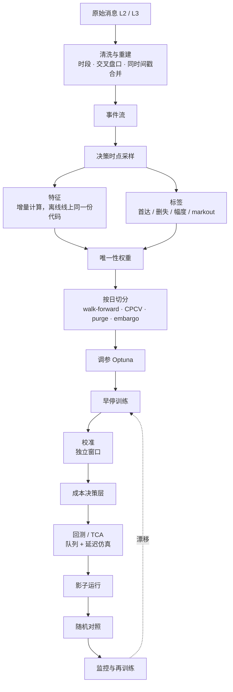

# 机器学习路线：从逻辑回归到 GBDT 和生存模型

2026-10 调研整理。不用深度学习，怎么一步步改进信号，整条 pipeline 怎么搭，训练时看什么指标。总览见 [`modeling-guide.md`](modeling-guide.md)，变量见 [`features-and-targets.md`](features-and-targets.md)。

## 结论

| 主题 | 默认做法 |
|---|---|
| 标签 | 三分类首达：τ 内先涨 ≥ 1 tick / 先跌 ≥ 1 tick / 没动。本质是竞争风险问题。幅度单独建模 |
| 模型路线 | ① 新标签 + 新特征放进「样条 + 交互项 + 弹性网」的多项 logit，作为强基线 → ② LightGBM 多分类作为主力 → ③ 离散时间竞争风险 hazard，一个模型覆盖所有 τ → ④ 单独建被动单成交概率的生存模型 |
| 增益拆分 | 分开度量「标签和特征带来的增益」和「模型带来的增益」：旧 LR 旧标签 / 新 LR 新标签新特征 / GBDT 新标签新特征，三组对比 |
| 样本 | 按决策时点采样；按平均唯一性（average uniqueness）加权 |
| 切分 | 以整个交易日为块做 walk-forward；选模用 CPCV（N = 10，k = 2）+ purge + embargo |
| 早停和选模 | 早停用加权 `multi_logloss`；选模用相对基线的 log loss 技能分，ECE 作门槛，仿真成本打破平局。**不用准确率** |
| 校准 | 独立的校准窗口（测试期之前最近 1–2 天），temperature 或 Dirichlet；每天重新校准，每周重训 |
| 阈值 | 不用固定阈值。在概率单纯形上按期望成本最小选动作 |
| 上线 | 特征一致性校验 → 影子运行 2–4 周 → 小流量 → 按母单随机化对照，CUPED 降方差 |
| 延迟 | 控制树的总量；LightGBM 单行快速接口、lleaves、ONNX，或自己把树导出成扁平数组的 C++ |

## 1. 模型路线

### 1.1 先把标签做对

- **三分类首达标签**：决策时点 t 的中间价 m_t；在 (t, t+τ] 内先达到 `m_t + δ` 记 UP，先达到 `m_t − δ` 记 DOWN，都没达到记 NONE。δ 默认 1 tick，正好过滤掉「价差从 1 档变 2 档时中间价移动半个 tick」这种噪声。
- **竞争风险视角**：UP 和 DOWN 是两种互斥的首次事件，NONE 是在 τ 处的右删失。这决定了后面的生存模型路线。
- **τ 怎么选**：先用事件时间（未来 N 次 L1 变化），再加一个时钟版本（如 1 秒）做对照。NONE 占比在 20%–50% 比较合适；超过 80% 说明 τ 太短，低于 10% 说明 τ 太长。
- **幅度**：τ 内最大有利 / 不利偏移的序数分类 {1, 2, ≥3 tick}（离散 tick 下最稳）；或对 `m_{t+τ} − m_t` 做分位数回归；或直接回归 markout。
- **边界**：收盘截断的样本按删失处理，不能当作 NONE；停牌、熔断前后的样本剔除。

### 1.2 各模型族

| 模型 | 解决什么 | 适合 | 主要风险 | 推理延迟 |
|---|---|---|---|---|
| 二分类 LR（现状） | 下一笔的方向 | 最快、可解释 | 忽略「不动」和时间；固定阈值和成本脱节 | 几十 ns |
| **LR + 样条 + 交互项 + 弹性网** | 非线性（OBI 的饱和）和条件效应（OBI × 价差） | **新标签新特征的强基线**；漂移下稳；概率天然接近校准 | 交互项要手挑；节点太多会过拟合 | 0.1–1 µs |
| 多项 logit | 直接输出三类概率 | 三分类基线 | 参数量翻倍 | 同上 |
| 有序 logit | 假设 DOWN < NONE < UP 是同一个潜变量 | 方向信号强、类别对称时 | **比例优势假设经常不成立**：波动升高会同时推高 UP 和 DOWN | 同上 |
| **两阶段** `P(动) × P(涨 \| 动)` | 把「会不会动」（波动、强度驱动）和「往哪动」（OBI / OFI 驱动）分开 | 两部分特征不同；方向子模型可以加单调约束 | 乘积的校准要单独检查 | 两次 |
| **LightGBM / XGBoost / CatBoost 多分类** | 自动学非线性和交互 | **主力**；百万到亿级样本，CPU 够 | 过拟合噪声；延迟随树数线性增长 | 0.5–20 µs |
| GBDT 分位数 / CatBoost MultiQuantile | 幅度的分位数 | 幅度模型 | 分位数可能交叉 | 同 GBDT |
| NGBoost | 完整的参数化分布，支持右删失 | 研究幅度和持续时间的不确定性 | 慢，不放关键路径 | 慢 |
| **生存 / 首达模型**（AFT、Cox、离散时间 hazard、竞争风险） | 何时动、往哪动；被动单何时成交 | **一个模型覆盖所有 τ**；处理删失 | 实现更复杂；指标不同（C-index、IBS） | GBDT hazard 和 GBDT 相当 |

### 1.3 逻辑回归的强基线

- OBI、OFI / 深度、`microprice − mid` 这类有饱和或 S 形效应的特征用样条（`SplineTransformer(n_knots=5–8, degree=3)`）；其余特征先缩尾（1% / 99%）再滚动 z-score。
- 只加少量有先验依据的交互项：`OBI1 × spread_ticks`、`OFI_short × vol`、`OBI × (depth / avg_depth)`、`trade_imb × intensity`。
- 弹性网正则（`l1_ratio` 0.1–0.5），C 用 purged CV 选。
- 有序模型用 `statsmodels` 的 `OrderedModel`；先和多项模型比 log loss，检验比例优势假设。
- 理由：Gould 和 Bonart（2016）用逻辑回归 + 单一的队列不平衡，在大 tick 股票上已经拿到可观的增益。**「LR + 好特征」是很强的对照组，GBDT 必须明确跑赢它。**

### 1.4 LightGBM 起点超参

假设百万到千万行、30–80 个特征、三分类、延迟敏感。

| 参数 | 起点 | 搜索范围 | 说明 |
|---|---|---|---|
| `objective` / `num_class` | `multiclass` / 3 | — | 两阶段方案用 `binary` |
| `learning_rate` | 0.05 | [0.02, 0.1] log | |
| `num_boost_round` | 上限 2000 | — | 早停决定；**上线前按延迟预算封顶**，如 ≤ 400 轮 |
| `early_stopping_round` | 100 | 50–200 | `first_metric_only=True`，`metric=multi_logloss` |
| `num_leaves` | 31 | [15, 127] | |
| `max_depth` | 6 | {4–8} | 限制最坏推理路径 |
| `min_data_in_leaf` | 有效样本量的 0.1%–0.5%（通常 1000–5000） | [200, 20000] log | 默认 20 对 tick 数据太小 |
| `feature_fraction` | 0.7 | [0.4, 0.9] | |
| `bagging_fraction` / `bagging_freq` | 0.5 / 1 | [0.2, 0.8] | 重叠严重时接近平均唯一性，不低于 0.1 |
| `lambda_l2` | 10 | [0.01, 100] log | |
| `max_bin` | 63 | {31, 63, 127, 255} | 分箱越少越抗噪、推理越快 |
| `path_smooth` | 10 | [0, 50] | 叶子值平滑，抗噪 |
| `deterministic` / `force_row_wise` | True / True | — | 可复现 |
| 样本权重 | 平均唯一性 | — | 必须用 |

- XGBoost 对应：`tree_method=hist`、`multi:softprob`、`max_depth=6`、`eta=0.05`、`subsample=0.5`、`colsample_bytree=0.7`、`lambda=10`、`max_bin=64`。
- CatBoost 用对称树，单棵树推理只要 depth 次比较，单行延迟很友好；`MultiClass`、`depth=6`、`l2_leaf_reg=10`、`border_count=64`；幅度用 `MultiQuantile:alpha=0.1,0.5,0.9`。
- 自定义损失只推荐「按成本加权的交叉熵」（`sample_weight` 乘以 `|Δm|` 或当时的价差）。**不推荐 focal loss**，它会系统性破坏校准。

### 1.5 生存模型：最值得加的第二个模型

执行真正关心两件事：「我等的时候价格先往哪边走、多快走」（首达时间 + 竞争风险），和「我挂的单多久能成交，成交前价格会不会先跑」（成交时间 + 删失）。固定 τ 的分类只是生存曲线上的一个截面。

| 方法 | 工具 | 用法 |
|---|---|---|
| **离散时间竞争风险 hazard**（推荐） | 任意 GBDT 多分类 | 把 (0, τ_max] 切成 J 段（如 1、2、4、8、16、32 个 L1 事件），样本展开成「person-period」格式，目标是 {UP 发生, DOWN 发生, 继续}，时段编号当特征。累乘得到任意 τ 的累积发生函数（CIF）。**一个模型覆盖所有 τ** |
| AFT | XGBoost `survival:aft`（右删失时上界设 +inf） | 距下次中间价变化的时间；被动单成交时间 |
| Cox / 梯度提升生存 | scikit-survival（**GPL-3.0**） | 研究和对照 |
| 经典参数生存 | lifelines（MIT） | 快速做 Weibull / 对数正态基线 |
| 深度生存（参考） | Arroyo 等 2024；Maglaras 等 2022 | 借用问题设定，用 GBDT hazard 实现：用钉在最优价上的虚拟 1 股订单构造标签，未成交即删失 |

Lo、MacKinlay、Zhang（2002）发现限价单执行时间对限价敏感、对规模不敏感，而且**用首达时间构造的「假想成交」很难代替真实成交**。成交模型最终必须用自己的真实成交来校准。

## 2. Pipeline



### 2.1 清洗与对齐

| 问题 | 处理 |
|---|---|
| 交易时段 | 只留连续竞价；剔除开盘、收盘集合竞价，开盘后和收盘前各 N 分钟（默认 5，单独评估），午休边界，停复牌前后 |
| 交叉 / 锁定盘口 | `bid ≥ ask` 标记异常，剔除或沿用前一个有效状态，统计占比 |
| 异常报价 | 偏离中间价过多、数量 ≤ 0、不在 tick 网格上的剔除；tick 规则变更、除权除息做日历化处理 |
| 同一时间戳多条消息 | **合并成一次盘口更新**，中间态不做采样点，否则会制造虚假的可预测性 |
| 时间戳 | 区分交易所时间和本地接收时间。**特征只用决策时刻看得到的信息**（本地接收时间）；回测注入实测延迟 |
| 成交方向 | 有主动方标志直接用；没有就用盘口变化反推；最后才用 tick rule |
| L1 / L2 / L3 | L1 能做 OBI1、microprice；L2 能做多档 OBI 和多档 OFI；L3 能还原**队列位置**，成交模型强烈建议用 L3 |
| 重建校验 | 快照和增量回放逐日核对；缺包、序列号跳号的日子标记出来 |

### 2.2 采样

| 方案 | 评价 |
|---|---|
| 每次盘口更新或成交（事件时间） | 信息密度高；样本高度重叠，配唯一性加权。**默认** |
| 每次 L1 变化 | 去掉深档噪声；对比用 |
| 固定时钟（如 100 ms） | 跨标的可比；对照和监控用 |
| 成交量钟 / 笔数钟 | 收益分布更接近平稳；跨标的混训时值得试 |
| **决策时点** | 只在算法真正会查询信号的时刻采样，训练分布和线上一致。**最终方案** |

### 2.3 标签实现

- 每个样本记录 `t_i0`（决策时刻）和 `t_i1`（首次触达时刻，没触达则 t+τ）。这个区间是 purge 和唯一性计算的依据。
- 同时生成：类别（UP / DOWN / NONE / 删失）、触达用时、τ 末的 `Δm`、τ 内最大有利和不利偏移、多个 h 的 markout。

### 2.4 样本去重叠：唯一性权重

事件时间密集采样时，相邻样本的标签区间几乎完全重叠，样本并不独立。不处理的话，有效样本量被严重高估，叶子过小、早停偏晚、交叉验证偏乐观。

```
并发数      c_t = Σ_i 1{t ∈ [t_i0, t_i1]}
平均唯一性  ū_i = mean_{t ∈ [t_i0, t_i1]} (1 / c_t)
权重        w_i = ū_i，归一化使 Σ w_i = N
有效样本量  ≈ N × mean(ū)        # 密集采样时 mean(ū) 常常只有 0.02–0.1
```

替代：sequential bootstrap，或者每隔约 `1 / mean(ū)` 个事件取一个样本做快速实验。逻辑只有几十行，建议自己实现（López de Prado 2018 第 4 章）。

### 2.5 切分

| 方法 | 用途 | 默认 |
|---|---|---|
| Walk-forward | **最终评估，模拟上线节奏** | 训练 40–60 个交易日 → 早停 2 天 → 校准 1–2 天 → 测试 5 天；每次滚 5 天 |
| Purged K-fold | 调参、特征选择 | K = 5–10，以交易日为块；删掉标签区间和测试块重叠的训练样本 |
| Embargo | 序列相关 | 测试块之后 `max(τ_max, 最长特征窗口)` 不进训练；以日为块时跨日 embargo 可以是 0 |
| CPCV | 得到性能的**分布** | N = 10、k = 2：45 个切分，拼成 9 条样本外路径 |

- skfolio 的 `CombinatorialPurgedCV` **默认不做 purge 和 embargo**，要自己设。标签长度不固定时建议按 `t_i1` 自己做 purge。
- 过拟合检验：记录试过的所有配置，用 PBO（Bailey 等 2017）和 Deflated Sharpe（Bailey 和 López de Prado 2014）折扣「最好的那组」。

### 2.6 调参

- Optuna TPE + MedianPruner，50–200 个 trial；目标是 purged CV 上加权 `multi_logloss` 的均值 + 0.5 × 标准差。
- 硬约束：`best_iteration × num_class × 平均叶深` 超过延迟预算的 trial 直接剪掉。
- **不要用回测 PnL 或执行成本做调参目标**，噪声太大。经济指标只在最后几个候选之间做选择。
- 调好后固定超参，滚动重训时只让早停决定轮数。

### 2.7 校准

| 方法 | 适用 |
|---|---|
| Temperature scaling | 多分类默认（sklearn ≥ 1.8 原生支持） |
| Vector / Dirichlet 校准 | 各类偏差不对称时，比如 NONE 被系统性低估 |
| Platt（OvR） | 两阶段二分类 |
| Isotonic（OvR 后归一化） | 每类 ≥ 1 万个有效样本时 |
| Venn-Abers | 想给概率区间时 |

做法：已训练的模型包成 `FrozenEstimator`，在独立的校准窗口上拟合校准器。检查按类的可靠性图（等频 15 箱）、classwise-ECE，并**分状态检查**（价差 1 档 vs ≥ 2 档、开盘半小时、波动三分位）。某个分组 ECE 超标，就把分组变量作为校准器的输入，或分组校准。

### 2.8 阈值：从成本推，不用固定值

以买单为例：中间价 m，价差 s，吃单费用 f_t，挂单费用 f_m（返佣为负）；三类概率 p_u、p_d、p_0；Δ_u 是「先涨」后的期望上移幅度（幅度模型）；q 是 τ 内被动单的成交概率（成交模型）；c_wait 是落后于进度的单位惩罚。

```
C_take = s/2 + f_t

C_post ≈ p_u × (Δ_u + s/2 + f_t)                         # 先涨，没成交，只好追价吃单
       + p_d × (−s/2 + f_m)                              # 先跌，挂单大概率成交
       + p_0 × [ q × (−s/2 + f_m) + (1 − q) × (s/2 + f_t + c_wait) ]

C_take < C_post − margin  →  吃单；否则挂单
p_d 很高、且有更低价位可挂  →  撤单后挂深，或等待
```

- 在概率单纯形上，决策边界是一个超平面，位置随价差、费率、Δ_u、q 和进度变化。这正是固定阈值做不到的。
- 二分类的特例就是 Elkan（2001）的代价敏感阈值 `p* = C(FP) / (C(FP) + C(FN))`。
- 成本参数用自己的 TCA 数据按价差档位估计；`margin` 吸收模型误差，在回测里调。
- **不要用重采样或 class_weight「修正」类不平衡**，否则概率偏离真实分布。不平衡交给成本决策层。

### 2.9 回测与 TCA

- 仿真器必须有：**队列位置**（L3 回放，或 L2 上的概率队列模型）、**双向延迟**、自身订单对盘口的影响（至少不能免费吃掉对手价的全部数量）。hftbacktest 开箱支持前两项。
- 用历史真实子单的成交去校准仿真的成交模型。
- 母单级：IS、相对区间 VWAP、被动成交率、完成率和进度偏差、子单 markout。按价差档位、大 / 小 tick、时段、波动、参与率分组报告。

### 2.10 上线

1. **特征一致性**：线上实时算的特征和离线用同一份行情重算的结果逐条比对，不一致率必须为 0。
2. **影子运行 2–4 周**：记录信号和「假如采用的决策」，不执行；在线上数据上核对校准和 log loss。
3. **小流量**：1%–5% 的母单，设熔断（成本恶化超过 X bp 或 ECE 超阈值就自动回退）。
4. **随机对照**：按母单随机化，按标的、规模、紧急度分层；同一标的同时有多笔母单会互相影响，必要时按「标的 × 日」轮换。主指标 IS，CUPED 降方差。**事先做功效分析**，往往要数千笔母单（见 [`reinforcement-learning.md`](reinforcement-learning.md) 的样本量表）。

### 2.11 监控与再训练

| 监控项 | 方法 | 阈值和动作 |
|---|---|---|
| 特征漂移 | 每个特征相对训练分布的 PSI | < 0.1 稳定，0.1–0.25 预警，> 0.25 告警 |
| 预测分布 | 三类平均概率、熵 | 类先验变化时先**重新校准** |
| 校准和性能 | 按天 log loss、Brier、classwise-ECE（τ 很短，标签几分钟内就有） | 连续 3 天比基线差 2σ 以上告警 |
| 经济指标 | 每天的 markout、被动成交率、IS | 和对照组比 |
| 数据质量 | 交叉盘口比例、缺包、时间戳延迟 | 超标的日子不参与训练 |

节奏：**每天重新校准**，**每周滚动重训**（固定超参），**每季度重新调参和做特征审计**。新模型必须在最近一周样本外上，统计指标和仿真成本都不劣于当前模型，才允许替换，并保留一键回滚。

### 2.12 推理延迟

| 方案 | 评价 |
|---|---|
| LightGBM C API `SingleRowFast` | 最省事，延迟要自测 |
| lleaves（LLVM 编译 LightGBM） | 单行约 5 倍加速；多分类输出形状要自己确认 |
| ONNX Runtime | 可移植，单次调用有 µs 级固定开销 |
| 自己导出扁平数组 + C++ 遍历；或 CatBoost 对称树位运算寻址 | **延迟最低、最可控，推荐最终上线用** |
| TL2cgen | **2026-10-19 已归档**，新项目不要依赖 |
| m2cgen | 2022 年后没有提交 |
| Hummingbird | 面向批量和 GPU，不适合单行 |

压缩思路：限制轮数和深度；减小 `max_bin`；删掉低重要性特征（**特征计算往往比树遍历更贵**）；把 GBDT 蒸馏成样条 LR；特征一律做成 O(1) 增量更新（环形缓冲、EWMA）。

## 3. 训练时看什么指标

### 3.1 统计指标

| 指标 | 角色 |
|---|---|
| **加权 log loss**（严格 proper 的评分规则） | **早停 + 主要选模** |
| Log loss 技能分 `1 − LL_model / LL_ref` | 跨标的、跨时期比较的主报告指标 |
| Brier score | 辅助；可分解为可靠性、分辨率、不确定性 |
| ECE / classwise-ECE + 可靠性图 | **门槛**（例如 classwise-ECE < 0.01–0.02） |
| 每类 AUC（OvR） | 诊断；对「动 / 不动」和「涨 / 跌 \| 动」分别报 |
| Macro-F1、MCC、Cohen's κ | 只在成本决策层之后报告 |
| 每类 precision / recall | 关注 UP、DOWN 在高置信区间的 precision |
| 分组指标 | 按价差档位、tick 规模、时段、波动分组，防止平均数掩盖问题 |

类不平衡：**保持原始分布训练**，用 proper 评分早停，用成本决策层处理不平衡。确实要用 class_weight 的话，之后必须重新校准。

### 3.2 经济指标

| 指标 | 定义（买单 d = +1） | 用途 |
|---|---|---|
| Markout | `MO_h = d × (m_{t+h} − P_fill) / m × 1e4`，h ∈ {100 ms, 1 s, 5 s, 30 s} | 子单质量；被动成交的平均负 markout 就是逆向选择成本 |
| Implementation shortfall | `d × (VWAP_exec − m_arrival) / m_arrival` + 未完成部分的机会成本 | **主要业务指标** |
| 被动成交率 / 成交时间 | 被动成交量 ÷ 挂出量 | 检验成交模型 |
| 价差捕获 | 被动成交相对中间价的节省 | |
| 加权命中率 | `Σ sign(pred) × Δm / Σ |Δm|` | 比命中率更接近 PnL |
| **信号十分位图** | 按 `p_u − p_d` 分十组，看每组未来 Δm 的均值（以 tick 计） | **最直观的诊断**：应当单调，两端幅度要大于半个价差 |

### 3.3 为什么准确率会误导

1. **类别不平衡**：τ 短时 NONE 占多数，全猜 NONE 准确率就很高。
2. **可预测不等于可交易**：很多高准确率来自扣掉价差后不赚钱的状态，比如价差 2 档后的回补、队列快被吃穿时的跳动（Briola 等 2025）。
3. **忽略置信度和幅度**：执行用的是概率 × 成本，准确率只反映 0.5 阈值下的结果。
4. **准确率不是 proper 评分**，用它早停或选模会偏向过度自信、校准差的模型。

**选模流程**：早停用加权 log loss → CPCV 9 条路径上的 log loss 技能分（中位数和 10% 分位数都要大于 0）→ ECE 和延迟门槛 → 平局时比仿真成本 → 最终看线上对照的 IS。

## 4. 特征重要性与稳健性

| 方法 | 注意 | 建议 |
|---|---|---|
| MDI / LightGBM `gain` | 在训练集上算；偏向取值多的变量；不反映样本外价值 | 只粗筛 |
| Permutation importance | 必须在样本外 purged 折上做；特征高度相关时（多档 OBI、多窗口 OFI）单个置换会外推、低估整组 | **按特征组整体置换** |
| **分组消融（drop-column）** | 代价高但最可靠 | **最终特征决策用这个**：去掉后在 ≥ 70% 的 CPCV 路径上变差才保留 |
| SHAP（TreeSHAP） | 两种模式在特征相关时结果不同 | 看方向和形状是否符合微观结构直觉（OBI↑ ⇒ UP↑），发现交互 |
| 按日稳定性 | 相邻日重要性排名的 Spearman 相关 | 低于 0.5 或符号常翻转的特征要警惕 |
| 对抗验证 | 训练「训练期 vs 测试期」分类器 | AUC 高说明有漂移，找出漂移最严重的特征 |
| 跨标的一致性 | 大 tick vs 小 tick | 不一致时分组建模，或加 tick 规模交互 |

## 5. 落地排期

| 阶段 | 内容 | 退出标准 |
|---|---|---|
| P0（2–3 周） | 清洗和重建校验；决策时点采样；三分类和删失标签；唯一性权重；按日 walk-forward + purged CV 框架 | 数据质量报告；旧 LR 在新框架下的指标 |
| P1（2–3 周） | 新特征 + 样条 / 交互 LR；校准层；成本决策层 | 相对旧 LR，log loss 技能分 > 0，仿真成本改善 |
| P2（3–4 周） | LightGBM 多分类，Optuna + CPCV；分组 ECE；SHAP 和分组消融；低延迟实现 | CPCV 下分位数仍好于 P1；p99 延迟达标 |
| P3（3–4 周） | 竞争风险 hazard（多个 τ）；被动单成交生存模型（L3 队列）；幅度模型 | 成交模型在真实成交上校准合格 |
| P4（4–8 周） | 一致性校验 → 影子运行 → 小流量 → 随机对照；监控看板；每天校准、每周重训 | 对照中 IS 的改善统计显著 |

开源工具见 [`repos.md`](repos.md)。

## 参考文献

- Cont, Kukanov, Stoikov (2014). The price impact of order book events. *J. Financial Econometrics* 12(1):47–88.
- Xu, Gould, Howison (2019). Multi-level order-flow imbalance in a limit order book. https://arxiv.org/abs/1907.06230
- Cont, Cucuringu, Zhang (2023). Cross-impact of order flow imbalance in equity markets. *Quantitative Finance* 23(10):1373–1393.
- Gould, Bonart (2016). Queue imbalance as a one-tick-ahead price predictor in a limit order book. https://arxiv.org/abs/1512.03492
- Stoikov (2018). The micro-price. *Quantitative Finance* 18(12):1959–1966.
- Cartea, Donnelly, Jaimungal (2018). Enhancing trading strategies with order book signals. *Applied Mathematical Finance* 25(1):1–35.
- Arroyo, Cartea, Moreno-Pino, Zohren (2024). Deep attentive survival analysis in limit order books: estimating fill probabilities with convolutional-transformers. *Quantitative Finance* 24(1):35–57.
- Maglaras, Moallemi, Wang (2022). A deep learning approach to estimating fill probabilities in a limit order book. *Quantitative Finance* 22(11):1989–2003.
- Lo, MacKinlay, Zhang (2002). Econometric models of limit-order executions. *J. Financial Economics* 65:31–71.
- Sirignano, Cont (2019). Universal features of price formation in financial markets. https://arxiv.org/abs/1803.06917
- Lucchese, Pakkanen, Veraart (2024). The short-term predictability of returns in order book markets. *International Journal of Forecasting* 40(4):1587–1621.
- Briola, Bartolucci, Aste (2025). Deep limit order book forecasting: a microstructural guide. *Quantitative Finance* 25(7):1101–1131.
- Easley, López de Prado, O'Hara (2012). The volume clock. *J. Portfolio Management*.
- López de Prado (2018). *Advances in Financial Machine Learning*. Wiley.（第 4 章样本权重，第 7 章 purged K-fold，第 12 章 CPCV）
- Bailey, Borwein, López de Prado, Zhu (2017). The probability of backtest overfitting. *J. Computational Finance* 20(4).
- Bailey, López de Prado (2014). The deflated Sharpe ratio. *J. Portfolio Management* 40(5):94–107.
- Ke 等 (2017). LightGBM. *NeurIPS*.
- Prokhorenkova 等 (2018). CatBoost. *NeurIPS*.
- Duan 等 (2020). NGBoost. *ICML*.
- Barnwal, Cho, Hocking (2022). Survival regression with accelerated failure time model in XGBoost. *JCGS* 31(4):1292–1302.
- Fine, Gray (1999). A proportional hazards model for the subdistribution of a competing risk. *JASA* 94(446):496–509.
- Niculescu-Mizil, Caruana (2005). Predicting good probabilities with supervised learning. *ICML*.
- Guo 等 (2017). On calibration of modern neural networks. *ICML*.
- Kull 等 (2019). Beyond temperature scaling: Dirichlet calibration. *NeurIPS*.
- Gneiting, Raftery (2007). Strictly proper scoring rules. *JASA* 102(477):359–378.
- Elkan (2001). The foundations of cost-sensitive learning. *IJCAI*.
- Strobl 等 (2007). Bias in random forest variable importance measures. *BMC Bioinformatics* 8:25.
- Hooker, Mentch, Zhou (2021). Unrestricted permutation forces extrapolation. *Statistics and Computing* 31:82.
- Lundberg 等 (2020). From local explanations to global understanding with explainable AI for trees. *Nature Machine Intelligence* 2:56–67.

未核实：LightGBM `monotone_constraints` 能否用于 multiclass；lleaves 多分类的输出形状；Sirignano 和 Cont 的期刊信息。
