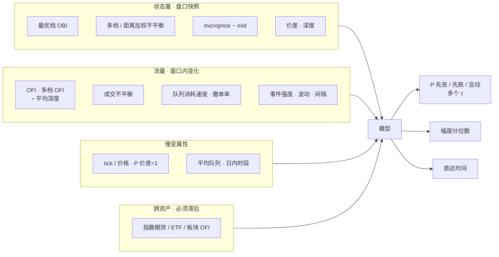
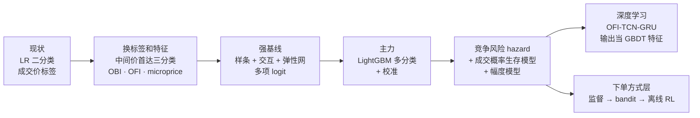
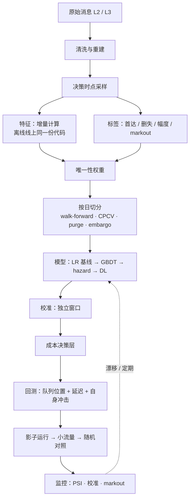

# 建模总览：输入、输出、改进路线

2026-10 调研整理。tick 级订单簿短期信号的通用建模思路：用什么变量、预测什么、机器学习和深度学习分别怎么改、pipeline 怎么搭、训练看什么指标。这一页是入口，每一节的细节在对应的文档里。

| 文档 | 内容 |
|---|---|
| [`features-and-targets.md`](features-and-targets.md) | 输入变量全表（公式、直觉、经济含义）、经济学概念、预测目标对比 |
| [`ml-pipeline.md`](ml-pipeline.md) | 机器学习路线：逻辑回归 → GBDT → 生存模型；完整 pipeline；指标；超参起点 |
| [`deep-learning.md`](deep-learning.md) | 深度学习路线：模型谱系、基准的问题、网络设计、训练指标 |
| [`reinforcement-learning.md`](reinforcement-learning.md) | 强化学习放在哪一层、MDP、算法、模拟器、评估 |
| [`repos.md`](repos.md) | GitHub 开源仓库清单（许可证、维护状态） |
| [`execution-signal-plan.md`](execution-signal-plan.md) | 执行层：信号决定什么、进度带规则、评估、分步计划 |

## 1. 问题是什么

- **场景**：执行。母单方向给定，当天做完，有进度上下限。信号不决定买卖，只决定**这一刻怎么下单**（吃单、挂单、撤单）和**在进度带里快还是慢**。
- **起点假设**：基线是逐 tick 的逻辑回归，二分类「下一笔成交时价格涨还是跌」，固定阈值。
- **这种基线的三个问题**：没有幅度；没有时间尺度；大量 tick 价格不变。而且这个标签被 bid-ask bounce 污染，学到的多半是「下一笔是主动买还是主动卖」，不是价格变化。

记号：δ 是最小价位变动（tick），s 是价差，mid 是中间价，τ 是预测的时间长度。

## 2. 截面还是时序？

**结论：本质是时间序列（更准确地说是单只股票的事件序列）预测，但估计时应该把多只股票合成一个面板一起训练。**

### 为什么是时间序列

- 预测对象是「**某一只股票**从现在开始的短期价格路径」，信息主要来自**这只股票自己**最近的盘口状态和订单流。
- 执行决策是逐只、逐时刻做的，不需要在同一时刻对多只股票排序。
- 它不是资产定价意义上的截面问题。截面问题是「同一时刻，哪些股票接下来相对更强」，比如截面因子、多空选股；这里母单方向已经定了，用不上。

### 为什么逐点分类也要按时序处理

逐 tick 的逻辑回归把每个 tick 当成一个样本，特征从过去窗口算出来（OBI、OFI 等），然后逐点分类。这仍然是时序模型（相当于带滞后特征的 ARX 类模型），不是截面模型：**数据是时间序列，模型是「逐点表格模型」**，序列信息只通过手工构造的滞后特征进入，模型本身没有记忆，训练时又默认样本独立。这带来两个后果：

1. 相邻样本的标签区间高度重叠，样本并不独立 → 要做唯一性加权、purge 和 embargo，按日前向切分（见 [`ml-pipeline.md`](ml-pipeline.md) 第 2.4–2.5 节）。
2. 随机打乱切分会把未来泄漏进训练集，结果严重高估。

GBDT 也是同一类「逐点表格模型」。深度学习（GRU、TCN）才是直接读序列。

### 三种建模结构

| 结构 | 是什么 | 证据 | 风险 |
|---|---|---|---|
| **逐只时间序列** | 每只股票单独一个模型，只用自身特征 | 价格冲击回归通常逐只、滚动估计（Cont 等 2023）；Kolm 等（2023）对 115 只股票分别训练，OFI 输入好于原始盘口 | 样本少的股票过拟合；参数不稳；新股、冷门股没法覆盖 |
| **合并面板（pooled）** | 所有股票的样本合起来训练一个模型；特征无量纲化，加股票属性 | 通用模型**一致好于**逐只模型，数据少的股票优势最大，还能泛化到没见过的股票（Sirignano 和 Cont 2019）；可预测性普遍存在（Lucchese 等 2024） | 不标准化、不控制 tick 类别，会把不同机制混在一起；评估仍要逐只报告 |
| **跨资产信息** | 把其他资产的滞后 OFI 或收益加进来 | **同期**跨资产项没有增量；**滞后**跨资产 OFI 能改善约 1 分钟的预测，衰减很快（Cont、Cucuringu、Zhang 2023；Chinco 等 2019） | 维度高，要稀疏化；领先关系不稳；时间戳误差会制造假的领先关系 |

### 推荐结构

1. **主模型**：合并面板，所有股票共享一个模型。输入是无量纲的自身特征 + 股票属性（tick 相对价格、价差 = 1 档的时间占比、平均队列 / 平均成交）+ 必要的交互（如 QI × 大 tick）。
2. **按 tick 类别分组或加交互**：大 tick 和小 tick 的机制不同。
3. **跨资产**：只加少数稳定的领先变量（指数期货、ETF、板块的滞后 OFI），严格滞后，在 ≤ 1 分钟上验证。不做全 N × N。
4. **逐只微调（可选）**：数据充足的股票，只在合并模型上做轻量调整（截距、温度缩放），不完全独立训练。介于两者之间的做法是分层收缩：个股只在数据足够时才偏离全局，数据少的股票自动向同类靠拢（经验贝叶斯 / 混合效应模型可以做对照）。
5. **验证**：按日前向滚动；purge 和 embargo；留一批「新股票」测泛化；**在新框架（首达标签、log loss 技能分、经济指标）下逐只比较**合并模型和逐只模型，逐 tick 类别、逐时段报告。
6. **维护**：特征、标签、训练窗口写成配置，一套流水线跑全部股票；按股票拆开看误差，监控哪些股票长期偏离。

## 3. 输入：变量一览

| 变量 | 定义（简写） | 经济含义 | 优先级 |
|---|---|---|---|
| **OBI（队列不平衡）** | `(qb_1 − qa_1) / (qb_1 + qa_1)` | 薄的一侧先被打穿；大 tick 股票的价格变化由队列耗尽驱动 | 高 |
| 多档不平衡 | 各档加权，或按距中间价的 tick 距离分桶 | 深档压力；小 tick 股票更重要 | 中高 |
| **OFI（订单流不平衡）** | 最优档买量增加 / 卖量减少记正，窗口内求和，除以平均深度 | 净供需变化；短窗口内和价格变化近似线性，斜率 ∝ 1 / 深度（Kyle λ 的微观对应） | 高 |
| 多档 OFI | 每档分别算，或主成分合成 integrated OFI | 深档订单流；同期解释力大幅提高，预测增量有限 | 中 |
| **microprice** | 给定不平衡和价差时，中间价最终去向的条件期望 | 可以直接和吃单成本比较 | 高 |
| 价差（tick） | `(ask_1 − bid_1) / δ` | 逆向选择补偿（Glosten-Milgrom）；**条件变量** | 高 |
| 成交不平衡 | `Σ sign_i × v_i`，以及「意外」部分 | Kyle 模型里净订单流携带信息；但成交符号有长记忆，真正有信息的是意外部分 | 中 |
| 队列消耗速度 | 预计耗尽时间 `qb_1 / (消耗 − 新增)` | 哪侧跑得快比哪侧现在短更有信息 | 高（大 tick） |
| 撤单率 | 撤单量 / 平均队列 | 提供者撤退，预示价格朝那一侧走 | 中 |
| 事件强度 | 各类事件的指数衰减计数（Hawkes 的廉价近似） | 活跃度、自激 | 中 |
| 波动 | 中间价算的已实现波动、中间价变动次数 | 能走多远；幅度模型的核心输入 | 高 |
| tick / 价格 | `δ / mid`、价差 = 1 档的时间占比 | 大 tick / 小 tick 机制完全不同；**第一位的分组变量** | 高 |
| 跨资产滞后 OFI | 指数期货、ETF、板块 OFI，滞后 | 共同因子、价格发现领先 | 中 |

完整公式、经济学概念（Kyle、Glosten-Milgrom、平方根冲击律、订单流长记忆、队列位置价值、Roll、tick 约束）和跨股票标准化方法见 [`features-and-targets.md`](features-and-targets.md)。

## 4. 输出：预测什么

| 输出 | 定义 | 用在哪 |
|---|---|---|
| **方向 + 时间**（主输出） | τ 内中间价先涨 ≥ 1 tick / 先跌 ≥ 1 tick / 没动；多个 τ | 吃单还是挂单 |
| 首达时间 | 竞争风险：`CIF_up(τ)`、`CIF_down(τ)`，一个模型覆盖一组格点上的 τ | 执行算法按自己的节奏查询 |
| 幅度 | 以「动了」和方向为条件，动几档（1 / 2 / ≥ 3）；**涨跌分开**。分位数只用于小 tick 股票 | 等待的预期成本 |
| 被动单成交概率 | 挂在某档，τ 内成交的概率，**按「先涨 / 先跌 / 没动」分别给出**（生存模型，L3 队列位置） | 挂单的预期收益 |
| markout | 成交后 1 s / 5 s / 30 s 的价格走势 | **评估指标**，不当训练标签 |

**τ 的统一口径**：主定义用**物理时间，等于执行层实际的决策间隔**（如 1 / 5 / 30 秒），因为执行算法按物理时间查询信号。跨股票可比性交给「平均中间价变动间隔」这个股票属性。事件时间的 τ 只作对照；「下 1、2、5 次中间价变动」只用于「下一次变动方向」这类目标。**NONE 的占比是诊断量，不是选 τ 的依据**，为了平衡类别去调 τ 正是 FI-2010 平滑标签的毛病。

不要用：成交价做标签（bid-ask bounce）；FI-2010 式平滑标签（阈值没有经济含义、对 horizon 敏感、不可交易）。

信号最终要以**带时间尺度的期望漂移和不确定性**交给执行层，再由成本推出动作（成本公式见 [`ml-pipeline.md`](ml-pipeline.md) 2.8 节，进度带规则见 [`execution-signal-plan.md`](execution-signal-plan.md) 第 2 节）。

## 5. 改进路线：机器学习、深度学习、强化学习

| | 机器学习（GBDT） | 深度学习 | 强化学习 |
|---|---|---|---|
| 解决什么 | 预测：方向、时间、幅度、成交概率 | 同左，直接读序列 | **决策**：下单方式（不做预测） |
| 输入 | 手工特征（多尺度 OFI、OBI、microprice…） | 逐档 OFI 序列 + 事件元数据 + 静态特征 | 盘口特征 + **监督信号的概率** + 队列位置 + 切片剩余量 / 时间 |
| 算力 | CPU 足够 | 训练最好有 GPU；CPU 推理 | CPU 足够；瓶颈是模拟器 |
| 部署 | 单行推理 0.5–20 µs | 3.5–5 万参数，流式增量推理，延迟需在目标 CPU 上实测 | 小 MLP 或蒸馏成决策树 |
| 可解释 | 高（SHAP、单调约束） | 低 | 低，需蒸馏 |
| 先后 | **先做** | GBDT 做扎实之后 | 监督信号上线之后 |
| 文献中的收益 | 特征和标签带来的增益通常远大于模型 | 真实数据上模型之间只差 1–5 个 F1 点 | 通常几个 bp，多来自不含自身冲击的回放 |

### 5.1 机器学习怎么改（详见 [`ml-pipeline.md`](ml-pipeline.md)）

1. **先换标签，再换特征，最后换模型**，四组对比：旧特征旧标签 → 旧特征新标签 → 新特征新标签（样条 LR）→ 新特征新标签（GBDT）。后两步分别度量特征和模型带来的增益；log loss 只在同一个标签内比较。
2. **强基线**：样条 + 少量有依据的交互项（`OBI × 价差`、`OFI × 波动`）+ 弹性网的多项 logit。GBDT 必须明确跑赢它。
3. **主力**：LightGBM 多分类，按唯一性加权（不加类权重，不按 |Δm| 加权），早停盯加权 log loss；在独立窗口上做温度缩放校准。
4. **两阶段可选**：`P(动) × P(涨 | 动)`，「会不会动」由波动和强度驱动，「往哪动」由 OBI / OFI 驱动。
5. **第二个模型**：离散时间竞争风险 hazard（一个模型覆盖所有 τ）+ 被动单成交生存模型。
6. **决策层**：在概率单纯形上按期望成本最小选动作，不用固定阈值。

### 5.2 深度学习怎么改（详见 [`deep-learning.md`](deep-learning.md)）

1. **输入表示比结构重要**：逐档 OFI、相对中间价的价格（以 tick 计）、量网格，好于原始 10 档价量。
2. **第一版网络**：`Linear(→32) → 3 × 残差因果 TCN(dilation 1/2/4) → GRU(64) → 拼接静态特征 → 每个 horizon 几个头（首达、方向、涨 / 跌幅度）`，3.5–5 万参数。为什么这样搭：
   - **TCN** 抓最近几十个事件里的局部模式（队列快速变薄、连续的同向订单流），因果卷积保证不看未来；
   - **GRU** 承接更长的依赖，而且隐状态可以逐事件更新，CPU 上每来一个事件只算一步；
   - **静态特征**（时段、波动、股票属性、跨资产滞后 OFI）变化慢，不进序列，在输出头之前拼接；
   - **多任务头**共享主干，首达头给主决策，幅度头以「动了」为条件、涨跌分开。
3. **损失**：交叉熵（样本按唯一性加权）+ 幅度交叉熵（或小 tick 用 pinball），按量级平衡权重；**不用 focal，也不用逆频率类权重**，两者都破坏校准。
4. **基线**：BiN-CTABL（1.1 万参数、最稳）和 DeepLOB。
5. **落地方式**：先把网络输出当 GBDT 的特征，检验增量；CPU 上流式增量推理。
6. **只在可预测的子集上启用**（大 tick、信息丰富的股票）。

### 5.3 强化学习放在哪（详见 [`reinforcement-learning.md`](reinforcement-learning.md)）

只做排程切片内的「下单方式」：一个切片一个 episode，结束时剩余量按规则清扫；进度带由动作屏蔽和排程层保证。顺序：监督「预测再优化」→ contextual bandit → 离线 RL → 模拟器里的在线 RL（研究）。**要尽早在现行规则里加受控随机化并记录倾向得分**，否则离线评估做不了。

## 6. 改进的整条 pipeline

要点（每一步的做法见 [`ml-pipeline.md`](ml-pipeline.md) 第 2 节）：

- **同一时间戳的多条消息合并**成一次盘口更新，中间态不做采样点。
- **特征只用决策时刻看得到的信息**（本地接收时间），回测注入实测延迟。
- **样本按决策时点采样**，和线上调用分布一致。
- **重叠标签必须处理**：唯一性权重 + purge + embargo；有效样本量常常只有名义的 2%–10%。
- **校准是独立的一层**：每天重新校准，每周重训，每季度重新调参。
- **仿真必须有队列位置和延迟**，并用自己的真实成交校准。

## 7. 训练时看什么指标

| 用途 | 指标 | 说明 |
|---|---|---|
| **早停** | 加权 log loss（多分类交叉熵，样本按唯一性加权，不加类权重） | 严格 proper 的评分规则，同时奖励区分度和校准 |
| **选模** | log loss 技能分 `1 − LL_model / LL_ref`，看 CPCV 路径上的分布。`LL_ref` 默认是训练期的类频率（无条件先验），另报一个相对强基线 LR 的技能分 | 中位数和 10% 分位数都要 > 0；只在同一个标签内比较 |
| **门槛** | classwise-ECE、可靠性图；分状态检查（价差 1 档 vs ≥ 2 档、开盘、波动三分位） | 执行直接用概率，校准很重要 |
| 诊断 | 每类 AUC、MCC、macro-F1、按日 IC | 只在决策层之后看 F1 |
| **最直观的诊断** | 信号十分位图：按 `P(涨) − P(跌)` 分十组，看每组未来 Δmid | 应当单调，两端幅度要大于半个价差 |
| 深度学习训练过程 | 分任务、分 horizon 的训练 / 验证 loss（验证 loss 1–3 个 epoch 后就回升说明在记日内模式）；梯度范数；预测是否塌缩到 Flat；至少 3 个种子的方差 | 见 [`deep-learning.md`](deep-learning.md) 第 4 节 |
| 稳定性 | 按日指标序列、相邻日特征重要性的排名相关 | 防止平均数掩盖问题 |
| **经济（最终门槛）** | **主检验**：子单级 markout、价差捕获、清扫成本（相对决策时刻中间价）；**护栏**：母单 IS、进度带越界、完成率 | 对照组是「同一套逻辑、不用信号」，不是 TWAP |

不看准确率：类别不平衡时全猜「没动」就很高，而且它不是 proper 评分（详见 [`ml-pipeline.md`](ml-pipeline.md) 3.3 节）。

**默认节奏和口径**（其他文档引用这一套）：

| 项 | 默认 |
|---|---|
| 校准方法 | 温度缩放（多分类）；各类偏差不对称时用 Dirichlet；在独立窗口上拟合，不复用早停集 |
| 校准频率 | 每天 |
| 重训 | 每周滚动（固定超参）；每季度重新调参和特征审计 |
| markout 时长 | 1 s / 5 s / 30 s（需要时加 100 ms、60 s） |
| 切分 | 按交易日 walk-forward；选模用 CPCV（N = 10，k = 2）；purge ≥ τ，embargo ≥ 最长多日特征窗口 |

## 8. 先做什么

| 顺序 | 做什么 | 判断标准 |
|---|---|---|
| 1 | 数据层：清洗、重建、决策时点采样、首达标签、唯一性权重、按日切分框架 | 旧基线在新框架下的经济指标和十分位图 |
| 2 | 换标签和特征，先用强基线 LR | 同一标签下 log loss 技能分 > 0；信号十分位图单调 |
| 3 | LightGBM + 校准 + 成本决策层 | CPCV 下稳定好于 LR；p99 延迟达标 |
| 4 | 竞争风险 hazard、成交生存模型、幅度模型 | 成交模型在真实成交上校准合格 |
| 5 | 影子运行 → 小流量 → 随机对照 | 子单级指标显著改善，母单 IS 不显著变差 |
| 6（可选） | 深度学习：OFI-TCN-GRU，输出当 GBDT 特征 | GBDT + 网络输出 显著好于 GBDT |
| 7（可选） | 下单方式层：bandit → 离线 RL | 显著好于「同一信号 + 成本决策层」 |

## 9. 落地前要确认的事

1. 数据粒度：几档盘口；有没有 L3 逐笔委托；时间戳精度；有没有主动方标志。
2. 算法多久做一次决定，这决定 τ 和采样点。
3. 延迟预算（从收到行情到发出订单）。
4. 有没有自己的子单和成交记录，能不能算 markout。
5. 覆盖哪些股票，大 tick 和小 tick 各占多少。
6. 能不能在现行规则里加少量受控的随机化（为以后的离线评估留数据）。

## 10. 术语

| 术语 | 意思 |
|---|---|
| OBI / OFI | 盘口不平衡（某一时刻两侧挂单量之差）/ 订单流不平衡（一段时间内两侧挂单量的净变化） |
| microprice | 给定盘口状态时，中间价最终会去哪的条件期望 |
| 首达 / 竞争风险 | 先触到上障碍还是下障碍、什么时候触到；两个事件互斥，没触到的算删失 |
| CIF | 累积发生函数：到时刻 τ 为止某一类事件（如先涨）已经发生的概率 |
| hazard | 还没发生的前提下，下一小段时间内发生的概率 |
| proper 评分 | 只有报出真实概率才能拿到最好分数的评分规则，如 log loss、Brier；准确率不是 |
| ECE | 期望校准误差：预测概率和实际频率的平均差距 |
| purge / embargo | 切分时删掉标签区间和测试集重叠的训练样本 / 在测试集之后再空出一段不进训练 |
| CPCV | 组合式清洗交叉验证：把数据分 N 组、每次拿 k 组做测试，得到多条样本外路径 |
| 唯一性权重 | 按标签区间重叠的程度给样本降权，重叠越多权重越小 |
| markout | 成交后一段时间的价格走势，衡量这笔成交「买贵了」还是「买便宜了」 |
| 逆向选择 | 挂单被成交往往是因为价格要往不利方向走；成交后价格继续不利的那部分损失 |
| IS | Implementation shortfall，相对到达价的执行差 |
| TCA | 交易成本分析 |
| PSI | 群体稳定性指数，衡量特征分布相对训练期的漂移 |
| CUPED | 用试验前的协变量做回归调整，降低对照试验的方差 |
| OPE | 离线策略评估：用历史日志估计一个新策略的效果，需要日志里有随机化 |
