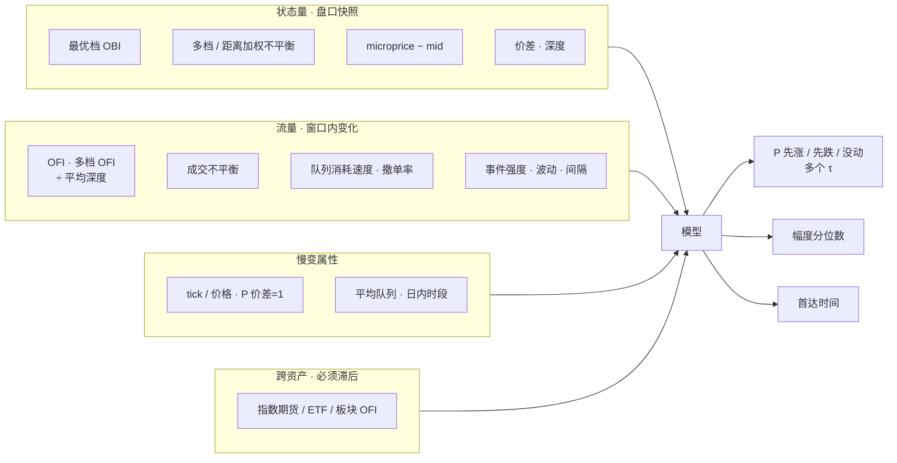
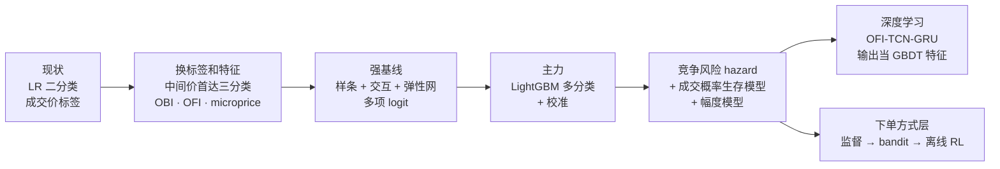
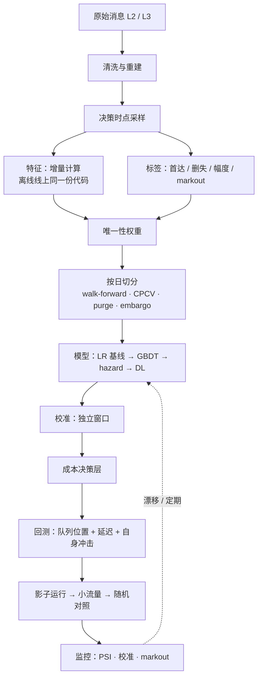

# 建模总览：输入、输出、改进路线

2026-10 调研整理。tick 级订单簿短期信号的通用建模思路：用什么变量、预测什么、机器学习和深度学习分别怎么改、pipeline 怎么搭、训练看什么指标。这一页是入口，每一节的细节在对应的文档里。

| 文档 | 内容 |
|---|---|
| [`features-and-targets.md`](features-and-targets.md) | 输入变量全表（公式、直觉、经济含义）、经济学概念、预测目标对比 |
| [`ml-pipeline.md`](ml-pipeline.md) | 机器学习路线：逻辑回归 → GBDT → 生存模型；完整 pipeline；指标；超参起点 |
| [`deep-learning.md`](deep-learning.md) | 深度学习路线：模型谱系、基准的问题、网络设计、训练指标 |
| [`reinforcement-learning.md`](reinforcement-learning.md) | 强化学习放在哪一层、MDP、算法、模拟器、评估 |
| [`repos.md`](repos.md) | GitHub 开源仓库清单（许可证、维护状态） |
| [`execution-signal-plan.md`](execution-signal-plan.md) | 信号在执行里怎么用：阈值、进度带、分步计划 |
| [`pooled-model.md`](pooled-model.md) | 从逐只建模改成通用模型 |

## 1. 问题是什么

- **场景**：执行。母单方向给定，当天做完，有进度上下限。信号不决定买卖，只决定**这一刻怎么下单**（吃单、挂单、撤单）和**在进度带里快还是慢**。
- **现状**：逻辑回归，二分类「下一笔成交时价格涨还是跌」，固定阈值。
- **现状的三个问题**：没有幅度；没有时间尺度；大量 tick 价格不变。而且这个标签被 bid-ask bounce 污染，学到的多半是「下一笔是主动买还是主动卖」，不是价格变化。

## 2. 截面还是时序？

**结论：本质是时间序列（更准确地说是单只股票的事件序列）预测，但估计时应该把多只股票合成一个面板一起训练。**

### 为什么是时间序列

- 预测对象是「**某一只股票**从现在开始的短期价格路径」，信息主要来自**这只股票自己**最近的盘口状态和订单流。
- 执行决策是逐只、逐时刻做的，不需要在同一时刻对多只股票排序。
- 它不是资产定价意义上的截面问题。截面问题是「同一时刻，哪些股票接下来相对更强」，比如截面因子、多空选股；这里母单方向已经定了，用不上。

### 为什么现在的逻辑回归「看起来」像截面

现在的做法把每个 tick 当成一个独立样本，特征是从过去窗口算出来的（OBI、OFI 等），然后用逻辑回归逐点分类。**数据是时间序列，模型是「逐点表格模型」**：序列信息只通过手工构造的滞后特征进入，模型本身没有记忆，也假设样本独立。这带来两个后果：

1. 相邻样本的标签区间高度重叠，样本并不独立 → 要做唯一性加权、purge 和 embargo，按日前向切分（见 [`ml-pipeline.md`](ml-pipeline.md) 第 2.4–2.5 节）。
2. 随机打乱切分会把未来泄漏进训练集，结果严重高估。

GBDT 也是同一类「逐点表格模型」。深度学习（GRU、TCN）才是直接读序列。

### 三种建模结构

| 结构 | 是什么 | 证据 | 风险 |
|---|---|---|---|
| **逐只时间序列** | 每只股票单独一个模型，只用自身特征 | 价格冲击回归通常逐只、滚动估计（Cont 等 2023）；Kolm 等（2023）对 115 只股票分别训练，OFI 输入好于原始盘口 | 样本少的股票过拟合；参数不稳；新股、冷门股没法覆盖 |
| **合并面板（pooled）** | 所有股票的样本合起来训练一个模型；特征无量纲化，加股票属性 | 通用模型**一致好于**逐只模型，数据少的股票优势最大，还能泛化到没见过的股票（Sirignano 和 Cont 2019）；可预测性普遍存在（Lucchese 等 2024） | 不标准化、不控制 tick 类别，会把不同机制混在一起；评估仍要逐只报告 |
| **跨资产信息** | 把其他资产的滞后 OFI 或收益加进来 | **同期**跨资产项没有增量；**滞后**跨资产 OFI 能改善约 1 分钟的预测，衰减很快（Cont、Cucuringu、Zhang 2023；Chinco 等 2019） | 维度高，要稀疏化；领先关系不稳；时间戳误差会制造假的领先关系 |

### 推荐结构

1. **主模型**：合并面板，所有股票共享一个模型。输入是无量纲的自身特征 + 股票属性（tick 相对价格、价差 = 1 档的时间占比、平均队列 / 平均成交）+ 必要的交互（如 QI × 大 tick）。
2. **按 tick 类别分组或加交互**：大 tick 和小 tick 的机制不同。
3. **跨资产**：只加少数稳定的领先变量（指数期货、ETF、板块的滞后 OFI），严格滞后，在 ≤ 1 分钟上验证。不做全 N × N。
4. **逐只微调（可选）**：数据充足的股票，只在合并模型上做轻量校准（Platt / isotonic、截距），不完全独立训练。
5. **验证**：按日前向滚动；purge 和 embargo；留一批「新股票」测泛化；逐只、逐 tick 类别、逐时段报告。

## 3. 输入：变量一览

| 变量 | 定义（简写） | 经济含义 | 优先级 |
|---|---|---|---|
| **OBI（队列不平衡）** | `(qb_1 − qa_1) / (qb_1 + qa_1)` | 薄的一侧先被打穿；大 tick 股票的价格变化由队列耗尽驱动 | 高 |
| 多档不平衡 | 各档加权，或按距中间价的 tick 距离分桶 | 深档压力；小 tick 股票更重要 | 中高 |
| **OFI（订单流不平衡）** | 最优档买量增加 / 卖量减少记正，窗口内求和，除以平均深度 | 净供需变化；短窗口内和价格变化近似线性，斜率 ∝ 1 / 深度（Kyle λ 的微观对应） | 高 |
| 多档 OFI | 每档分别算，或主成分合成 integrated OFI | 深档订单流；同期解释力大幅提高，预测增量有限 | 中 |
| **microprice** | 给定不平衡和价差时，中间价最终去向的条件期望 | 可以直接和吃单成本比较 | 高 |
| 价差（tick） | `(ask_1 − bid_1) / δ` | 逆向选择补偿（Glosten-Milgrom）；**条件变量** | 高 |
| 成交不平衡 | `Σ sign_i × v_i`，以及「意外」部分 | Kyle 模型里净订单流携带信息；但成交符号有长记忆，真正有信息的是意外部分 | 中 |
| 队列消耗速度 | 预计耗尽时间 `qb_1 / (消耗 − 新增)` | 哪侧跑得快比哪侧现在短更有信息 | 高（大 tick） |
| 撤单率 | 撤单量 / 平均队列 | 提供者撤退，预示价格朝那一侧走 | 中 |
| 事件强度 | 各类事件的指数衰减计数（Hawkes 的廉价近似） | 活跃度、自激 | 中 |
| 波动 | 中间价算的已实现波动、中间价变动次数 | 能走多远；幅度模型的核心输入 | 高 |
| tick / 价格 | `δ / mid`、价差 = 1 档的时间占比 | 大 tick / 小 tick 机制完全不同；**第一位的分组变量** | 高 |
| 跨资产滞后 OFI | 指数期货、ETF、板块 OFI，滞后 | 共同因子、价格发现领先 | 中 |

完整公式、经济学概念（Kyle、Glosten-Milgrom、平方根冲击律、订单流长记忆、队列位置价值、Roll、tick 约束）和跨股票标准化方法见 [`features-and-targets.md`](features-and-targets.md)。

## 4. 输出：预测什么

| 输出 | 定义 | 用在哪 |
|---|---|---|
| **方向 + 时间**（主输出） | τ 内中间价先涨 ≥ 1 tick / 先跌 ≥ 1 tick / 没动；多个 τ | 吃单还是挂单 |
| 首达时间 | 竞争风险：`CIF_up(τ)`、`CIF_down(τ)`，一个模型覆盖所有 τ | 执行算法按自己的节奏查询 |
| 幅度 | 动了以后动几档（1 / 2 / ≥ 3），或分位数；**涨跌分开** | 等待的预期成本 |
| 被动单成交概率 | 挂在某档，τ 内成交的概率（生存模型，L3 队列位置） | 挂单的预期收益 |
| markout | 成交后 1 s / 5 s / 30 s 的价格走势 | **评估指标**，不当训练标签 |

不要用：成交价做标签（bid-ask bounce）；FI-2010 式平滑标签（阈值没有经济含义、对 horizon 敏感、不可交易）。

信号最终要以**带时间尺度的期望漂移和不确定性**交给执行层，再由成本推出动作（见 [`execution-signal-plan.md`](execution-signal-plan.md) 第 4 节和 [`ml-pipeline.md`](ml-pipeline.md) 第 2.8 节）。

## 5. 改进路线：机器学习、深度学习、强化学习

| | 机器学习（GBDT） | 深度学习 | 强化学习 |
|---|---|---|---|
| 解决什么 | 预测：方向、时间、幅度、成交概率 | 同左，直接读序列 | **决策**：下单方式（不做预测） |
| 输入 | 手工特征（多尺度 OFI、OBI、microprice…） | 逐档 OFI 序列 + 事件元数据 + 静态特征 | 盘口特征 + **监督信号的概率** + 队列位置 + 切片剩余量 / 时间 |
| 算力 | CPU 足够 | 训练最好有 GPU；CPU 推理 | CPU 足够；瓶颈是模拟器 |
| 延迟 | 0.5–20 µs | 50 k 参数，流式增量推理 | 小 MLP 或蒸馏成决策树 |
| 可解释 | 高（SHAP、单调约束） | 低 | 低，需蒸馏 |
| 先后 | **先做** | GBDT 做扎实之后 | 监督信号上线之后 |
| 文献中的收益 | 特征和标签带来的增益通常远大于模型 | 真实数据上模型之间只差 1–5 个 F1 点 | 通常几个 bp，多来自不含自身冲击的回放 |

### 5.1 机器学习怎么改（详见 [`ml-pipeline.md`](ml-pipeline.md)）

1. **先换标签和特征，模型不变**。分开度量「标签 / 特征带来的增益」和「模型带来的增益」。
2. **强基线**：样条 + 少量有依据的交互项（`OBI × 价差`、`OFI × 波动`）+ 弹性网的多项 logit。GBDT 必须明确跑赢它。
3. **主力**：LightGBM 多分类，按唯一性加权，早停盯加权 log loss；温度缩放校准。
4. **两阶段可选**：`P(动) × P(涨 | 动)`，「会不会动」由波动和强度驱动，「往哪动」由 OBI / OFI 驱动。
5. **第二个模型**：离散时间竞争风险 hazard（一个模型覆盖所有 τ）+ 被动单成交生存模型。
6. **决策层**：在概率单纯形上按期望成本最小选动作，不用固定阈值。

### 5.2 深度学习怎么改（详见 [`deep-learning.md`](deep-learning.md)）

1. **输入表示比结构重要**：逐档 OFI、相对中间价的价格（以 tick 计）、量网格，好于原始 10 档价量。
2. **第一版网络**：`Linear(→32) → 3 × 残差因果 TCN(dilation 1/2/4) → GRU(64) → 拼接静态特征 → 多 horizon 三个头（方向、分位数幅度、首达）`，3.5–5 万参数。
3. **损失**：加权交叉熵 + pinball + 首达交叉熵，按量级平衡权重；不用 focal（破坏校准）。
4. **基线**：BiN-CTABL（1.1 万参数、最稳）和 DeepLOB。
5. **落地方式**：先把网络输出当 GBDT 的特征，检验增量；CPU 上流式增量推理。
6. **只在可预测的子集上启用**（大 tick、信息丰富的股票）。

### 5.3 强化学习放在哪（详见 [`reinforcement-learning.md`](reinforcement-learning.md)）

只做排程切片内的「下单方式」：一个切片一个 episode，结束时剩余量按规则清扫；进度带由动作屏蔽和排程层保证。顺序：监督「预测再优化」→ contextual bandit → 离线 RL → 模拟器里的在线 RL（研究）。**要尽早在现行规则里加受控随机化并记录倾向得分**，否则离线评估做不了。

## 6. 改进的整条 pipeline

要点（每一步的做法见 [`ml-pipeline.md`](ml-pipeline.md) 第 2 节）：

- **同一时间戳的多条消息合并**成一次盘口更新，中间态不做采样点。
- **特征只用决策时刻看得到的信息**（本地接收时间），回测注入实测延迟。
- **样本按决策时点采样**，和线上调用分布一致。
- **重叠标签必须处理**：唯一性权重 + purge + embargo；有效样本量常常只有名义的 2%–10%。
- **校准是独立的一层**：每天重新校准，每周重训，每季度重新调参。
- **仿真必须有队列位置和延迟**，并用自己的真实成交校准。

## 7. 训练时看什么指标

| 用途 | 指标 | 说明 |
|---|---|---|
| **早停** | 加权 log loss（多分类交叉熵） | 严格 proper 的评分规则，同时奖励区分度和校准 |
| **选模** | log loss 技能分 `1 − LL_model / LL_基线`，看 CPCV 路径上的分布 | 中位数和 10% 分位数都要 > 0 |
| **门槛** | classwise-ECE、可靠性图；分状态检查（价差 1 档 vs ≥ 2 档、开盘、波动三分位） | 执行直接用概率，校准很重要 |
| 诊断 | 每类 AUC、MCC、macro-F1、按日 IC | 只在决策层之后看 F1 |
| **最直观的诊断** | 信号十分位图：按 `P(涨) − P(跌)` 分十组，看每组未来 Δmid | 应当单调，两端幅度要大于半个价差 |
| 稳定性 | 按日指标序列、相邻日特征重要性的排名相关、种子间方差 | 防止平均数掩盖问题 |
| **经济（最终门槛）** | 被动成交的 markout、价差捕获、清扫成本、IS、进度带越界 | 对照组是「同一套逻辑、不用信号」，不是 TWAP |

**为什么不能看准确率**：类别不平衡（全猜「没动」就很高）；可预测不等于可交易（很多高准确率来自扣掉价差后不赚钱的状态）；准确率忽略置信度和幅度；它不是 proper 评分，用它选模会偏向过度自信的模型。

## 8. 先做什么

| 顺序 | 做什么 | 判断标准 |
|---|---|---|
| 1 | 数据层：清洗、重建、决策时点采样、首达标签、唯一性权重、按日切分框架 | 旧 LR 在新框架下的指标 |
| 2 | 换标签和特征，先用强基线 LR | log loss 技能分 > 0；信号十分位图单调 |
| 3 | LightGBM + 校准 + 成本决策层 | CPCV 下稳定好于 LR；p99 延迟达标 |
| 4 | 竞争风险 hazard、成交生存模型、幅度模型 | 成交模型在真实成交上校准合格 |
| 5 | 影子运行 → 小流量 → 随机对照 | 执行成本统计上显著改善 |
| 6（可选） | 深度学习：OFI-TCN-GRU，输出当 GBDT 特征 | GBDT + 网络输出 显著好于 GBDT |
| 7（可选） | 下单方式层：bandit → 离线 RL | 显著好于「同样用信号的规则版」 |

## 9. 落地前要确认的事

1. 数据粒度：几档盘口；有没有 L3 逐笔委托；时间戳精度；有没有主动方标志。
2. 算法多久做一次决定，这决定 τ 和采样点。
3. 延迟预算（从收到行情到发出订单）。
4. 有没有自己的子单和成交记录，能不能算 markout。
5. 覆盖哪些股票，大 tick 和小 tick 各占多少。
6. 能不能在现行规则里加少量受控的随机化（为以后的离线评估留数据）。
