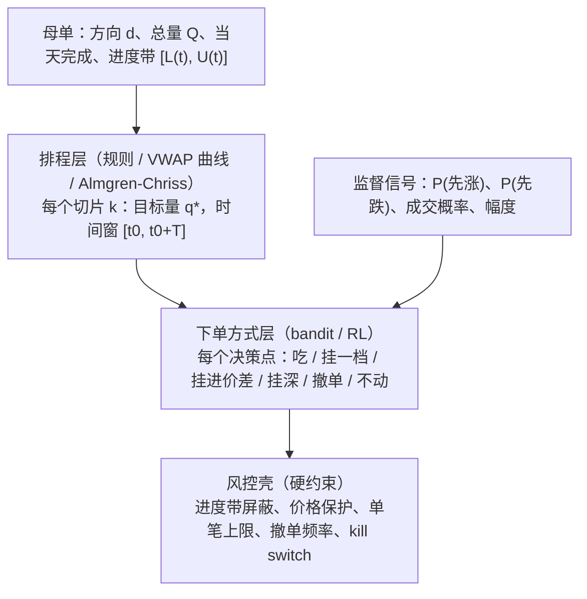

# 强化学习：怎么建模、选哪一种

2026-10 整理。强化学习（RL）在执行里放在哪一层，状态、动作、奖励、价值函数怎么写；RL 有哪几类，各自的核心公式；按我们的约束逐项比较以后，哪一种最可靠，以及它的完整算法。监督信号本身见 [`modeling-guide.md`](modeling-guide.md)。

运行环境假设：12 代 Intel i9（例如 12900K：8 个性能核 + 8 个能效核，24 线程），没有 GPU。**全部算法的模块化实现在 [`src/execrl/`](../../src/execrl/__init__.py)，结构和训练函数见第 13 节。**

## 结论

1. **RL 不做预测，只做排程切片内「怎么下单」这一层的决策。** 监督模型给出的概率当作状态的一部分。全天排程和进度带由确定性逻辑负责，RL 出错的最坏后果被限制在一个切片的清扫成本以内。
2. **奖励直接从执行成本推出来**：相对决策时刻中间价的切片成本（含清扫），可以拆成「价差项」和「时机项」，见第 2.4 节。进度带是**动作屏蔽**，不进奖励。
3. **最可靠的方案是「宏动作 contextual bandit + 双重稳健（DR）离线学习和评估」**（第 6 节）。它是 RL 里最简单的一类：没有时序信用分配，只学「这个状态下每个动作的期望收益」，样本效率高、能离线评估、能解释。
4. 当撤单重挂、排队位置这类**多步效应**确实重要时，再上**带行为约束的拟合 Q 迭代（FQI + LightGBM）**或离散 IQL（第 7 节）。PPO、DQN 只在校准过的模拟器里做研究对照，产出的策略要蒸馏成浅决策树。
5. **前提是日志里有受控随机化**，并记录每个动作被选中的概率。没有这一步，第 3、4 条都做不了。
6. 在 i9 CPU 上，bandit 和 FQI 是分钟级，小网络的离线 RL 和模拟器里的 PPO 是小时级。瓶颈是模拟器的速度，不是算力。
7. **代码按「配置 / 数据 / 动作与奖励 / 算法 / 训练入口」分层**（第 13 节）：每种方法一个 `train_*` 函数，步骤固定为「数据 → 按母单切分 → 拟合 → 离线评估 + 模拟器真值 → 保存」，新增方法照抄一个即可。在玩具模拟器上，bandit 的 DR 估计落在真值的一个标准误以内；约束 FQI 和 IQL 都优于日志策略（第 13.6 节）。

## 1. 分层



这种分层就是一个两级的分层强化学习（hierarchical RL / options）：上层排程不学，下层只在一个短时间窗内学。好处是动作空间小、反馈快、样本多（样本数 = 母单数 × 切片数 × 决策点数）。文献里在模拟器训练的 RL 在部分场景下会收敛到接近 TWAP 的轨迹（Karpe 等 2020），说明排程层面 RL 的增量可能有限。

## 2. 把切片写成 MDP

### 2.1 时间和记号

一个切片内的决策时刻 $t_0 < t_1 < \dots < t_N = t_0 + T$（每 $\Delta$ 秒一次，或由盘口事件触发）。母单方向 $d \in \{+1, -1\}$（买为 $+1$），切片目标量 $q^*$，决策时刻的中间价 $m_n = m(t_n)$，切片起点中间价 $m_0$。第 $n$ 步结束时切片的剩余量为 $q^{\text{rem}}_n$，母单整体的执行进度为 $p(t) = \text{已成交量} / Q$。

### 2.2 状态

$$
s_n = \big(\underbrace{\tfrac{q^{\text{rem}}_n}{q^*},\ \tfrac{t_N - t_n}{T}}_{\text{切片私有变量}},\ \underbrace{\tfrac{p(t_n) - L(t_n)}{U(t_n) - L(t_n)}}_{\text{进度在带中的位置}},\ \underbrace{x^{\text{mkt}}_n}_{\text{盘口特征}},\ \underbrace{\hat\pi^{\uparrow}_n, \hat\pi^{\downarrow}_n, \hat q_n}_{\text{监督信号}},\ \underbrace{x^{\text{own}}_n}_{\text{自己的挂单}}\big)
$$

- $x^{\text{mkt}}_n$：价差（以 tick 计）、最优档 OBI、$\text{microprice} - \text{mid}$、标准化 OFI、短窗波动、时段。
- $\hat\pi^{\uparrow}_n, \hat\pi^{\downarrow}_n$：监督模型给出的「τ 内先涨 / 先跌」概率；$\hat q_n$：挂单成交概率。**RL 不重新学预测，只使用它们。**
- $x^{\text{own}}_n$：有没有挂单、挂在哪档、队列位置估计 $\frac{\text{前方量}}{\text{该档总量}}$、已挂时长。
- 原则：10–30 个低维、按股票尺度归一化的特征，不直接喂原始盘口张量。剩余时间放进状态，策略就可以是平稳的。

### 2.3 动作和屏蔽

离散动作集合：

$$
\mathcal{A} = \{\texttt{TAKE},\ \texttt{JOIN},\ \texttt{IMPROVE},\ \texttt{POST\_DEEP},\ \texttt{CANCEL},\ \texttt{HOLD}\}
$$

| 动作 | 含义 |
|---|---|
| `TAKE` | 吃对手一档，数量 $\min(q^{\text{rem}}, \alpha \cdot \text{对手一档量})$ |
| `JOIN` | 挂在己方一档队尾 |
| `IMPROVE` | 价差大于 1 档时挂进价差内 |
| `POST_DEEP` | 挂二档或更深 |
| `CANCEL` | 撤掉现有挂单 |
| `HOLD` | 什么都不做（保留现有挂单） |

**进度带用动作屏蔽实现，不进奖励。** 设 $\epsilon_{\text{band}}$ 是缓冲带，$S_n$ 是价差（以 tick 计），允许的动作集合是：

$$
\mathcal{A}(s_n) =
\begin{cases}
\{\texttt{TAKE}, \texttt{IMPROVE}\} & p(t_n) < L(t_n) + \epsilon_{\text{band}} \quad \text{（快落后了，只能追）}\\
\mathcal{A} \setminus \{\texttt{TAKE}\} & p(t_n) > U(t_n) - \epsilon_{\text{band}} \quad \text{（超前了，不许吃）}\\
\mathcal{A} & \text{其他}
\end{cases}
\quad \cap \quad \{a : a \ne \texttt{IMPROVE} \text{ 若 } S_n = 1\}
$$

再加上撤单频率、价格保护等风控条件。屏蔽在策略输出时实现：对 $a \notin \mathcal{A}(s)$ 把分数设为 $-\infty$，见第 8.2 节的代码。

**为什么不用奖励里的惩罚项？** 软惩罚 $-c_{\text{pen}} \max(0, L - p)^2$ 只是让越界变「贵」，样本少时学不出可靠的「永不越界」；而且 $c_{\text{pen}}$ 很难调。屏蔽是硬保证。如果确实要放进优化，正确的形式是**约束 MDP**：

$$
\max_\pi\ \mathbb{E}_\pi\Big[\sum_n r_n\Big] \quad \text{s.t.} \quad \mathbb{E}_\pi\Big[\sum_n c^{\text{band}}_n\Big] \le \bar c
\qquad\Longrightarrow\qquad
\mathcal{L}(\pi, \nu) = \mathbb{E}_\pi\Big[\sum_n (r_n - \nu\, c^{\text{band}}_n)\Big] + \nu \bar c
$$

拉格朗日乘子 $\nu \ge 0$ 按 $\nu \leftarrow \max\big(0, \nu + \eta (\hat{\mathbb{E}}[\sum c^{\text{band}}] - \bar c)\big)$ 更新（$\eta$ 是步长）。我们的场景用屏蔽就够了。

### 2.4 奖励：从执行成本推出来

切片的执行成本（以基点计，越小越好），参考价用**切片起点的中间价** $m_0 = m(t_0)$：

$$
C = \frac{10^4}{q^*\, m_0}\Big[\ \underbrace{d \sum_{i \in \text{fills}} v_i\,(p_i - m_0)}_{\text{切片内成交}} \;+\; \underbrace{d\, q^{\text{rem}}_N\,(p^{\text{clean}} - m_0)}_{\text{窗口结束时按规则清扫}}\ \Big]
$$

$v_i, p_i$ 是第 $i$ 笔成交的量和价，$p^{\text{clean}}$ 是清扫剩余量的平均成交价。

**逐步奖励**取每一步内实现的成本，最后一步加上清扫：

$$
r_n = -\frac{10^4\, d}{q^*\, m_0} \sum_{i:\ t_i \in (t_n, t_{n+1}]} v_i\,(p_i - m_0),
\qquad
r_{N-1} \mathrel{+}= -\frac{10^4\, d}{q^*\, m_0}\, q^{\text{rem}}_N\,(p^{\text{clean}} - m_0)
$$

于是 $\sum_n r_n = -C$，最大化累计奖励就等于最小化切片成本。

**成本可以拆成两部分**，这说明了信号为什么有用：

$$
d\,(p_i - m_0) = \underbrace{d\,(p_i - m_{t_i})}_{\text{价差项：相对当时中间价付了多少}} + \underbrace{d\,(m_{t_i} - m_0)}_{\text{时机项：成交前价格漂了多少}}
$$

- 吃单时价差项约为 $+\tfrac{s}{2}$（付半个价差），挂单成交时约为 $-\tfrac{s}{2}$（赚半个价差）。
- 时机项由价格漂移决定，**这正是 OBI / OFI 信号能预测的部分**。所以信号必须进状态。

**为什么参考价用 $m_0$ 而不是母单到达价？** 到达价包含切片开始之前的全部漂移，切片内的动作控制不了，只会增加方差。

**清扫成本必须进奖励。** 否则策略会一直挂深档等便宜价，把未成交的风险推给排程层（reward hacking）。

**加密奖励：基于势函数的塑形。** 只在最后一步给清扫成本会让奖励很稀疏。用势函数 $\Phi$ 塑形不改变最优策略（Ng、Harada、Russell 1999），前提是**终止状态的势为 0**：

$$
\tilde r_n = r_n + \Phi(s_{n+1}) - \Phi(s_n),
\qquad
\Phi(s_n) = \begin{cases} -\dfrac{10^4}{q^*\,m_0}\, q^{\text{rem}}_n\Big(\dfrac{S_n\,\delta}{2} + f_t\Big) & n < N \\[2mm] 0 & n = N \end{cases}
$$

$\Phi(s_n)$ 就是「如果现在把剩余量全部吃掉」的预期成本取负（$S_n$ 为价差 tick 数，$\delta$ 为 tick，$f_t$ 为吃单费用）。每成交一部分，势函数就回升，奖励因此变密。加总后

$$
\sum_{n=0}^{N-1}\tilde r_n = \sum_n r_n + \Phi(s_N) - \Phi(s_0) = -C - \Phi(s_0)
$$

$\Phi(s_0)$ 只取决于初始状态，和策略无关，所以最优策略不变。**如果 $\Phi(s_N) \ne 0$**（比如还按剩余量计势），它会随策略变化，剩余量会在已经含清扫成本的 $r_{N-1}$ 之外再被罚一次，最优策略就变了。

**风险偏好（可选）。** 均值-方差或 CVaR 目标：

$$
J_{\lambda_{\text{mv}}}(\pi) = \mathbb{E}_\pi[-C] - \lambda_{\text{mv}}\,\mathrm{Var}_\pi(C),
\qquad
J_\alpha(\pi) = -\mathrm{CVaR}_\alpha(C) = -\mathbb{E}\big[C \mid C \ge \mathrm{VaR}_\alpha(C)\big]
$$

评估时可以把切片内的市场漂移 $d(m_N - m_0)$ 当控制变量降方差，**训练时不要**，否则会抹掉信号带来的择时收益。

### 2.5 价值函数和 Bellman 方程

有限时域、不打折（$\gamma = 1$）。策略 $\pi$ 的价值函数和动作价值函数：

$$
V^\pi_n(s) = \mathbb{E}_\pi\Big[\sum_{k=n}^{N-1} r_k \,\Big|\, s_n = s\Big],
\qquad
Q^\pi_n(s, a) = \mathbb{E}\big[r_n + V^\pi_{n+1}(s_{n+1}) \,\big|\, s_n = s, a_n = a\big]
$$

最优动作价值满足 Bellman 最优方程，终止条件就是清扫：

$$
Q^*_n(s, a) = \mathbb{E}\Big[r_n + \max_{a' \in \mathcal{A}(s_{n+1})} Q^*_{n+1}(s_{n+1}, a') \,\Big|\, s_n = s, a_n = a\Big],
\qquad
Q^*_N(s, \cdot) \equiv 0
$$

（清扫成本已经计入 $r_{N-1}$。）因为剩余时间 $\frac{t_N - t_n}{T}$ 在状态里，可以去掉下标 $n$，用一个函数 $Q^*(s, a)$ 表示。

**和监督模块的关系。** 对一步决策，$Q$ 有显式结构。以买单的 `TAKE` 和 `JOIN` 为例（括号里是以价格计的成本，乘以 $\frac{10^4}{m_0}$ 换成基点，再取负号就是奖励；$S_n\delta$ 是第 $n$ 步的价差）：

$$
Q(s_n, \texttt{TAKE}) \approx -\frac{10^4}{m_0}\Big(\frac{S_n\delta}{2} + f_t + \text{impact}\Big) + \text{continuation}
$$

$$
Q(s_n, \texttt{JOIN}) \approx -\frac{10^4}{m_0}\sum_{k \in \{\uparrow, \downarrow, 0\}} \hat\pi^{k}_n\Big[q_k\Big(-\frac{S_n\delta}{2} + f_m\Big) + (1 - q_k)\Big(\Delta_k + \frac{S_n\delta}{2} + f_t\Big)\Big] + \text{continuation}
$$

（$\Delta_k$ 是结局 $k$ 下没成交、追价时的价格变化：$\Delta_\uparrow > 0$，$\Delta_\downarrow < 0$，$\Delta_0 = 0$ 但要加上落后进度的代价。）

去掉 continuation 项，就是 [`ml-pipeline.md`](ml-pipeline.md) 2.8 节的成本决策层。**所以「监督模块 + 一步决策」是 $Q$ 的一步近似**，RL 补上的是 continuation：现在不成交、下一步还能做什么的价值（比如排队位置的期权价值）。

## 3. 强化学习有哪几类

| 类别 | 代表算法 | 核心公式 | 要在线探索 | 能纯离线 | 适合我们吗 |
|---|---|---|---|---|---|
| **Contextual bandit** | ε-greedy、LinUCB、Thompson、DR 离线策略学习 | $\pi(x) = \arg\max_a \hat\mu(x, a)$，只学一步的期望收益 | 少量（安全集内） | 有随机化日志时可以 | **最适合起步** |
| 值函数（无模型） | Q-learning、DQN、Double DQN | $\big(r + \gamma Q_{\bar\theta}(s', \arg\max_{a'} Q_\theta(s', a')) - Q_\theta(s, a)\big)^2$ | 是 | 否 | 只在模拟器里 |
| 策略梯度 | REINFORCE、A2C、PPO | $\nabla J = \mathbb{E}[\nabla \log \pi_\theta(a\mid s)\,\hat A]$；PPO 截断 $\min(\rho \hat A, \mathrm{clip}(\rho, 1\pm\epsilon_{\text{clip}})\hat A)$ | 是 | 否 | 只在模拟器里 |
| 连续动作 actor-critic | DDPG、TD3、SAC | SAC：$\max \mathbb{E}\big[\sum r + \alpha \mathcal{H}(\pi(\cdot\mid s))\big]$ | 是 | 否 | 不推荐（价格是离散 tick） |
| 基于模型 | Dyna、MPC、MuZero | 学 $\hat P(s'\mid s, a)$ 再规划 | 视情况 | 可以 | 难点就是模型本身（= 模拟器） |
| **离线 RL** | BCQ、CQL、IQL、TD3+BC、FQI | 在固定日志上学，限制策略不偏离日志覆盖的动作 | 否 | **是** | **第二步** |
| 模仿学习 | 行为克隆、DAgger、逆强化学习 | BC：$\min_\theta -\mathbb{E}_{(s,a)\sim\mathcal{D}} \log \pi_\theta(a\mid s)$ | 否 | 是 | 做离线 RL 的初始化和安全基线 |
| 风险敏感 / 分布式 | QR-DQN、CVaR-RL | 学回报的分位数 $\theta_\tau(s, a)$，优化 CVaR | 是 | 有离线版本 | 尾部成本重要时加 |
| 约束 RL | CPO、拉格朗日 PPO | 见 2.3 节的 $\mathcal{L}(\pi, \nu)$ | 是 | 有离线版本 | 我们用硬屏蔽代替 |
| 分层 RL | Options、feudal | 上层选子任务，下层执行 | — | — | 我们的「排程 + 下单方式」就是两层，上层不学 |
| 多智能体 | MADDPG、自博弈 | — | — | — | 不需要 |

## 4. 按我们的约束比较

我们的约束：**样本少**（每只股票一年约 250 个全天母单，切片级别多一些）、**不能在线自由探索**（探索有真实成本）、**要可解释、可验证**（模型风险管理和算法交易监管）、**模拟器有偏**（回放没有自身冲击和真实队列位置）、**只有 CPU**。

| 方法 | 样本效率 | 不需要在线探索 | 能离线评估 | 可解释 | 不依赖模拟器 | 训练稳定 | i9 CPU 成本 | 综合 |
|---|---|---|---|---|---|---|---|---|
| 监督 + 一步决策（非 RL 基线） | 5 | 5 | 4 | 5 | 5 | 5 | 分钟 | 基线 |
| **Contextual bandit + DR** | 5 | 4 | **5** | 5 | 5 | 5 | 分钟 | **首选** |
| 约束 FQI + GBDT | 4 | 5 | 4 | 4 | 4 | 4 | 分钟到小时 | **第二步** |
| 离散 IQL | 3 | 5 | 3 | 2 | 4 | 4 | 小时 | 备选 |
| 离散 CQL | 3 | 5 | 3 | 2 | 4 | 3 | 小时 | 备选 |
| DQN / DDQN（模拟器） | 2 | 1 | 2 | 1 | 1 | 2 | 小时 | 研究 |
| PPO（模拟器） | 1 | 1 | 2 | 1 | 1 | 3 | 小时 | 研究 |
| SAC / TD3 | 2 | 1 | 2 | 1 | 1 | 3 | 小时 | 不推荐 |

（5 分最好。分数是基于文献和上面约束的定性判断，不是实测。）

**为什么 bandit 最可靠：**

1. **没有时序信用分配**：只估计 $\mathbb{E}[r \mid x, a]$，是普通的回归问题，误差不会通过 Bellman 备份累积放大。
2. **能严格离线评估**：日志里记录了真实的倾向得分时，DR 估计量在一定条件下无偏（6.3 节），还有标准误，可以设置上线门槛。
3. **可解释**：奖励模型是 GBDT，策略可以压成深度 2–4 的策略树。
4. **出错有上界**：宏动作只持续几秒，结束就清扫或回到规则。

**它的代价**：一步决策忽略了「现在不成交、下一步还能做什么」的价值。宏动作（「挂在 X 档、持有 $\tau_h$ 秒、没成交就按规则处理」）把一段多步交互压成一步，可以部分弥补。只有当分析表明多步效应显著（例如撤单重挂、排队位置的价值很大）时，才进入第二步。

**为什么第二步选约束 FQI 而不是深度离线 RL：** 动作只有 6 个、特征 10–30 个，GBDT 拟合 $Q$ 就够了；有限时域下 $N$ 次迭代就是精确的逆向归纳；行为约束（只在日志里出现得足够多的动作上取 max）直接避免了离线 RL 最大的问题，也就是对没见过的动作的外推误差。IQL 是它的神经网络版本，作为备选。

## 5. 数据前提：日志里要有随机化

所有离线方法都需要知道「日志策略 $\pi_0$ 在每个状态下选每个动作的概率」。如果日志全是确定性规则产生的，规则没选过的动作就永远无法评估（覆盖度问题）。做法：

$$
\pi_0(a \mid x) =
\begin{cases}
1 - \varepsilon + \dfrac{\varepsilon}{\lvert \mathcal{A}_{\text{safe}}(x) \rvert} & a = \text{规则的动作} \\[2mm]
\dfrac{\varepsilon}{\lvert \mathcal{A}_{\text{safe}}(x) \rvert} & a \in \mathcal{A}_{\text{safe}}(x),\ a \ne \text{规则的动作}
\end{cases}
\qquad \varepsilon \in [0.02, 0.10]
$$

$\mathcal{A}_{\text{safe}}(x)$ 是 2–3 个在当前状态下都合理的动作。每次决策记录 $(x_i, a_i, \pi_0(a_i \mid x_i), r_i)$。**这是最需要尽早落地的工程措施。**

## 6. 推荐方案：宏动作 contextual bandit + DR

### 6.1 问题设定

- **上下文** $x$：第 2.2 节的状态。
- **宏动作** $a = (\text{类型}, \text{档位}, \tau_h)$，例如 {吃单, 挂一档持有 2 秒, 挂一档持有 5 秒, 挂进价差持有 2 秒}。到期没成交就撤单，交回规则。
- **奖励** $r$：这个宏动作覆盖的数量在持有期内的成本（相对决策时刻中间价，含到期后的处理成本），取负号、以基点计：

$$
r_i = -\frac{10^4\, d}{v^{\text{target}}_i\, m_{t_i}}\Big[\sum_{j \in \text{fills}_i} v_j (p_j - m_{t_i}) + v^{\text{left}}_i\,(p^{\text{after}}_i - m_{t_i})\Big]
$$

$v^{\text{target}}_i$ 是这个宏动作要处理的量，$v^{\text{left}}_i$ 是到期没成交、交回规则处理的部分，$p^{\text{after}}_i$ 是这部分后来的成交均价（或按吃单估计）。

### 6.2 奖励模型（直接法）

用 LightGBM 拟合 $\hat\mu(x, a) \approx \mathbb{E}[r \mid x, a]$，动作作为 one-hot 特征。策略是在允许的动作里取最大：

$$
\hat\pi(x) = \arg\max_{a \in \mathcal{A}(x)} \hat\mu(x, a)
$$

### 6.3 离线评估：IPW、SNIPW、DR

用一段**没参与训练**的日志评估新策略 $\pi$（确定性策略时 $\pi(a \mid x) = \mathbf{1}[a = \pi(x)]$）：

$$
\hat V_{\text{IPW}}(\pi) = \frac{1}{n}\sum_{i=1}^{n} \frac{\pi(a_i \mid x_i)}{\pi_0(a_i \mid x_i)}\, r_i,
\qquad
\hat V_{\text{SNIPW}}(\pi) = \frac{\sum_i w_i r_i}{\sum_i w_i},\quad w_i = \frac{\pi(a_i \mid x_i)}{\pi_0(a_i \mid x_i)}
$$

$$
\hat V_{\text{DR}}(\pi) = \frac{1}{n}\sum_{i=1}^{n}\Big[\underbrace{\sum_{a} \pi(a \mid x_i)\,\hat\mu(x_i, a)}_{\text{直接法}} + \underbrace{w_i\,\big(r_i - \hat\mu(x_i, a_i)\big)}_{\text{用实际奖励修正模型误差}}\Big]
$$

- IPW 无偏但方差大；直接法方差小但有模型偏差；**DR 只要倾向得分和奖励模型有一个正确就（渐近）无偏**（Dudík、Langford、Li 2011）。奖励模型较准时 DR 的方差比 IPW 小；但 $\hat\mu$ 很差时，DR 的方差可以超过 IPW。
- 严格无偏需要：(1) $\pi_0$ 是日志里真实记录的倾向；(2) 重叠：$\pi(a \mid x) > 0 \Rightarrow \pi_0(a \mid x) > 0$；(3) $\hat\mu$ 在和评估样本独立的数据上拟合（交叉拟合）；(4) 权重不截断。截断换来更小的方差，代价是一点偏差。
- 权重截断 $w_i \leftarrow \min(w_i, M)$（如 $M = 20$）用偏差换方差。
- 标准误：$\widehat{\mathrm{se}} = \mathrm{sd}(\Gamma_i)/\sqrt{n}$，其中 $\Gamma_i$ 是上式方括号里的每样本项。同一母单内的样本相关，标准误要按母单聚类计算。
- **上线门槛**：$\hat V_{\text{DR}}(\hat\pi) - \hat V_{\text{DR}}(\pi_0)$ 的 95% 置信下界大于 0。

### 6.4 让策略可解释：策略树

把每个样本对每个动作的 DR 分数

$$
\Gamma_i(a) = \hat\mu(x_i, a) + \frac{\mathbf{1}[a_i = a]}{\pi_0(a_i \mid x_i)}\big(r_i - \hat\mu(x_i, a_i)\big)
$$

当作「如果当时选 $a$ 能得到的奖励」的估计（满足 6.3 节的条件时无偏），在深度为 $D$ 的决策树类 $\Pi_D$ 里找最优策略（Athey 和 Wager 2021）：

$$
\hat\pi_{\text{tree}} = \arg\max_{\pi \in \Pi_D} \sum_{i=1}^{n} \Gamma_i\big(\pi(x_i)\big)
$$

深度 2–3 的树就能写成交易员看得懂的规则，例如「价差 = 1 档且 $\hat\pi^{\uparrow} > 0.45$ 时吃单」。

### 6.5 在线：安全集内的 Thompson 采样

上线后继续小比例探索、持续更新。每个动作一个贝叶斯线性回归 $r = \theta_a^\top x + \varepsilon$，$\varepsilon \sim \mathcal{N}(0, \sigma^2)$，先验 $\theta_a \sim \mathcal{N}(0, \lambda_0^{-1} I)$。后验：

$$
A_a = \lambda_0 I + \frac{1}{\sigma^2}\sum_{i: a_i = a} x_i x_i^\top,
\qquad
b_a = \frac{1}{\sigma^2}\sum_{i: a_i = a} r_i x_i,
\qquad
\theta_a \mid \mathcal{D} \sim \mathcal{N}\big(A_a^{-1} b_a,\ A_a^{-1}\big)
$$

每次决策从后验抽 $\tilde\theta_a$，选 $\arg\max_{a \in \mathcal{A}_{\text{safe}}(x)} \tilde\theta_a^\top x$。LinUCB 是它的确定性版本：$\arg\max_a \hat\theta_a^\top x + \alpha\sqrt{x^\top A_a^{-1} x}$。**选中的概率要记录下来**（Thompson 的倾向得分可以用蒙特卡洛估计），供下一轮离线评估用。

### 6.6 代码

奖励模型、贪心策略和三种离线评估（已在模拟数据上跑通：DR 估计在真值的 2 个标准误以内）：

```python
import numpy as np
import lightgbm as lgb


def fit_reward_model(X, a, r, n_actions, w=None):
    """Direct method: one LightGBM regressor on [x, one-hot(a)] -> r (reward = -cost in bp)."""
    A = np.eye(n_actions)[a]
    model = lgb.LGBMRegressor(n_estimators=300, learning_rate=0.05, num_leaves=31,
                              min_child_samples=200, subsample=0.8, subsample_freq=1,
                              colsample_bytree=0.8, verbose=-1)
    model.fit(np.hstack([X, A]), r, sample_weight=w)
    return model


def predict_all_actions(model, X, n_actions):
    """mu_hat[i, a] = E[r | x_i, a]."""
    n = len(X)
    return np.column_stack([
        model.predict(np.hstack([X, np.tile(np.eye(n_actions)[k], (n, 1))]))
        for k in range(n_actions)])


def greedy_policy(mu_hat, mask):
    """pi(x) = argmax over allowed actions; mask[i, a] = 1 if action a is allowed at x_i."""
    return np.where(mask, mu_hat, -np.inf).argmax(axis=1)


def off_policy_value(pi_a, a, r, p, mu_hat, clip=20.0):
    """IPW, self-normalised IPW and doubly robust estimates of a deterministic policy's value.
    pi_a: action chosen by the new policy; a, r, p: logged action, reward, propensity pi_0(a|x)."""
    match = (pi_a == a).astype(float)
    w = np.minimum(match / p, clip)
    ipw = np.mean(w * r)
    snipw = np.sum(w * r) / np.sum(w)
    dm = mu_hat[np.arange(len(a)), pi_a]
    dr_terms = dm + w * (r - mu_hat[np.arange(len(a)), a])
    dr = dr_terms.mean()
    se = dr_terms.std(ddof=1) / np.sqrt(len(a))   # cluster by parent order in practice
    return {"ipw": ipw, "snipw": snipw, "dr": dr, "dr_se": se}
```

完整实现（交叉拟合、按母单聚类的标准误、上线门槛、权重截断敏感性）：[`bandit/reward_model.py`](../../src/execrl/bandit/reward_model.py)、[`bandit/ope.py`](../../src/execrl/bandit/ope.py)；训练入口 [`train.train_bandit`](../../src/execrl/train.py)。

安全集内的线性 Thompson 采样（完整版带蒙特卡洛倾向得分：[`bandit/thompson.py`](../../src/execrl/bandit/thompson.py)）：

```python
import numpy as np


class LinearThompson:
    """Per-action Bayesian linear regression r = theta_a' x + noise, theta_a ~ N(0, lam^-1 I).
    Posterior: A_a = lam I + sum x x' / s2,  b_a = sum r x / s2,  theta_a | data ~ N(A_a^-1 b_a, A_a^-1)."""

    def __init__(self, n_actions, dim, lam=1.0, noise_var=1.0, seed=0):
        self.A = np.stack([lam * np.eye(dim) for _ in range(n_actions)])
        self.b = np.zeros((n_actions, dim))
        self.s2 = noise_var
        self.rng = np.random.default_rng(seed)

    def act(self, x, allowed):
        scores = np.full(len(self.b), -np.inf)
        for k in np.flatnonzero(allowed):
            cov = np.linalg.inv(self.A[k])
            theta = self.rng.multivariate_normal(cov @ self.b[k], cov)
            scores[k] = theta @ x
        return int(scores.argmax())

    def update(self, x, a, r):
        self.A[a] += np.outer(x, x) / self.s2
        self.b[a] += r * x / self.s2
```

### 6.7 参数怎么选

| 参数 | 建议 | 怎么判断 |
|---|---|---|
| 探索率 $\varepsilon$ | 0.02–0.10 | 越大离线评估越准、当期成本越高；用「探索的额外成本 ≈ $\varepsilon \times$ 安全集内动作的平均劣势」估算 |
| 宏动作持有时长 $\tau_h$ | 和监督信号的 τ 一致（如 1 / 2 / 5 秒） | 信号有效期约 2 次平均价格变动，持有太久信号就失效 |
| 权重截断 $M$ | 10–50 | 看 $\hat V_{\text{DR}}$ 随 $M$ 的变化，选变化开始平缓的位置 |
| 奖励模型 | LightGBM，`min_child_samples` 200+，只用不依赖结果的样本权重 | 在留出日上看 $\hat\mu$ 的 MSE 和校准 |
| 策略树深度 $D$ | 2–3 | 和 GBDT 贪心策略比 $\hat V_{\text{DR}}$，损失不超过 0.1 bp 就用树 |

## 7. 第二步：离线 RL

### 7.1 带行为约束的拟合 Q 迭代（推荐）

先估计行为策略 $\hat\pi_\beta(a \mid s)$（一个多分类器）。第 $j$ 次迭代：

$$
y_i^{(j)} = r_i + (1 - \text{done}_i)\max_{a' \in \mathcal{A}_\beta(s'_i)} Q^{(j)}(s'_i, a'),
\qquad
\mathcal{A}_\beta(s') = \Big\{a' \in \mathcal{A}(s') : \hat\pi_\beta(a' \mid s') \ge \tau \max_{b}\hat\pi_\beta(b \mid s')\Big\}
$$

$$
Q^{(j+1)} = \arg\min_{Q \in \mathcal{F}_{\text{GBDT}}} \sum_i \big(Q(s_i, a_i) - y_i^{(j)}\big)^2
$$

- $\mathcal{A}_\beta$ 只保留日志里出现得足够多的动作（BCQ 的思路，Fujimoto 等 2019），阈值 $\varsigma$ 取 0.05–0.3。
- **最终的策略也要限制在同一个支撑集上**：$\hat\pi(s) = \arg\max_{a \in \mathcal{A}(s) \cap \mathcal{A}_\beta(s)} Q(s, a)$。只在备份里限制而不在策略提取时限制，策略仍可能选日志里罕见的动作。
- 两处都限制以后：$\varsigma \to 0$ 退化为普通 FQI（会过度乐观），$\varsigma \to 1$ 退化为「总选日志里最常见的动作」（行为策略的众数）。
- 剩余时间在状态里时，迭代 $N$ 次（切片的决策步数）就是精确的逆向归纳。
- 可以加单调约束，例如 $Q(s, \texttt{TAKE})$ 对价差单调递减。

```python
import numpy as np
import lightgbm as lgb


def _xa(S, a, K):
    return np.hstack([S, np.eye(K)[a]])


def constrained_fqi(S, A, R, S2, done, mask2, n_steps, K, behaviour_prob2, tau=0.1, params=None):
    """Batch-constrained fitted Q iteration with LightGBM (finite horizon, gamma = 1).

    S, A, R, S2, done: transitions from the logs (done = 1 at the slice's last step; its R already
                       includes the clean-up cost).
    mask2[i, a]:       action a is allowed at S2[i] (progress-band mask).
    behaviour_prob2:   estimated pi_beta(a | S2[i]) for every a, shape (n, K).
    Only actions with pi_beta(a|s') >= tau * max_b pi_beta(b|s') enter the max (BCQ-style support
    constraint), so the backup never trusts actions the logs barely contain.
    (tau here is the support threshold called varsigma in the text.)
    n_steps:           horizon in decisions; with time-to-go in the state, n_steps iterations are exact
                       backward induction.
    """
    params = params or dict(n_estimators=200, learning_rate=0.05, num_leaves=31,
                            min_child_samples=200, verbose=-1)
    support = behaviour_prob2 >= tau * behaviour_prob2.max(axis=1, keepdims=True)
    allowed = mask2 & support
    q = None
    for _ in range(n_steps):
        if q is None:
            target = R.copy()
        else:
            q2 = np.column_stack([q.predict(_xa(S2, np.full(len(S2), k), K)) for k in range(K)])
            q2 = np.where(allowed, q2, -np.inf).max(axis=1)
            q2 = np.where(np.isfinite(q2), q2, 0.0)
            target = R + (1 - done) * q2
        q = lgb.LGBMRegressor(**params).fit(_xa(S, A, K), target)
    return q


def constrained_greedy(q, S, mask, behaviour_prob, K, tau=0.1):
    """Policy extraction restricted to the same support: argmax over allowed AND well-logged actions."""
    support = behaviour_prob >= tau * behaviour_prob.max(axis=1, keepdims=True)
    qs = np.column_stack([q.predict(_xa(S, np.full(len(S), k), K)) for k in range(K)])
    return np.where(mask & support, qs, -np.inf).argmax(axis=1)
```

（在一个 5 步的玩具切片上验证过：信号有利时学到挂单，信号不利时学到「先等、最后一步再吃」，和手算的最优解一致。）完整实现：[`offline/fqi.py`](../../src/execrl/offline/fqi.py)、行为策略模型 [`offline/behaviour.py`](../../src/execrl/offline/behaviour.py)、训练入口 [`train.train_fqi`](../../src/execrl/train.py)。

**支撑阈值 $\varsigma$ 必须低于日志的探索比例。** 日志策略以 $\varepsilon$ 在 $k$ 个允许动作里探索时，非规则动作和规则动作的概率比是 $\dfrac{\varepsilon/k}{1-\varepsilon+\varepsilon/k}$，$\varepsilon=0.1$、$k=5$ 时约 0.02。$\varsigma=0.1$ 会把所有探索过的动作都剪掉，FQI 只能复制规则：在玩具模拟器上实测，$\varsigma=0.1$ 时 FQI 和日志策略持平，$\varsigma=0.01$ 时明显更好（第 13.6 节）。代码默认 $\varsigma=0.01$。

### 7.2 IQL（神经网络备选）

IQL（Kostrikov、Nair、Levine）从不在备份里查询日志之外的动作。三个损失：

$$
\mathcal{L}_V(\psi) = \mathbb{E}_{(s,a)\sim\mathcal{D}}\Big[L_2^{\kappa_e}\big(Q_{\bar\theta}(s, a) - V_\psi(s)\big)\Big],
\qquad
L_2^{\kappa_e}(u) = \big\lvert \kappa_e - \mathbf{1}[u < 0] \big\rvert\, u^2
$$

$$
\mathcal{L}_Q(\theta) = \mathbb{E}_{(s,a,r,s')\sim\mathcal{D}}\Big[\big(r + (1 - \text{done})\,V_\psi(s') - Q_\theta(s, a)\big)^2\Big]
$$

$$
\mathcal{L}_\pi(\phi) = -\mathbb{E}_{(s,a)\sim\mathcal{D}}\Big[\exp\big(\beta\,(Q_{\bar\theta}(s, a) - V_\psi(s))\big)\log \pi_\phi(a \mid s)\Big]
$$

- 期望分位数 $\kappa_e \in (0.5, 1)$：$\kappa_e$ 越接近 1，$V$ 越接近日志里动作的最大 $Q$（越激进）。常用 0.7–0.9。
- $\beta$ 是优势加权的温度：$\beta \to 0$ 是行为克隆，越大越贪心。常用 3–10，权重截断到 100。
- 网络：2 层 MLP，256 单元，Adam，学习率 3e-4。$10^6$ 条转移在 i9 上训练约 1–3 小时。
- 完整实现：[`offline/iql.py`](../../src/execrl/offline/iql.py)（双 Q、目标网络 Polyak 平均、带动作屏蔽的策略），FQE 在 [`offline/fqe.py`](../../src/execrl/offline/fqe.py)。

### 7.3 CQL（另一个备选）

在 TD 损失上加一个保守项，压低日志之外动作的 $Q$ 值（Kumar 等 2020）：

$$
\mathcal{L}_{\text{CQL}}(\theta) = \alpha\,\mathbb{E}_{s\sim\mathcal{D}}\Big[\log\sum_{a}\exp Q_\theta(s, a) - \mathbb{E}_{a\sim\mathcal{D}(\cdot\mid s)} Q_\theta(s, a)\Big] + \frac{1}{2}\mathbb{E}\Big[\big(Q_\theta(s, a) - \mathcal{B}Q_{\bar\theta}(s, a)\big)^2\Big]
$$

$\alpha$ 对结果很敏感（太小过度乐观，太大退化为行为克隆），需要用离线评估来选；这是它排在 IQL 后面的原因。

### 7.4 离线 RL 怎么评估：拟合 Q 评估（FQE）

对一个固定策略 $\pi$，用和 FQI 一样的回归，但备份时用 $\pi$ 的动作而不是取 max：

$$
y_i^{(j)} = r_i + (1 - \text{done}_i)\, Q_\pi^{(j)}\big(s'_i, \pi(s'_i)\big),
\qquad
\hat V(\pi) = \frac{1}{\lvert \mathcal{D}_0 \rvert}\sum_{s_0 \in \mathcal{D}_0} Q_\pi\big(s_0, \pi(s_0)\big)
$$

$\mathcal{D}_0$ 是各切片的初始状态。FQE 和第 4 节的模拟器评估要一起看：两者都显示改善，才进入影子运行。

## 8. 模拟器里的在线 RL（研究用）

### 8.1 PPO

用于在校准过的模拟器里做研究对照，或者验证 bandit / 离线 RL 的结论。

$$
\rho_t(\theta) = \frac{\pi_\theta(a_t \mid s_t)}{\pi_{\theta_{\text{old}}}(a_t \mid s_t)},
\qquad
\mathcal{L}^{\text{CLIP}}(\theta) = -\mathbb{E}_t\Big[\min\big(\rho_t \hat A_t,\ \mathrm{clip}(\rho_t, 1-\epsilon_{\text{clip}}, 1+\epsilon_{\text{clip}})\,\hat A_t\big)\Big]
$$

优势用 GAE：

$$
\delta^{\text{TD}}_t = r_t + \gamma V(s_{t+1}) - V(s_t),
\qquad
\hat A_t = \sum_{l \ge 0} (\gamma\lambda_{\text{GAE}})^l\, \delta^{\text{TD}}_{t+l}
$$

总损失 $\mathcal{L} = \mathcal{L}^{\text{CLIP}} + c_v\,\mathbb{E}\big[(V_\theta(s_t) - \hat R_t)^2\big] - c_e\,\mathbb{E}\big[\mathcal{H}(\pi_\theta(\cdot \mid s_t))\big]$。

| 超参数 | 起点 |
|---|---|
| $\gamma$ / $\lambda_{\text{GAE}}$ | 1.0 / 0.95（有限时域） |
| $\epsilon_{\text{clip}}$ | 0.2 |
| 学习率 | 3e-4，线性衰减 |
| 每次更新的步数 / minibatch / epoch | 4096 / 256 / 10 |
| $c_v$ / $c_e$ | 0.5 / 0.01 |
| 网络 | 2 层 MLP，64–128 单元，tanh |
| 并行环境 | i9 上 8–16 个进程 |

### 8.2 动作屏蔽和 PPO 的辅助函数

屏蔽的数学形式是 $\pi(a \mid s) = \dfrac{\exp(z_a)\,\mathbf{1}[a \in \mathcal{A}(s)]}{\sum_{b \in \mathcal{A}(s)} \exp(z_b)}$：

```python
import numpy as np
import torch


def masked_logits(logits, mask):
    """Disallowed actions get -inf, so softmax gives them probability exactly 0."""
    return logits.masked_fill(~mask, float("-inf"))


def ppo_loss(new_logp, old_logp, adv, clip=0.2):
    """L_clip = -E[min(rho * A, clip(rho, 1 - eps, 1 + eps) * A)],  rho = pi_new / pi_old."""
    rho = torch.exp(new_logp - old_logp)
    return -torch.min(rho * adv, torch.clamp(rho, 1 - clip, 1 + clip) * adv).mean()


def gae(rewards, values, gamma=1.0, lam=0.95):
    """Generalised advantage estimation for one episode; values has len(rewards) + 1 entries (last = 0)."""
    adv, last = np.zeros(len(rewards)), 0.0
    for t in reversed(range(len(rewards))):
        delta = rewards[t] + gamma * values[t + 1] - values[t]
        last = delta + gamma * lam * last
        adv[t] = last
    return adv
```

完整实现：[`online/ppo.py`](../../src/execrl/online/ppo.py)（向量化环境、GAE、PPO 更新、蒸馏成决策树）。现成实现：Stable-Baselines3 的 SB3-Contrib 有 `MaskablePPO`（MIT）。训练出的策略要**蒸馏成深度 4–6 的决策树**（用策略在大量状态上的动作当标签训练分类树），树的表现不显著变差才可能上线（Vyetrenko 和 Xu 2019）。

## 9. 解析基线

RL 和 bandit 都要和解析解比，参数从数据校准。

**Almgren-Chriss（排程层）**：线性临时冲击 $\eta$、波动 $\sigma$、风险厌恶 $\lambda_{\text{AC}}$、执行时长 $T_{\text{ex}}$，最优剩余持仓轨迹

$$
x(t) = X\,\frac{\sinh\big(\kappa_{\text{AC}} (T_{\text{ex}} - t)\big)}{\sinh(\kappa_{\text{AC}} T_{\text{ex}})},
\qquad
\kappa_{\text{AC}} = \sqrt{\frac{\lambda_{\text{AC}}\sigma^2}{\eta}}
$$

$\lambda_{\text{AC}} \to 0$ 时退化为 TWAP 的线性轨迹。

**下单方式层**：Cartea 和 Jaimungal（2015）的限价 + 市价单最优执行（平时挂单赚价差、进度落后时用市价单补），以及 Cartea 和 Jaimungal（2016）、Lehalle 和 Neuman（2019）把订单流信号加进最优执行。它们的解在简单情形下是检验 RL 管线的「标准答案」：RL 在这些模型的模拟环境（如 mbt_gym）里应当能复现解析最优解。

## 10. 模拟器

### 10.1 历史回放的偏差和修正

| 问题 | 后果 | 修正 |
|---|---|---|
| 没有自身冲击 | 低估吃单成本 | 叠加冲击核（10.2） |
| 不知道队列位置 | **高估被动成交** | L3 精确追踪；L2 用概率队列模型（10.3），同时报告保守版本 |
| 没有反事实 | 评估不了「当时挂在 X 档」 | 交互式模拟器（queue-reactive） |
| 延迟 | 高估抢到一档的能力 | 注入实测延迟分布 |
| 非平稳 | 过拟合 | 滚动样本外，跨时期压力测试 |

### 10.2 冲击叠加（传播子模型）

在历史中间价上叠加自己订单造成的冲击（Bouchaud 等 2004）：

$$
\tilde m_t = m_t^{\text{hist}} + \sum_{s \le t} G(t - s)\, \varepsilon_s\, v_s^{\beta},
\qquad
G(\ell) = \frac{G_0}{(1 + \ell/\ell_0)^{\gamma}}
$$

$\varepsilon_s$ 是自己第 $s$ 笔主动成交的方向，$v_s$ 是量，$\beta \approx 0.5$（凹冲击），$\gamma$ 控制衰减速度。$G_0, \ell_0, \gamma$ 用自己的成交数据估计。

### 10.3 L2 数据上的概率队列模型

只有按价位聚合的数据时，不知道撤单发生在我们前面还是后面。设我们前面的量为 $Q_a$，后面的量为 $Q_b$：

- 该档有成交量 $v$：$Q_a \leftarrow \max(Q_a - v, 0)$，$Q_a$ 降到 0 后再有成交，我们才开始成交。
- 该档撤单量 $\Delta$：$Q_a \leftarrow Q_a - \Delta \cdot \dfrac{f(Q_a)}{f(Q_a) + f(Q_b)}$，常用 $f(x) = x^n$：$n = 1$ 时撤单按前后两段的长度比例分摊；$n > 1$ 时更多地分给较长的那一段（我们靠近队尾时更乐观，靠近队首时反而更悲观）。

$n$ 要用自己的真实子单校准。**真正的保守界**是「撤单全算在我们后面」（$Q_a$ 只随成交减少），同时报告这个结果。hftbacktest（MIT）内置了这类模型和延迟模型，是第一层模拟器的好起点。

### 10.4 Queue-reactive 模型（交互式）

各档的下单、撤单、成交强度只依赖当前队列状态（Huang、Lehalle、Rosenbaum 2015）：

$$
\lambda^{\text{limit}}_i(q),\quad \lambda^{\text{cancel}}_i(q),\quad \lambda^{\text{market}}_i(q),
\qquad
\hat\lambda^{e}_i(q) = \frac{\#\{\text{类型 } e \text{ 的事件，队列状态为 } q\}}{\text{处在状态 } q \text{ 的总时长}}
$$

模拟时按这些强度抽下一个事件；我们的订单改变了队列，强度随之改变，于是有了反事实。Noble、Rosenbaum、Souilmi（2026）把它扩展到大 tick 资产（状态 = 价差 + 量失衡，加幂律衰减的反馈核，复现凹冲击和部分回复），有 C++ 实现（MIT）。

### 10.5 上线门槛：模拟器校验

1. **自身订单回放**：把历史上真实发出的子单注入模拟器，比较成交率、成交时间分布和 markout 曲线（可靠性图、分档 KS 检验）。
2. **策略排名一致性**：3–5 个有实盘结果的规则策略，模拟器里的排名要和实盘一致（Spearman 相关）。
3. **敏感性**：扰动队列模型参数 $n$、冲击参数、延迟，结论不变。
4. **训练时参数随机化**：随机化冲击强度、撤单率、延迟，避免过拟合单一校准值。

## 11. 评估和样本量

评估层级：离线回测 → 模拟器 → 离线策略评估（DR / FQE）→ 影子运行 → 小流量随机对照 → 逐步放量。

**每组需要的样本数**（双侧检验水平 5%，功效 80%）：

$$
n = \Big\lceil \frac{2\,(z_{0.975} + z_{0.8})^2\,\sigma^2}{\Delta^2} \Big\rceil \approx \Big\lceil \frac{15.70\,\sigma^2}{\Delta^2} \Big\rceil
$$

| 单笔成本标准差 $\sigma$ | $\Delta = 1$ bp | $\Delta = 2$ bp | $\Delta = 3$ bp |
|---|---|---|---|
| 10 bp | 1,570 | 393 | 175 |
| 30 bp | 14,128 | 3,532 | 1,570 |
| 50 bp | 39,245 | 9,812 | 4,361 |

让试验可行：

- **主检验用子单级指标**（价差捕获、markout、清扫成本），它们的 $\sigma$ 比母单 IS 小得多；母单 IS 当护栏。
- **按母单随机化**（避免同一母单内的子单互相干扰）。用子单级指标分析时，同一母单内的子单相关，有效样本量按设计效应折算：$n_{\text{eff}} = \dfrac{n}{1 + (\bar m - 1)\rho}$（$\bar m$ 是每个母单的平均决策数，$\rho$ 是组内相关），标准误按母单聚类计算。
- **CUPED**：用试验前就知道的协变量 $X$（如事前成本预估）降方差：

$$
Y^{\text{cuped}} = Y - \theta\,(X - \bar X),\qquad \theta = \frac{\mathrm{Cov}(Y, X)}{\mathrm{Var}(X)},\qquad \mathrm{Var}(Y^{\text{cuped}}) = (1 - \rho_{XY}^2)\,\mathrm{Var}(Y)
$$

## 12. 模型风险和上线

- 算法交易监管（如欧盟 MiFID II RTS 6）一般要求：上线前测试、测试环境与生产隔离、受控部署、重大变更管理、kill 功能、事前和实时风控。模型风险管理（如 SR 11-7、PRA SS1/23）要求独立验证和持续监控。
- **再训练包络**：事先写清楚哪些变化算常规再训练（同特征、同动作、同奖励、同结构、窗口滚动、超参数在预定范围），走自动验证门槛；包络外的变化按实质性更新处理。
- **冠军-挑战者**：新版本先影子运行，再小流量对照，再替换；保留一键回退到规则策略。
- **监控**：状态分布、动作分布、成本、信号校准度的漂移；超阈值自动回退。

## 13. 代码：模块结构与训练函数

完整代码在 [`src/execrl/`](../../src/execrl/__init__.py)。每个文件开头的 docstring 写明了输入输出的形状、单位和对应的文档小节；站点上每个 `.py` 文件都有源码页，顶部列出全部函数和类（点击下面表格里的文件名即可跳转，源码块右上角有「复制」按钮）。

### 13.1 目录结构

```text
src/execrl/
├── __init__.py          包说明和阅读顺序
├── config.py            全部超参数（dataclass），ExperimentConfig 可存取 JSON
├── compute.py           CPU 检测（12 代 i9 的性能核 / 能效核）、线程设置、LightGBM 线程基准
├── actions.py           6 个原子动作、宏动作、进度带屏蔽 action_mask / macro_mask
├── reward.py            切片成本、逐步奖励、势函数塑形、宏动作奖励、价差 / 时机拆分
├── data.py              BanditLog / Transitions 容器、校验、按母单切分、交叉拟合折
├── simulator.py         向量化玩具环境 SliceEnv（reset/step），rollout、macro_bandit_log
├── logging_policy.py    epsilon_rule（带倾向得分的随机化日志策略）、greedy、uniform
├── baselines.py         TWAP、Almgren-Chriss、规则策略、一步成本规则、宏动作规则
├── bandit/
│   ├── reward_model.py  奖励模型 μ̂(x,a)、交叉拟合
│   ├── ope.py           IPW / SNIPW / DR、聚类标准误、上线门槛、截断敏感性
│   ├── policy_tree.py   DR 分数、深度 1–2 的精确策略树、规则文本
│   └── thompson.py      线性 Thompson 采样（蒙特卡洛倾向得分）
├── offline/
│   ├── behaviour.py     行为策略模型 π̂_β(a|s)
│   ├── fqi.py           带支撑约束的拟合 Q 迭代、受约束的贪心策略
│   ├── fqe.py           拟合 Q 评估
│   └── iql.py           离散 IQL（PyTorch）
├── online/
│   └── ppo.py           带屏蔽的 PPO、GAE、蒸馏成决策树
├── evaluate.py          样本量、设计效应、CUPED、聚类 bootstrap、模拟器真值
└── train.py             train_bandit / train_fqi / train_iql / train_ppo_run 和命令行
src/tests/test_execrl.py  9 个测试：屏蔽规则、奖励恒等式、倾向得分、DR 无偏、策略树、各训练函数冒烟
```

### 13.2 三个统一接口

**策略**：所有策略（日志策略、学到的贪心策略、策略树、PPO）都是同一个签名，所以可以互相替换、用同一套评估：

```text
policy(x: (n, d) float, mask: (n, K) bool, rng) -> (actions: (n,) int, propensities: (n,) float)
```

**数据**：

| 容器 | 字段 | 说明 |
|---|---|---|
| `BanditLog` | `X (n,d)`、`A (n,)`、`P (n,)`、`R (n,)`、`mask (n,K)`、`group (n,)` | 一行一次决策；`P` 必须是日志里**记录**的倾向得分；`group` 是母单编号 |
| `Transitions` | `S`、`A`、`R`、`S2`、`done`、`mask`、`mask2`、`prop`、`group`、`step` | 一行一步；`mask2` 是下一状态的允许动作，FQI 的备份要用 |

两者都在构造时校验：长度一致、倾向得分在 $(0,1]$、日志动作在自己的屏蔽集合内。真实日志用 `BanditLog.from_frame(df, feature_cols, ...)` 从表格构造，列名作为参数传入。

**配置**：`ExperimentConfig` 由 `SliceConfig`、`LoggingConfig`、`BanditConfig`、`FQIConfig`、`IQLConfig`、`PPOConfig`、`ComputeConfig` 组成。JSON 可以只写要改的字段，其余用默认值：

```bash
PYTHONPATH=src python -m execrl.train fqi --config '{"fqi": {"support_tau": 0.02}, "compute": {"threads": 8}}'
```

### 13.3 模块和本页小节的对应

| 文件 | 本页小节 | 主要对象 |
|---|---|---|
| [`actions.py`](../../src/execrl/actions.py) | 2.3、6.1 | `Action`、`action_mask`、`MacroAction`、`macro_mask` |
| [`reward.py`](../../src/execrl/reward.py) | 2.4、6.1 | `slice_cost_bp`、`step_reward`、`potential`、`shaped`、`macro_reward_bp` |
| [`logging_policy.py`](../../src/execrl/logging_policy.py) | 5 | `epsilon_rule` |
| [`bandit/reward_model.py`](../../src/execrl/bandit/reward_model.py) | 6.2 | `fit_reward_model`、`cross_fit` |
| [`bandit/ope.py`](../../src/execrl/bandit/ope.py) | 6.3 | `evaluate`、`gate`、`cluster_se`、`clip_sensitivity` |
| [`bandit/policy_tree.py`](../../src/execrl/bandit/policy_tree.py) | 6.4 | `dr_scores`、`PolicyTree` |
| [`bandit/thompson.py`](../../src/execrl/bandit/thompson.py) | 6.5 | `LinearThompson` |
| [`offline/fqi.py`](../../src/execrl/offline/fqi.py) | 7.1 | `constrained_fqi`、`constrained_greedy` |
| [`offline/iql.py`](../../src/execrl/offline/iql.py) | 7.2 | `DiscreteIQL` |
| [`offline/fqe.py`](../../src/execrl/offline/fqe.py) | 7.4 | `fqe` |
| [`online/ppo.py`](../../src/execrl/online/ppo.py) | 8 | `ActorCritic`、`gae`、`train_ppo`、`distill_tree` |
| [`baselines.py`](../../src/execrl/baselines.py) | 9 | `almgren_chriss_trajectory`、`slice_rule`、`one_step_rule` |
| [`simulator.py`](../../src/execrl/simulator.py) | 10（玩具版） | `SliceEnv`、`rollout`、`macro_bandit_log` |
| [`evaluate.py`](../../src/execrl/evaluate.py) | 11 | `sample_size`、`cuped`、`cluster_bootstrap` |
| [`compute.py`](../../src/execrl/compute.py) | 14 | `detect_cpu`、`recommended_threads`、`bench_lightgbm` |

### 13.4 训练函数怎么写

[`train.py`](../../src/execrl/train.py) 里每种方法一个函数，步骤完全一样：

1. **数据**：传入 `BanditLog` / `Transitions`；不传时在玩具模拟器里用随机化日志策略生成。
2. **切分**：`split_by_group` 按母单切分训练和测试，同一母单的决策不会同时出现在两边。真实数据改用 `split_by_time`（按天滚动）。
3. **拟合**：调用对应模块。bandit 的奖励模型用交叉拟合，DR 用的 $\hat\mu$ 不能见过被评估的那一行。
4. **评估**：测试集上的离线估计（bandit 用 DR 和上线门槛，离线 RL 用 FQE）；如果数据来自模拟器，再加模拟器真值。真实数据没有真值，对应的是影子运行。
5. **保存**：`out_dir` 下写 `config.json`、`metrics.json`、模型文件，bandit 和 PPO 还写 `rules.txt`（策略树的 if/else 文本）。

新增一种方法就照抄其中一个函数，改第 3 步。在 Python 里直接调用（在仓库根目录运行；样本量调小以便快速试跑）：

```python
import sys
sys.path.insert(0, "src")                       # run from the repository root

from execrl.config import ExperimentConfig
from execrl.train import train_bandit

cfg = ExperimentConfig()
cfg.bandit.n_samples = 8_000                    # small run; the default is 40_000
cfg.bandit.lgbm.n_estimators = 100
out = train_bandit(cfg, out_dir=None, log=lambda *a: None)
m = out["metrics"]
print("logging DR", round(m["logging"]["dr"], 3), "| greedy DR", round(m["greedy"]["dr"], 3),
      "+/-", round(m["greedy"]["dr_se"], 3), "| gate", m["greedy_gate"]["pass"])
print("simulator truth:", {k: round(v, 3) for k, v in m["truth"].items()})
```

### 13.5 命令行

```bash
PYTHONPATH=src python -m pytest -q src/tests/test_execrl.py        # about 25 s
PYTHONPATH=src python -m execrl.compute --bench                    # cores, threads, LightGBM timing
PYTHONPATH=src python -m execrl.train bandit --out runs/bandit
PYTHONPATH=src python -m execrl.train fqi    --out runs/fqi
PYTHONPATH=src python -m execrl.train iql    --out runs/iql --steps 20000
PYTHONPATH=src python -m execrl.train ppo    --out runs/ppo --iterations 200
PYTHONPATH=src python -m execrl.train all    --out runs/all --threads 8
```

### 13.6 玩具模拟器上的结果

玩具模拟器的设定见 [`simulator.py`](../../src/execrl/simulator.py) 开头：买 10 手、10 个决策步，中间价按潜在漂移随机游走，智能体看到带噪声的涨跌概率，挂单在价格下跌时更容易成交（逆向选择）。**它只用来检验代码，不代表真实市场。** 下表是默认配置的结果（单位：基点，越接近 0 越好；真值来自模拟器里 1 万个切片的平均）：

| 策略 | 切片收益（真值） | 离线估计 | 说明 |
|---|---|---|---|
| 日志策略（规则 + 10% 探索） | −1.96 | — | 生成训练数据的策略 |
| 规则（挂买一，落后就吃） | −1.97 | FQE −1.97 | |
| 一步成本规则（看信号决定吃还是挂） | −1.60 | — | 监督信号 + 一步决策，非 RL 基线 |
| 约束 FQI（$\varsigma=0.01$） | −1.33 | FQE −1.25 | 6000 个日志切片，10 次迭代 |
| 约束 FQI（$\varsigma=0.1$） | −2.01 | FQE −1.92 | 支撑太窄，只能复制规则 |
| 离散 IQL（5000 步） | −1.76 | FQE −1.19 | FQE 对它过于乐观 |
| PPO（60 次迭代，模拟器内在线学习） | −0.92 | — | 能无限试错，所以最好 |
| PPO 蒸馏成深度 4 的树 | −0.96 | — | 几乎不损失 |

宏动作 bandit 的奖励以决策时刻的中间价为参考，和上表不是同一个量，单独列出：

| 宏动作策略 | DR 估计 | 模拟器真值 |
|---|---|---|
| 日志策略 | −6.18 ± 0.06（在线均值） | −6.35 |
| GBDT 贪心 | −4.56 ± 0.23 | −4.77 |
| 深度 2 策略树 | −4.51 ± 0.23 | −4.77 |

上线门槛（新策略减日志策略的 DR 差，95% 单侧下界）为 +1.25，通过。策略树学到的规则是：

```text
if sig_up <= 0.3763:
    if band_pos <= 0.1:   -> take_now        (behind schedule)
    else:                 -> join_hold5
else:
    if sig_dn <= 0.2393:  -> take_now        (price likely to rise)
    else:                 -> join_hold2
```

几点读法：

- DR 估计落在真值的约一个标准误以内，而且对权重截断阈值 $M$ 不敏感：$M$ 从 5 到不截断，估计在 −4.56 到 −4.62 之间，标准误从 0.06 增到 0.38。IPW 则很敏感：$M=5$ 时 −1.1，不截断时 −4.4。截断让 IPW 严重有偏，不截断又方差大，这正是推荐 DR 的原因。结果里的 `clip_sensitivity` 就是 6.7 节说的「看估计随 $M$ 的变化」。
- FQE 对 FQI 的估计接近真值，对 IQL 偏乐观 0.6 bp：离线评估必须和模拟器、影子运行一起看。
- PPO 在玩具环境里最好，是因为它能无限次试错，而且环境就是真值；在有偏的模拟器里，这个优势会变成过拟合模拟器。所以 PPO 只做研究对照，见第 8 节。

### 13.7 接真实数据要做的事

1. **日志**：每次决策记录 `X`（决策时刻可得的特征）、选中的动作、**倾向得分**、允许动作的屏蔽、母单编号、决策时刻的中间价，以及持有期结束后算出的奖励。字段和 `BanditLog` 一一对应。
2. **模拟器**：用 queue-reactive 加 Hawkes 的订单流（[`event-arrivals.md`](event-arrivals.md) 第 10.4 节）替换 `SliceEnv`，保持 `reset() -> (obs, mask)`、`step(a) -> (obs, r, done, mask, info)` 的接口，`info` 里给出 `fill_v` 和 `fill_vp`。其余代码不用改。
3. **切分**：用 `split_by_time` 按天滚动，不要随机切分。
4. **特征**：`simulator.OBS_NAMES` 只有 8 个玩具特征；真实特征按第 2.2 节，名称表传给 `PolicyTree.rules` 以生成可读规则。

### 13.8 扩展点（给后续修改的说明）

- **加一个宏动作**：在 `actions.DEFAULT_MACROS` 里加一个 `MacroAction`，必要时在 `macro_mask` 里写它的允许条件。bandit 的其余部分按 `len(DEFAULT_MACROS)` 自动适配。
- **加一个原子动作**：改 `Action`、`action_mask`，以及 `SliceEnv.step` 里的执行逻辑。
- **换奖励**：只改 `reward.py`，并在 `src/tests/test_execrl.py` 里保留「逐步奖励之和等于负的切片成本」这条测试。
- **加一种算法**：在 `bandit/`、`offline/` 或 `online/` 新建模块，在 `train.py` 里按 13.4 节的五步写 `train_xxx`，在命令行的 `choices` 里登记，并加一个冒烟测试。
- **并行**：LightGBM 和 PyTorch 的线程数由 `ComputeConfig.threads` 控制（0 表示自动取性能核数）；多个独立实验用进程池并行，每个进程 1 个线程。

## 14. 算力（12 代 i9，没有 GPU）

**先确认 CPU。** 12 代 i9 都是「性能核 + 能效核」的混合架构，没有 12 核的型号：

| 型号 | 性能核（P，带超线程） | 能效核（E） | 线程 |
|---|---|---|---|
| i9-12900K / KF / KS / 12900 / F / T | 8 | 8 | 24 |
| i9-12900HX / 12950HX（笔记本） | 8 | 8 | 24 |
| i9-12900H / HK（笔记本） | 6 | 8 | 20 |

Linux 上用 `lscpu`，Windows 上看任务管理器的「性能」页；`PYTHONPATH=src python -m execrl.compute` 会打印检测结果。

**线程怎么设**（[`compute.py`](../../src/execrl/compute.py)）：

| 任务 | 设置 | 原因 |
|---|---|---|
| 单个 LightGBM / PyTorch 训练 | 线程数 = 性能核数（8） | 工作量平均分给各线程，慢的能效核会拖住整体 |
| 多个独立任务（调参、多股票、多种子） | 进程数 = 物理核数（16），每个进程 1 线程 | 互不等待，能效核也能用满 |
| 线上推理（单次决策） | 1–2 线程 | 单次计算很小，多线程的调度开销反而更大 |
| 总原则 | 进程数 × 每进程线程数 ≤ 物理核数 | 超订会显著变慢；进程池里设 `OMP_NUM_THREADS=1` |

用 `PYTHONPATH=src python -m execrl.compute --bench` 在自己的机器上测一次 LightGBM 在 1、4、8、16、24 线程下的耗时，选最快的写进配置。

**耗时**：下表前四行是在本仓库的 4 核云端容器（Xeon 2.8 GHz）上实测的默认配置；12 代 i9 的单核更快、核更多，预计更短。后几行是估计，未实测。

| 组件 | 规模 | 耗时 |
|---|---|---|
| bandit：生成数据、交叉拟合、DR、策略树、模拟器真值 | 4 万次决策 | 14 秒（实测） |
| 约束 FQI：行为模型、10 次迭代、两次 FQE、模拟器真值 | 6000 个切片，6 万条转移 | 41 秒（实测） |
| 离散 IQL | 4.2 万条转移，5000 步 | 约 1.5 分钟（实测，含评估） |
| PPO + 蒸馏 | 256 个向量化环境 × 60 次迭代 | 26 秒（实测） |
| Bandit 奖励模型 + DR 评估 | $10^6$–$10^7$ 次决策 | 几分钟 |
| 约束 FQI（LightGBM，$N$ 次迭代） | $10^6$ 条转移，$N \le 60$ | 十几分钟到 1 小时 |
| IQL / CQL（2 层 MLP） | $10^6$ 条转移，$10^5$–$10^6$ 步 | 1–3 小时 |
| PPO（真实感的模拟器，8–16 个进程） | $10^7$ 步 | 几小时，瓶颈在模拟器 |
| ABIDES（多主体，Python） | 每个 episode 模拟全天 | 很慢，只适合评估 |
| JAX-LOB、生成式 LOB 模型 | — | 需要 GPU，不考虑 |

## 参考文献

**执行 RL**

- Nevmyvaka, Feng, Kearns (2006). Reinforcement learning for optimized trade execution. *ICML 2006*.
- Ning, Lin, Jaimungal (2021). Double deep Q-learning for optimal execution. *Applied Mathematical Finance* 28(4):361–380. https://arxiv.org/abs/1812.06600
- Lin, Beling (2020). An end-to-end optimal trade execution framework based on proximal policy optimization. *IJCAI 2020*.
- Karpe, Fang, Ma, Wang (2020). Multi-agent reinforcement learning in a realistic limit order book market simulation. *ICAIF 2020*. https://arxiv.org/abs/2006.05574
- Vyetrenko, Xu (2019). Risk-sensitive compact decision trees for autonomous execution in presence of simulated market response. https://arxiv.org/abs/1906.02312
- Fang 等 (2021). Universal trading for order execution with oracle policy distillation. *AAAI 2021*. https://arxiv.org/abs/2103.10860
- Zhang 等 (2023). Towards generalizable reinforcement learning for trade execution. *IJCAI 2023*. https://arxiv.org/abs/2307.11685
- Fabre, Ragel (2023). Interpretable ML for high-frequency execution. https://arxiv.org/abs/2307.04863
- Cheridito, Weiss (2025). Reinforcement learning for trade execution with market and limit orders. https://arxiv.org/abs/2507.06345

**RL 方法**

- Ng, Harada, Russell (1999). Policy invariance under reward transformations: theory and application to reward shaping. *ICML 1999*.
- Dudík, Langford, Li (2011). Doubly robust policy evaluation and learning. *ICML 2011*.
- Athey, Wager (2021). Policy learning with observational data. *Econometrica* 89(1):133–161.
- Li, Chu, Langford, Schapire (2010). A contextual-bandit approach to personalized news article recommendation (LinUCB). *WWW 2010*.
- Agrawal, Goyal (2013). Thompson sampling for contextual bandits with linear payoffs. *ICML 2013*.
- Ernst, Geurts, Wehenkel (2005). Tree-based batch mode reinforcement learning (FQI). *JMLR* 6:503–556.
- Le, Voloshin, Yue (2019). Batch policy learning under constraints (FQE). *ICML 2019*.
- Fujimoto, Meger, Precup (2019). Off-policy deep reinforcement learning without exploration (BCQ). *ICML 2019*.
- Kumar, Zhou, Tucker, Levine (2020). Conservative Q-learning for offline reinforcement learning. *NeurIPS 2020*.
- Kostrikov, Nair, Levine (2022). Offline reinforcement learning with implicit Q-learning. *ICLR 2022*.
- Schulman 等 (2017). Proximal policy optimization algorithms. https://arxiv.org/abs/1707.06347
- Schulman 等 (2016). High-dimensional continuous control using generalized advantage estimation. *ICLR 2016*.
- Altman (1999). *Constrained Markov Decision Processes*. Chapman & Hall.

**解析基线和模拟器**

- Almgren, Chriss (2001). Optimal execution of portfolio transactions. *Journal of Risk* 3(2):5–39.
- Cartea, Jaimungal (2015). Optimal execution with limit and market orders. *Quantitative Finance* 15(8):1279–1291.
- Cartea, Jaimungal (2016). Incorporating order-flow into optimal execution. *Mathematics and Financial Economics* 10:339–364.
- Lehalle, Neuman (2019). Incorporating signals into optimal trading. *Finance and Stochastics* 23(2):275–311.
- Bouchaud, Gefen, Potters, Wyart (2004). Fluctuations and response in financial markets. *Quantitative Finance* 4(2):176–190.
- Huang, Lehalle, Rosenbaum (2015). Simulating and analyzing order book data: the queue-reactive model. *JASA* 110:107–122.
- Noble, Rosenbaum, Souilmi (2026). Bridging the reality gap in limit order book simulation. https://arxiv.org/abs/2603.24137
- Jerome, Sánchez-Betancourt, Savani, Herdegen (2023). Model-based gym environments for limit order book trading (mbt_gym). *ICAIF 2023*. https://arxiv.org/abs/2209.07823
- Deng, Xu, Kohavi, Walker (2013). Improving the sensitivity of online controlled experiments by utilizing pre-experiment data (CUPED). *WSDM 2013*.
